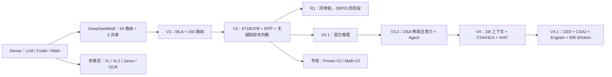

# 第 1 章：家族地图：先看代际，不要背模型名

- **难度**：★☆☆ | **预估学时**：1 小时 | **前置**：基础篇第 1–4 章

## 学习目标

学完本章，你能：把 DeepSeek 的公开模型按四代归位；说出每一代改的是注意力、FFN 还是训练目标；看到一个陌生 checkpoint 名字时，判断它属于哪个家族、大概是什么配置。

## 一句话核心

DeepSeek 的模型不是十几个互不相干的“新模型”，而是四条主线上的迭代：dense 起步 → MoE 化 → MLA + MoE → 稀疏注意力与百万上下文。名字里的 `Base / Chat / Instruct / R1 / Terminus / Exp / Speciale / DSpark` 是训练阶段和部署形态，不是新的网络结构。

## 1. 四代主线

| 代 | 时间 | 代表模型 | 总参数 / 激活 | 注意力 | FFN | 上下文 | 关键变化 |
|---|---|---|---|---|---|---|---|
| Dense 起步 | 2023–2024 | DeepSeek-LLM 7B/67B、Coder 1.3B/6.7B/33B、Math 7B | 7B/67B、1.3B–33B | MHA / GQA | dense FFN | 4K / 16K | 先把 LLaMA 式 decoder 跑通，代码与数学分支持续预训练 |
| 第一次 MoE | 2024 | DeepSeekMoE 16B | 16B / 2.8B | MHA | 64 路由 + 2 共享专家，top-6 | 4K | 细粒度专家 + 共享专家隔离 |
| MLA + MoE | 2024 | V2 236B、V2-Lite 16B、Coder-V2 236B、V2.5 | 236B/21B、16B/2.4B | MLA | 160 路由 + 2 共享，top-6 | 128K | KV cache 压缩，V2 成为后续 V3 的骨架 |
| V3 代 | 2024–2025 | V3 671B、R1 671B、V3.1、V3.2 | 671B/37B | MLA → DSA | 256 路由 + 1 共享，top-8 | 128K | 无辅助损失负载均衡、MTP、FP8、GRPO、Agent RL |
| V4 代 | 2026 | V4-Pro 1.6T、V4-Flash 284B、V4.1-Flash 552B | 1.6T/49B、284B/13B、552B/8B–16B | token 压缩 + DSA / CSA-HCA / CSA2 | 256–384 路由 + 1 共享，top-6 | 1M | mHC、Muon、CED、Engram、DSpark、FP4 KV |

这张表是“骨架级”归类。每一代里还有若干 checkpoint，它们共享网络结构，差别主要在训练数据、后训练、精度和部署形态。

## 2. 名字怎么读

- **Base**：只做预训练，补全/续写为主，不保证听指令。
- **Chat / Instruct**：做过指令微调，能对话。
- **R1 / R1-Zero**：推理模型；R1-Zero 是纯 RL 版本，R1 是四阶段版本。
- **Terminus**：同一代的小版本收尾，修语言一致性、Agent 表现，不是新架构。
- **Exp**：实验版，通常先验证一个结构改动，再发正式版。
- **Speciale**：长思考增强版，偏评测与研究，不保证日常对话体验。
- **DSpark / DFlash / Eagle3**：投机解码 drafter 或蒸馏权重，不是主模型。
- **Vision-Exp**：视觉理解实验版，主干通常复用同代文本模型。
- **日期后缀**（`-0324`、`-0528`、`-0731`、`-0813`、`-1017`）：同结构的新训练/后训练 checkpoint，不要当成新架构。

看到 `DeepSeek-V3.2-Exp-Base`，拆成三部分：家族 `V3.2`、阶段 `Exp`、训练形态 `Base`。看到 `DeepSeek-R1-Distill-Qwen-7B`，拆成：方法 `R1`、蒸馏 `Distill`、学生模型 `Qwen-7B`。学生模型不是 DeepSeek 的 MoE 架构。

## 3. 每一代到底改了什么

### 3.1 Dense 起步：先把地基打平

DeepSeek-LLM 7B/67B 是 LLaMA 式 decoder：RoPE 位置编码、SwiGLU、RMSNorm、GQA。67B 是 95 层、8192 隐藏维、64 个注意力头、8 个 KV 头，上下文 4096。Coder 33B 把上下文拉到 16K，词表缩到 32256，训练语料 87% 代码、13% 自然语言。

这一代的价值是建立 tokenizer、数据管线、训练稳定性；架构上没有 DeepSeek 自己的标志性组件。

### 3.2 DeepSeekMoE：把 FFN 拆细

标准 MoE 通常是“少量大专家”，DeepSeekMoE 走另一条路：把每个专家切得更细，增加专家数量，同时留 2 个共享专家。16B 版本是 28 层、2048 隐藏维、64 个路由专家 + 2 个共享专家，每 token 选 6 个路由专家，激活约 2.8B。

共享专家负责通用知识，路由专家负责细分知识。这样做的代价是路由和负载均衡变复杂，收益是同样激活参数下容量更大。

### 3.3 V2：MLA 把 KV cache 压下来

V2 是第一个把 MLA 和 DeepSeekMoE 一起上生产规模的模型：236B 总参数、21B 激活、60 层、5120 隐藏维、128 个注意力头、160 个路由专家 + 2 个共享专家、top-6、128K 上下文。

MLA 把每层每 token 的 K/V 压成低维潜向量（512 维）加一个解耦的 RoPE 部分（64 维），缓存的不再是每个头的完整 K/V。论文口径是 KV cache 降低约 93.3%，吞吐提升约 5.76 倍。这个数字是端到端测量，不是单 token 字节数的理论比。

V2-Lite 是同一骨架的缩小版：16B 总参数、2.4B 激活、27 层、64 路由 + 2 共享。它适合本地学习和单卡/小集群实验。

### 3.4 V3：把 V2 推到 671B

V3 沿用 MLA + DeepSeekMoE，但规模拉到 671B 总参数、37B 激活：61 层、7168 隐藏维、128 头、256 路由专家 + 1 共享专家、top-8、128K 上下文、14.8T 训练 token。

结构上的新增点有三个：无辅助损失的负载均衡（给专家加可学习偏置，不往主损失加辅助项）、MTP（多 token 预测，额外预测 t+2）、FP8 混合精度训练。HuggingFace 上 V3 总大小 685B，其中 671B 主模型 + 14B MTP 模块，这个差额经常被误读成“V3 是 685B”。

### 3.5 V4：百万上下文成为默认

V4 把上下文拉到 1M，并把长上下文成本当成架构问题：token 维度压缩 + DSA 稀疏注意力，配合 mHC 残差、Muon 优化器、FP4+FP8 混合精度。V4-Pro 是 1.6T 总参数 / 49B 激活，V4-Flash 是 284B / 13B。两者不是“同架构不同大小”这么简单：层数、专家数、隐藏维都不同。

V4.1-Flash 再往前走一步：552B 主干 + 196B Engram，CED 非对称编码器-解码器，CSA2 跨层 KV 复用，全局 KV 压到 890 B/token。它原生支持图像输入，prefill 8B、decode 16B 激活。

## 4. 同一家族里的 checkpoint 怎么处理

以 V3 家族为例：V3、V3-Base、V3-0324、V3.1、V3.1-Base、V3.1-Terminus、V3.2-Exp、V3.2、V3.2-Speciale 共享 61 层、7168 隐藏维、256 路由专家这套主干。区别是：

- V3-0324：后训练更新，代码/数学/前端提升，结构不变。
- V3.1：加入混合推理模板，一个模型同时支持思考/非思考，结构不变。
- V3.2-Exp：引入 DSA 稀疏注意力，结构变了。
- V3.2：DSA 正式版 + Agent 后训练。
- V3.2-Speciale：长思考版本，结构同 V3.2，训练与推理预算不同。

所以读模型卡时，先看 `config.json` 的 `architectures` 和 `model_type`：`DeepseekV3ForCausalLM` 和 `DeepseekV32ForCausalLM` 是两代结构；`DeepseekV3ForCausalLM` 的多个 checkpoint 才是同结构。

## 5. 图示

看图说明：主线是“dense → MoE → MLA → 稀疏注意力 → 百万上下文”；多模态和专用模型是从不同代主干分出去的枝，不是另一条主线。

## 6. 常见误解

- 别以为 `V3` 和 `V3.1` 是两套完全不同的网络——V3.1 主要改的是推理模板与后训练，主干配置相同。
- 别以为 `671B` 就是每个 token 都算 671B——MoE 只激活 37B，显存要装下全部专家，算力按激活参数估。
- 别以为 `V2-Lite` 是“阉割版不能用”——它是 16B/2.4B 的完整 MLA + MoE 结构，适合学习和本地推理。
- 别以为所有“开源”都是同一种许可证——V3/R1/V4 是 MIT，V2/VL2/Prover 是 DeepSeek Model License，Math-V2/OCR2 是 Apache 2.0。

## 7. 自测题

1. V3 的 671B 和 37B 分别指什么？（答案：B；解析：671B 总参数，37B 每 token 激活。）
   - A. 671B 激活，37B 总参数　B. 671B 总参数，37B 激活　C. 两者都是总参数　D. 两者都是激活参数
2. V3.2-Exp 相比 V3.1 的结构变化是什么？（答案：C；解析：引入 DSA 稀疏注意力。）
   - A. 换成 dense　B. 去掉 MoE　C. 引入 DSA 稀疏注意力　D. 改成 CNN
3. V2-Lite 的激活参数约多少？（答案：A；解析：16B 总参数、2.4B 激活。）
   - A. 2.4B　B. 16B　C. 21B　D. 37B

## 8. 复习锚点

- 四代主线：dense → MoE → MLA+MoE → 稀疏注意力/百万上下文。
- 名字里的 Base/Chat/R1/Exp/Speciale 是阶段，不是新结构。
- 同家族 checkpoint 先看 `architectures` 和 `model_type`。
- 总参数看显存，激活参数看算力。
- 下一章从 dense 起步开始，先把“没有路由”的模型吃透。
