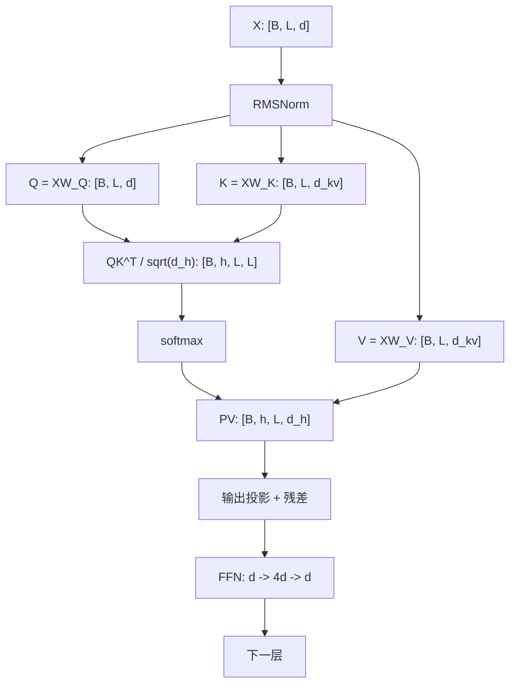

# 第 2 章：dense 起步：LLM、Coder 与 Math

- **难度**：★☆☆ | **预估学时**：2 小时 | **前置**：第 1 章、基础篇第 1–4 章

## 学习目标

学完本章，你能：画出 DeepSeek-LLM 67B 和 Coder 33B 的层数/头数/上下文配置；解释 GQA 为什么省 KV；说出 Coder 的 FIM 训练与 16K 上下文解决了什么问题；理解 Math 分支为什么从 Coder 继续预训练。

## 一句话核心

第一代没有 DeepSeek 自己的注意力或 MoE 结构，价值在于把 LLaMA 式 decoder、GQA、长上下文和代码/数学数据管线跑通。后面的 V2/V3 都建立在这套工程基础上。

## 1. DeepSeek-LLM：7B 与 67B

### 1.1 结构

DeepSeek-LLM 的 `config.json` 是标准 LLaMA 结构：

| 配置 | 7B | 67B |
|---|---|---|
| 层数 | 30 | 95 |
| 隐藏维 | 4096 | 8192 |
| 注意力头 | 32 | 64 |
| KV 头 | 32（MHA） | 8（GQA） |
| 中间维 | 11008 | 22016 |
| 上下文 | 4096 | 4096 |
| 词表 | 102400 | 102400 |

7B 是完整多头注意力（每个头都有自己的 K/V），67B 用 GQA：64 个查询头共享 8 组 K/V。这样 KV cache 降到原来的约 1/8，推理显存和带宽都降下来。

### 1.2 训练

官方口径是从零在 2 万亿 token 的中英文数据上训练。67B Base 在推理、代码、数学、中文理解上超过 Llama2 70B Base；67B Chat 在匈牙利高中考试拿到 65 分，中文能力超过 GPT-3.5。这些数字是官方模型卡口径，不是独立复现。

### 1.3 为什么先学它

dense 模型没有路由、没有专家并行、没有负载均衡。你只需要跟踪一条线：token → embedding → N 层（注意力 + FFN）→ logits。把这条线走通，再去看 MoE 的“多专家分支”才不会乱。

## 2. DeepSeek-Coder：1.3B / 6.7B / 33B

### 2.1 数据与目标

Coder 系列每个模型从零在 2 万亿 token 上训练，语料 87% 代码、13% 中英文自然语言。上下文 16K，支持项目级代码补全。训练里加了填空（FIM）任务：把代码中间挖掉一段，让模型根据前后文补回来。这个目标直接对应 IDE 里的“中间补全”，不是普通的从左到右续写。

### 2.2 33B 的结构

| 项 | 值 |
|---|---|
| 层数 | 62 |
| 隐藏维 | 7168 |
| 注意力头 | 56 |
| KV 头 | 8（GQA） |
| 中间维 | 19200 |
| 上下文 | 16384 |
| 词表 | 32256 |

词表比 LLM 的 102400 小很多，因为代码 token 分布不同。上下文从 4K 拉到 16K，靠 RoPE 外推与训练长度调整，不是简单改一个配置。

### 2.3 Coder-V2 不是 dense

`DeepSeek-Coder-V2` 是 MoE：236B 总参数 / 21B 激活，从 V2 的中间 checkpoint 继续预训练 6 万亿 token，支持 338 种语言、128K 上下文。它属于 V2 家族，不是第一代 Coder 的放大版。第 4 章会讲。

## 3. DeepSeek-Math：7B 的数学分支

DeepSeekMath 7B 以 DeepSeek-Coder-v1.5 7B 为起点，继续在 Common Crawl 里抽出的数学相关 token 上预训练，总量约 5000 亿 token。MATH 基准 51.7%，不使用外部工具和投票。它验证了一件事：在代码/数学这种有明确结构的语料上继续预训练，比单纯堆通用语料更有效。

这也是后面 R1 用“规则奖励 + 可验证答案”做 RL 的伏笔：数学题天然容易判对错。

## 4. 图示：dense 一层的形状

看图说明：dense 层的计算量主要来自两个矩阵乘法——注意力分数 $L^2d$ 和 FFN 的 $d^2$。上下文翻倍，注意力分数按平方涨；这就是后面 MLA、DSA、CSA 要解决的问题。

## 5. GQA 的账

设 $h$ 个查询头，$g$ 组 KV 头，每头维度 $d_h$。标准 MHA 的 KV cache 每 token 每层是 $2hd_h$ 个数；GQA 是 $2gd_h$。67B 的 $h=64,g=8$，KV cache 是 MHA 的 $8/64=1/8$。

但 GQA 不是免费的：多个查询头共享同一组 K/V，会损失一些表达能力。DeepSeek 在 67B 上选择 $g=8$，是在显存和效果之间取的一个点；到 V2 的 MLA，干脆把 KV 压成潜向量，换了一条路。

## 6. 常见误解

- 别以为 67B 的 8 个 KV 头是“只有 8 个头”——查询头还是 64 个，只是 K/V 分组共享。
- 别以为 Coder 的 16K 上下文是靠改一个 `max_position_embeddings` 就得到的——训练长度、RoPE 频率、数据都要配合。
- 别以为 Math 7B 是纯数学语料训出来的——它从 Coder 7B 继续预训练，代码能力是数学推理的底座。
- 别以为 Coder-V2 是第一代 Coder 的继续训练——它换成了 V2 的 MoE + MLA 骨架。

## 7. 自测题

1. DeepSeek-LLM 67B 的 KV 头数是多少？（答案：B；解析：64 个查询头、8 个 KV 头，GQA。）
   - A. 64　B. 8　C. 32　D. 16
2. Coder 的 FIM 训练对应什么任务？（答案：A；解析：挖掉中间一段，根据前后文补全。）
   - A. 中间填空补全　B. 图像分类　C. 语音识别　D. 机器翻译
3. Coder-V2 属于哪个家族？（答案：C；解析：236B/21B 的 MoE，属于 V2 家族。）
   - A. 第一代 dense Coder　B. V3 家族　C. V2 家族　D. Janus

## 8. 复习锚点

- 第一代是 LLaMA 式 dense：RoPE、SwiGLU、RMSNorm、GQA。
- 67B 是 95 层、8192 维、64 查询头 / 8 KV 头、4K 上下文。
- Coder 33B 是 62 层、7168 维、56 头 / 8 KV 头、16K 上下文。
- Coder-V2 不是 dense，是 V2 的 MoE 分支。
- 下一章进入 DeepSeekMoE：第一次把 FFN 拆成专家。
