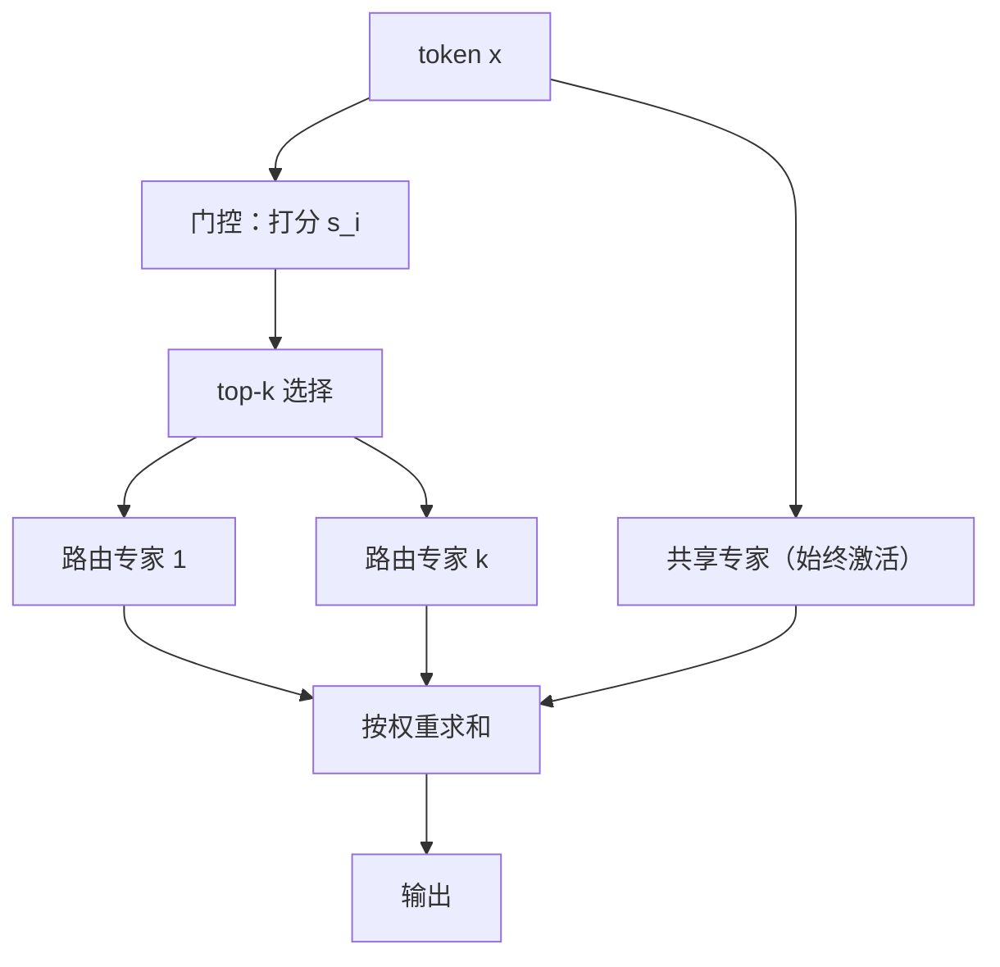

# 第 3 章：DeepSeekMoE：把 FFN 拆成细粒度专家

- **难度**：★★☆ | **预估学时**：2 小时 | **前置**：第 2 章、基础篇第 4 章

## 学习目标

学完本章，你能：解释“细粒度专家分割 + 共享专家隔离”这两刀切在哪；手算一个 token 的路由权重；区分总参数、激活参数和显存占用；说出 DeepSeekMoE 16B 与 V2/V3 的继承关系。

## 一句话核心

DeepSeekMoE 不是简单地把 FFN 换成“多个大 FFN”，而是把每个 FFN 切得更细、专家数量更多，再留两个共享专家兜住通用知识。这样在相同激活参数下，模型容量更大。

## 1. 标准 MoE 的问题

Transformer 的 FFN 通常是一个大矩阵：$d \to 4d \to d$。MoE 把它换成 $N$ 个专家，每个 token 只走其中 $k$ 个。问题是：

- 专家太少、太大：每个专家都很宽，路由稍微一变，输出差异很大，训练不稳定。
- 专家太多、太小：单个专家容量不足，路由组合爆炸。
- 没有共享专家：每个专家都要重复学“通用语言知识”，浪费容量。

DeepSeekMoE 的两个设计分别对应后两个问题。

## 2. 两刀：细粒度分割 + 共享专家

### 2.1 细粒度专家分割

把原来一个宽 FFN 切成 $m$ 个更窄的专家，同时把激活专家数也按比例增加。原来选 2 个大专家，现在选 6 个细专家。总激活参数量差不多，但组合更多，知识分配更细。

### 2.2 共享专家隔离

留 $N_s$ 个专家对所有 token 始终激活，专门学通用知识；路由专家只学细分知识。这样路由专家不用重复学“主谓宾”，共享专家也不会被路由噪声带偏。

DeepSeekMoE 16B 的配置是：64 个路由专家 + 2 个共享专家，每 token 选 top-6 路由专家。共享专家始终参与，所以每个 token 实际走 6 个路由 + 2 个共享。

## 3. 路由手算

设 8 个路由专家，top-2，某个 token 的打分是：

$$
s=[0.1,0.05,0.2,0.15,0.3,0.05,0.1,0.05]
$$

选第 5 个（0.3）和第 3 个（0.2）。归一化权重：

$$
w_5=\frac{0.3}{0.3+0.2}=0.6,\quad w_3=\frac{0.2}{0.5}=0.4
$$

输出：

$$
y=0.6\cdot E_5(x)+0.4\cdot E_3(x)+E_{\text{shared}}(x)
$$

如果 top-1，就只有 $E_5(x)$，权重 1。top-k 越大，组合越平滑，但计算越多。

## 4. 16B 的结构

| 项 | 值 |
|---|---|
| 层数 | 28 |
| 隐藏维 | 2048 |
| 注意力头 | 16（MHA） |
| 路由专家 | 64 |
| 共享专家 | 2 |
| top-k | 6 |
| 专家中间维 | 1408 |
| 激活专家 | 6 路由 + 2 共享（每专家 1408） |
| 上下文 | 4096 |
| 总参数 / 激活 | 16B / 约 2.8B |

论文里还有一个 145B 总参数 / 22B 激活的扩展配置，用来验证“专家再多也能训”；公开权重以 16B 为主。读论文时不要把两个配置混在一起。

## 5. 负载均衡：为什么专家会塌缩

如果所有 token 都挤向少数专家，其他专家收不到梯度，参数学不动，这叫专家塌缩。早期做法是加辅助损失：

$$
\mathcal{L}_{\text{aux}}=\alpha\sum_i f_i p_i
$$

其中 $f_i$ 是分到专家 $i$ 的 token 比例，$p_i$ 是路由概率均值。它惩罚负载集中，但和语言建模目标打架，$\alpha$ 难调。

V3 改成无辅助损失的偏置：给每个专家一个可学习偏置 $b_i$，路由分数变成 $s_i+b_i$。训练时统计负载，负载高的专家调低 $b_i$，负载低的调高。偏置只影响“选不选”，不影响选中后的加权系数。这样不往主损失加项，也能把负载拉平。

## 6. 显存与算力的账

MoE 的参数量要分开看：

- **总参数**：所有专家都要存，显存按总参数估。
- **激活参数**：每 token 只算 top-k 专家，算力按激活参数估。
- **通信**：专家并行时，token 要被路由到不同卡，通信量随专家并行度上升。

16B 总参数、2.8B 激活，意味着显存接近 16B dense，算力接近 2.8B dense。这就是 MoE 的“用显存换算力”。如果显存不够，可以把专家 offload 到 CPU/SSD，但延迟会上升。

## 7. 图示

看图说明：共享专家是一条“旁路”，不参与路由；路由专家只处理细分知识。两条路的输出相加，不是二选一。

## 8. 常见误解

- 别以为 top-6 就是“6 个专家全部参与训练”——只有被选中的 6 个收到这个 token 的梯度。
- 别以为总参数 16B 就按 16B 算 FLOPs——算力看激活的 2.8B，但显存要装 16B。
- 别以为共享专家是“第 65 个路由专家”——它不参与路由，始终激活。
- 别以为负载均衡只是“训练技巧”——它决定专家是否被充分利用，直接影响容量。

## 9. 自测题

1. DeepSeekMoE 16B 每 token 选几个路由专家？（答案：B；解析：top-6，另有 2 个共享专家始终激活。）
   - A. 2　B. 6　C. 8　D. 64
2. 共享专家的作用是什么？（答案：A；解析：始终激活，兜住通用知识，减少路由专家重复学习。）
   - A. 学通用知识　B. 只处理英文　C. 替代注意力　D. 只做负载均衡
3. MoE 的显存按什么估？（答案：C；解析：所有专家都要存，按总参数；算力按激活参数。）
   - A. 激活参数　B. top-k　C. 总参数　D. 词表大小

## 10. 复习锚点

- DeepSeekMoE 两刀：细粒度专家分割、共享专家隔离。
- 16B：64 路由 + 2 共享，top-6，28 层，2048 维。
- 总参数看显存，激活参数看算力。
- 负载均衡决定专家是否被充分训练。
- 下一章看 V2 怎么把 MoE 和 MLA 装进同一个 236B 模型。
