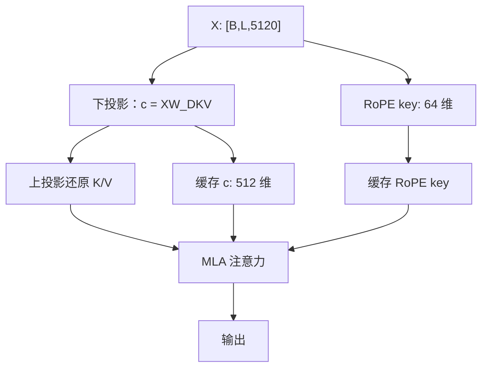

# 第 4 章：V2 代：MLA + DeepSeekMoE 的组合

- **难度**：★★★ | **预估学时**：3 小时 | **前置**：第 3 章、基础篇第 3–5 章

## 学习目标

学完本章，你能：写出 V2 的 60 层/160 专家/top-6 配置；用形状解释 MLA 缓存的是什么；手算一个 token 的 KV cache 字节；区分 V2、V2-Lite、Coder-V2、V2.5 的关系。

## 一句话核心

V2 是 DeepSeek 第一代“生产级”架构：MLA 把 KV cache 压成低维潜向量，DeepSeekMoE 把 FFN 拆成 160 个路由专家 + 2 个共享专家。V3 的骨架就是从这里长出来的。

## 1. V2 的配置

| 项 | V2 | V2-Lite |
|---|---|---|
| 总参数 / 激活 | 236B / 21B | 16B / 2.4B |
| 层数 | 60 | 27 |
| 隐藏维 | 5120 | 2048 |
| 注意力头 | 128 | 16 |
| 路由专家 | 160 | 64 |
| 共享专家 | 2 | 2 |
| top-k | 6 | 6 |
| 专家中间维 | 1536 | 1408 |
| 上下文 | 128K（配置 163840） | 128K（配置 163840） |
| 训练 token | 8.1T | 未单独披露 |

V2 的 21B 激活、236B 总参数，是“用显存换算力”的典型：显存按 236B 估，算力按 21B 估。`config.json` 里还有一个容易忽略的字段：`first_k_dense_replace=1`，意思是第 1 层用 dense FFN，从第 2 层起才是 MoE。算参数量时要把这层单独算，不能直接拿 60 层乘专家数。

## 2. MLA：缓存潜向量，不缓存完整 K/V

### 2.1 标准 MHA 的缓存

每个 token、每层、每个头都要存 K 和 V，各 $d_h$ 个数。128 头、128 维、60 层、BF16：

$$
2\times128\times128\times2\times60\approx3{,}932{,}160\ \text{字节/token}
$$

约 3.9 MB/token。1M 上下文单序列就是 3.9 TB，根本放不下。

### 2.2 MLA 的做法

MLA 不直接存每头的 K/V，而是把 K/V 联合压缩成一个低维潜向量 $c_t$（512 维），再存一个解耦的 RoPE 部分 $k_t^R$（64 维）。推理时只缓存这两部分，需要 K/V 时再用上投影矩阵还原。

配置里对应：

- `kv_lora_rank = 512`
- `qk_rope_head_dim = 64`
- `qk_nope_head_dim = 128`
- `v_head_dim = 128`

每 token 每层缓存约 $512+64=576$ 个数，BF16：

$$
576\times2\times60=69{,}120\ \text{字节/token}
$$

约 69 KB/token。与 MHA 的 3.9 MB 相比，理论比约 57 倍。论文口径的 KV cache 降低 93.3%、吞吐提升 5.76 倍，是端到端测量，包含带宽、并行和 kernel 效率，不等于单 token 字节数的理论比。

### 2.3 为什么能这样压

K/V 的主要信息集中在低维子空间里。MLA 用低秩投影把 K/V 压到 512 维，再用上投影还原。代价是多了投影矩阵的计算，但推理时省下的显存和带宽远大于这点计算。

## 3. Coder-V2：V2 的代码分支

Coder-V2 是 236B/21B 的 MoE，从 V2 中间 checkpoint 继续预训练 6T token，支持 338 种语言、128K 上下文。它不是第一代 Coder 的放大版，而是 V2 骨架的代码继续预训练。代码任务上对标 GPT-4-Turbo，通用能力与 V2 持平。

Coder-V2-Lite 是 16B/2.4B 的版本，适合本地实验。

## 4. V2.5：把 Chat 和 Coder 合并

V2.5 不是一个新结构，而是把 V2 Chat 和 Coder V2 合并后做统一后训练：通用能力、代码、写作、指令跟随一起对齐。API 上 `deepseek-chat` 和 `deepseek-coder` 都指向 V2.5。V2.5-1210 是 2024 年 12 月的更新版，MATH-500 从 74.8% 到 82.8%，LiveCodeBench 从 29.2% 到 34.38%。

这说明一件事：同一副 V2 骨架，通过数据配比和后训练，可以覆盖通用与代码两种场景，不必为每个场景单独训一套结构。

## 5. 形状表

| 张量 | 形状 |
|---|---|
| 输入 $X$ | $[B,L,5120]$ |
| Q 投影 | $[B,L,128\times(128+64)]$ |
| KV 潜向量 $c$ | $[B,L,512]$ |
| RoPE key | $[B,L,64]$ |
| 还原后的 K/V | $[B,L,128,128]$ |
| 注意力分数 | $[B,128,L,L]$ |

注意：缓存的是 $c$ 和 RoPE key，不是还原后的完整 K/V。还原发生在计算时，不占持久显存。

## 6. 图示

看图说明：缓存路径（下投影 + RoPE）和计算路径（上投影还原）分开。省显存的关键是只存低维潜向量，不存还原后的完整 K/V。

## 7. 常见误解

- 别以为 MLA 是“把 K/V 量化成 8 bit”——它是低秩压缩，不是量化。
- 别以为缓存 512 维就等于每层只算 512 维——还原后仍是 128 头、128 维的 K/V，只是不持久存。
- 别以为 V2-Lite 只是“参数少一点”——它保留了 MLA + MoE 的完整结构，是学习 V2 的最小可用样本。
- 别以为 V2.5 是新架构——它是 V2 骨架的合并后训练版。

## 8. 自测题

1. MLA 推理时缓存的核心内容是什么？（答案：B；解析：低维潜向量 c 和解耦的 RoPE key。）
   - A. 每个头的完整 K/V　B. 低维潜向量和 RoPE key　C. 只有 Query　D. 整个隐藏层
2. V2 的路由专家数量是多少？（答案：C；解析：160 个路由 + 2 个共享，top-6。）
   - A. 64　B. 128　C. 160　D. 256
3. V2-Lite 的总参数/激活参数约多少？（答案：A；解析：16B 总参数、2.4B 激活。）
   - A. 16B/2.4B　B. 236B/21B　C. 671B/37B　D. 7B/7B

## 9. 复习锚点

- V2：236B/21B、60 层、5120 维、128 头、160 路由 + 2 共享、top-6、128K。
- MLA 缓存 $c$（512）+ RoPE key（64），不缓存完整 K/V。
- V2-Lite 是 16B/2.4B 的完整 MLA + MoE。
- Coder-V2 是 V2 的代码继续预训练，不是第一代 Coder 的放大。
- 下一章看 V3 怎么把 236B 推到 671B，并加入 MTP 与无辅助损失均衡。
