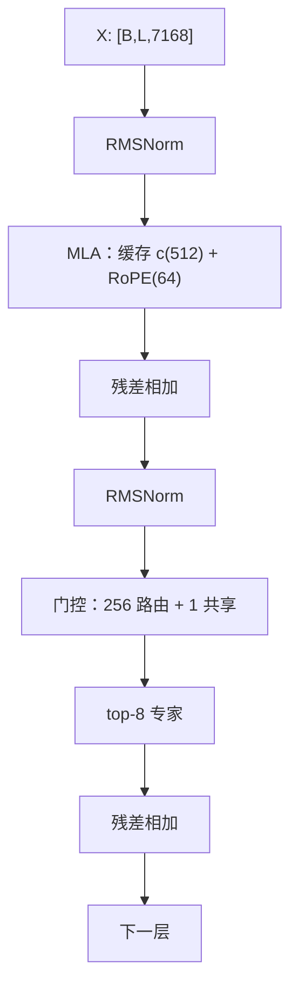

# 第 5 章：V3 代：671B/37B 的骨架

- **难度**：★★★ | **预估学时**：3 小时 | **前置**：第 4 章、基础篇第 5 章

## 学习目标

学完本章，你能：写出 V3 的 61 层/7168 维/256 路由专家配置；解释 MTP 为什么让 HuggingFace 权重多出 14B；说出无辅助损失负载均衡与 FP8 训练各解决什么问题；区分 V3、V3-0324、V3.1、V3.1-Terminus 的差别。

## 一句话核心

V3 沿用 V2 的 MLA + DeepSeekMoE，把规模推到 671B 总参数 / 37B 激活，并加了三件东西：MTP 训练目标、无辅助损失负载均衡、FP8 混合精度。它不是一个全新架构，而是 V2 的规模化与工程化。

## 1. 配置

| 项 | V3 |
|---|---|
| 总参数 / 激活 | 671B / 37B |
| 层数 | 61 |
| 隐藏维 | 7168 |
| 注意力头 | 128 |
| 路由专家 | 256 |
| 共享专家 | 1 |
| top-k | 8 |
| 专家中间维 | 2048 |
| 上下文 | 128K（配置 163840） |
| 训练 token | 14.8T |
| 精度 | FP8 混合 |

HuggingFace 上 V3 总大小 685B，其中 671B 主模型 + 14B MTP 模块。很多人看到 685B 就以为“V3 是 685B”，其实是把 MTP 头也算进去了。

`config.json` 里还有一个关键字段：`first_k_dense_replace=3`。V3 的前 3 层是 dense FFN，从第 4 层起才是 MoE。算总参数时，前 3 层按 dense 算，后 58 层按“256 路由 + 1 共享”算；直接把 61 层都乘 256 个专家，会高估约 5%。

## 2. MTP：多 token 预测

标准自回归训练在每个位置预测下一个 token（$t+1$）。MTP 让每个位置额外预测未来第 2 个 token（$t+2$），并把这个预测头串在主干后面。

训练时的损失是两项相加：

$$
\mathcal{L}_{\text{MTP}}=\mathcal{L}_{t+1}+\lambda\mathcal{L}_{t+2}
$$

好处是增加训练信号密度：同一个 token 位置，模型要同时学“下一步”和“下两步”。V3 论文说 MTP 能提升模型性能，也可以用于推理时的投机解码。

代价是训练时多一个 14B 的 MTP 模块，显存和计算增加；推理时如果不用投机解码，可以把 MTP 头去掉。

## 3. 无辅助损失负载均衡

MoE 的经典问题是专家塌缩。V2/V3 之前的做法是加辅助损失，但辅助损失和语言建模目标会打架。V3 的做法是给每个专家一个可学习偏置 $b_i$：

$$
\text{route}_i=\text{topk}(s_i+b_i)
$$

训练时统计每个专家的负载，负载高的调低 $b_i$，负载低的调高。偏置只影响“选不选”，不影响选中后的加权系数。这样不需要往主损失里加辅助项，也能把负载拉平。

这个方法的代价是：偏置的更新规则是启发式的，不是梯度下降；极端负载下仍可能震荡。V3 论文报告它比辅助损失更稳定。

## 4. FP8 训练

V3 用 FP8 混合精度训练：大部分矩阵乘法用 FP8，少数敏感部分用 BF16/FP32。FP8 的动态范围小，需要精细的缩放（scaling）和分块策略，否则梯度会溢出或下溢。

工程上配合了 DualPipe 双向流水线并行、EPLB 专家并行负载均衡、3FS 文件系统。这些不是模型结构，但决定了 671B 能不能在集群上训起来。

## 5. V3 家族 checkpoint

| Checkpoint | 结构 | 变化 |
|---|---|---|
| V3 / V3-Base | `DeepseekV3ForCausalLM` | 原始预训练 / 后训练 |
| V3-0324 | 同结构 | 后训练更新：MMLU-Pro 75.9→81.2，GPQA 59.1→68.4，AIME 39.6→59.4 |
| V3.1 / V3.1-Base | 同结构 | 混合推理：一个模型同时支持思考/非思考；128K；Agent 后训练 |
| V3.1-Terminus | 同结构 | 修中英文混杂、异常字符；优化 Code/Search Agent |

这些 checkpoint 的 `config.json` 都是 61 层、7168 维、256 路由专家、top-8。差别在训练数据、后训练模板和部署形态，不是网络结构。

## 6. 图示：V3 一层

看图说明：一层里有两个残差块——注意力块和 MoE 块。MoE 块的门控只决定走哪些专家，共享专家始终参与。

## 7. 常见误解

- 别以为 671B 是每个 token 都算一遍——只激活 37B。
- 别以为 MTP 是一个独立模型——它是挂在主干上的训练头，权重 14B。
- 别以为 V3.1 是新架构——它改的是推理模板和后训练。
- 别以为 FP8 只是“存储格式”——训练时的缩放、累加、通信都要配套，否则会掉点。

## 8. 自测题

1. V3 的 MTP 额外预测哪个位置？（答案：B；解析：在位置 t 额外预测 t+2。）
   - A. t+1　B. t+2　C. t-1　D. 随机
2. V3 有多少路由专家？（答案：C；解析：256 路由 + 1 共享，top-8。）
   - A. 64　B. 160　C. 256　D. 384
3. V3 的 685B HuggingFace 权重由什么组成？（答案：A；解析：671B 主模型 + 14B MTP。）
   - A. 671B + 14B MTP　B. 685B 全是主模型　C. 671B + 14B 视觉编码器　D. 685B 全是专家

## 9. 复习锚点

- V3：671B/37B、61 层、7168 维、256 路由 + 1 共享、top-8、14.8T token。
- MTP 额外预测 t+2，HF 权重多 14B。
- 无辅助损失均衡靠专家偏置，不往主损失加项。
- V3.1 是混合推理，V3.2 才换 DSA 结构。
- 下一章看 R1：同一副 V3 骨架，怎么用 RL 把推理能力拉起来。
