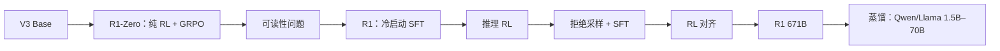

# 第 6 章：R1 代：同一副骨架，换训练目标

- **难度**：★★★ | **预估学时**：3 小时 | **前置**：第 5 章、论文拆解第 6–7 章

## 学习目标

学完本章，你能：解释 R1-Zero 和 R1 的区别；写出 GRPO 的组内标准化与目标函数；复述 R1 四阶段流水线；说出蒸馏学生模型的参数与限制；判断“架构没变，能力为什么变了”。

## 一句话核心

R1 没有换网络结构，还是 V3 的 671B/37B MoE + MLA。它换的是训练目标：用可验证奖励 + GRPO 做 RL，把“长链推理”从模型里逼出来。能力提升主要来自数据和训练，不是新层。

## 1. R1-Zero：纯 RL 的极限实验

R1-Zero 从 V3 Base 直接做 RL，不做 SFT 冷启动。奖励是规则奖励：

- 答案正确：+1。
- 格式正确（把推理放在 `...` 里）：+1。
- 语言一致：少量惩罚。

GRPO 不训练 value model，而是对同一道题采一组回答，用组内奖励标准化得到优势：

$$
A_i=\frac{r_i-\operatorname{mean}(r_1,\dots,r_G)}{\operatorname{std}(r_1,\dots,r_G)}
$$

然后做带 clip 的策略更新。AIME 2024 从 15.6 涨到 71.0，证明“纯 RL 也能把推理能力拉起来”。但 R1-Zero 有可读性问题：中英文混杂、格式混乱、思考过程重复。

## 2. R1：四阶段流水线

R1 在 R1-Zero 前面加了冷启动，在后面加了拒绝采样和再对齐：

1. **冷启动 SFT**：用少量高质量长 CoT 数据，让模型先学会“像人一样写推理”，解决可读性。
2. **推理 RL**：用 GRPO + 规则奖励，继续拉数学、代码、逻辑的正确率。
3. **拒绝采样 + SFT**：对 RL 后的模型采样，只保留答案正确、格式合格的样本，混入通用数据，做一轮 SFT。
4. **RL 对齐**：用奖励模型/规则混合，提升有用性、无害性、语言一致性。

最终 R1 的 AIME 2024 是 79.8，MATH-500 97.3，GPQA 71.5，LiveCodeBench 65.9，Codeforces 96.3% 通过率。这些数字是论文口径，不是独立复现。

## 3. 蒸馏：把长 CoT 塞进小模型

R1 蒸馏不是把 671B 压小，而是用 R1 生成 80 万条冷启动数据，去微调 Qwen/Llama 学生模型：

| 学生模型 | 参数量 |
|---|---|
| R1-Distill-Qwen-1.5B | 1.5B |
| R1-Distill-Qwen-7B | 7B |
| R1-Distill-Qwen-14B | 14B |
| R1-Distill-Qwen-32B | 32B |
| R1-Distill-Llama-8B | 8B |
| R1-Distill-Llama-70B | 70B |

学生模型的架构是 Qwen2.5 或 Llama3，不是 DeepSeek 的 MoE。它们继承的是 R1 的“推理数据分布”，不是 R1 的网络结构。R1-0528-Qwen3-8B 是后续的 8B 蒸馏版本。

## 4. 为什么“同骨架”能出不同能力

V3 是“会写代码、会答题”的通用模型；R1 是“愿意花长 token 去想”的推理模型。差别在：

- **数据**：R1 的 RL 题目以数学、代码、逻辑为主，答案可验证。
- **奖励**：规则奖励直接给正确性打分，不依赖人类偏好模型。
- **采样**：组内采样 + 标准化，让“比平均好”的回答获得正优势。
- **预算**：推理时允许更长的 CoT，用 token 换正确率。

这四条都不改网络结构。它说明“架构决定上限，数据与训练决定你怎么爬到上限”。

## 5. GRPO 的一个数值例子

四个回答奖励 $[1,0,0,-1]$，均值 0，标准差约 0.707：

$$
A=[1.414,0,0,-1.414]
$$

奖励全为 1 时，标准差 0，优势全 0，这一组不产生梯度。这就是“全对/全错题目没有学习信号”的原因。训练时要保证题目难度分布有梯度，否则 RL 空转。

## 6. 局限

- 长 CoT 成本高：简单题也可能生成几千 token。
- 幻觉：R1 仍会在长链里编造中间步骤；R1-0528 专门抑制了一部分。
- 安全与对齐：纯规则奖励不覆盖有用性/无害性，R1 的第四阶段才补。
- 蒸馏学生模型的能力上限受学生架构限制，不是“越小越划算”。

## 7. 图示

看图说明：R1-Zero 是去掉冷启动的消融实验；R1 是加了冷启动、拒绝采样和再对齐的完整流水线；蒸馏是从 R1 分出去的学生模型分支。

## 8. 常见误解

- 别以为 R1 是新架构——它和 V3 共享 671B/37B 的 MoE + MLA。
- 别以为 R1-Zero 比 R1 更强——R1-Zero 在部分基准上接近，但可读性和通用性差。
- 别以为蒸馏是把 671B 量化——蒸馏是让学生模型学 R1 的输出分布，架构完全不同。
- 别以为 GRPO 不需要 reward model 就“完全无监督”——它需要可验证的奖励函数。

## 9. 自测题

1. R1-Zero 与 R1 的关键区别是什么？（答案：A；解析：R1-Zero 不做冷启动 SFT，直接纯 RL。）
   - A. 有没有冷启动 SFT　B. 参数规模不同　C. 注意力不同　D. 词表不同
2. GRPO 的优势怎么算？（答案：B；解析：组内奖励减均值、除以标准差。）
   - A. 用 value model 估　B. 组内标准化　C. 直接取奖励　D. 用人类偏好打分
3. R1 蒸馏的 Qwen-7B 学生模型是什么架构？（答案：C；解析：Qwen2.5 的 dense 架构，不是 DeepSeek MoE。）
   - A. DeepSeek V3 MoE　B. MLA　C. Qwen dense　D. CNN

## 10. 复习锚点

- R1 不换结构，换训练目标。
- R1-Zero：纯 RL + GRPO + 规则奖励；R1：四阶段。
- GRPO 用组内标准化，全对/全错组没有梯度。
- 蒸馏学生模型是 Qwen/Llama 架构，继承数据分布，不继承网络。
- 下一章看 V3.1/V3.2：从推理模型走向 Agent 模型。
