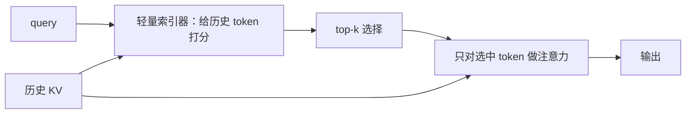

# 第 7 章：V3.1 / V3.2：从推理模型到 Agent 模型

- **难度**：★★★ | **预估学时**：3 小时 | **前置**：第 5–6 章、论文拆解第 8 章

## 学习目标

学完本章，你能：解释“混合推理”为什么能在一个模型里同时支持思考/非思考；说出 DSA 稀疏注意力的索引器与 top-k 在做什么；区分 V3.1、V3.1-Terminus、V3.2-Exp、V3.2、V3.2-Speciale；判断 Agent 训练数据合成对能力的影响。

## 一句话核心

V3.1 把“思考”和“不思考”合并进一个模型；V3.2 把“思考”嵌进工具调用，并用 DSA 稀疏注意力降低长上下文成本。V3.2 是 DeepSeek 从“会推理”走向“会做 Agent 任务”的分界线。

## 1. V3.1：一个模型，两种模式

V3.1 的结构还是 V3 的 61 层、7168 维、256 路由专家、top-8。变化在推理模板：

- 非思考模式：直接给答案，和 V3 类似。
- 思考模式：先输出 `...` 里的长 CoT，再给答案。
- 通过 chat template 里的特殊 token 切换，不需要部署两个模型。

官方口径：V3.1 在 SWE-bench Verified 66.0、SWE-bench Multilingual 54.5、Terminal-bench 31.3。V3.1-Terminus 是小版本收尾，修中英文混杂、异常字符，优化 Code/Search Agent，不换结构。

混合推理的代价是：同一个模型要同时学两种分布，思考模式的 token 预算更高；模板错了，模型可能在该思考时不思考，或在该直接答时啰嗦。

## 2. V3.2-Exp：DSA 稀疏注意力

V3.2-Exp 建在 V3.1-Terminus 上，引入 DeepSeek Sparse Attention（DSA）。标准注意力每个 query 要看所有历史 token，长上下文下 $L^2$ 成本爆炸。DSA 的做法是：

1. **轻量索引器**：给每个 query 和每个历史 token 打一个相关性分数。
2. **top-k 选择**：每个 query 只对分数最高的 $k$ 个 token 做注意力。
3. **只算被选中的 token**：没被选中的不参与 $QK^\top$ 和加权。

这样注意力复杂度从 $O(L^2)$ 降到约 $O(Lk)$。代价是索引器本身有计算，且 top-k 选错会丢信息。V3.2-Exp 的 API 价格降了 50% 以上，说明长上下文成本确实下来了。

DSA 是结构改动，不是后训练技巧。`config.json` 的 `architectures` 从 `DeepseekV3ForCausalLM` 变成 `DeepseekV32ForCausalLM`，这是判断 V3.2 与 V3.1 不同的硬标志。

## 3. V3.2：思考融入工具调用

V3.2 是 DSA 正式版，结构同 V3.2-Exp，重点在后训练：

- 首个把“思考”直接嵌进工具调用的模型：思考模式下可以多轮“想 → 调工具 → 再想”。
- 同时支持思考/非思考模式的工具调用。
- Agent 训练数据合成：1800+ 环境、85,000+ 复杂指令，构造“难解答、易验证”的 RL 任务。
- 公开基准达到 GPT-5 水平，略低于 Gemini-3.0-Pro；输出长度比 Kimi-K2-Thinking 短。

V3.2-Speciale 是长思考增强版，结合 Math-V2 的定理证明能力，在 IMO 2025、CMO 2025、ICPC World Finals 2025、IOI 2025 拿金牌。它只通过临时 API 开放，不支持工具调用，不适合日常对话。

## 4. Agent 训练为什么难

普通 SFT 只能教“怎么答”，教不会“怎么在多轮工具调用里试错”。Agent RL 需要：

- **环境**：代码执行、网页、文件系统、终端等，能给出可验证结果。
- **奖励**：任务是否完成、测试是否通过、答案是否正确。
- **轨迹**：一次任务可能几十步，信用分配很难。
- **成本**：每次 rollout 都要真的跑工具，比纯文本 RL 贵得多。

V3.2 的 1800+ 环境/85k 指令，就是用大规模合成把“难解答、易验证”的任务铺开。这个方向比“再加一层网络”更能提升 Agent 能力。

## 5. 三代对比

| 项 | V3.1 | V3.2-Exp | V3.2 | V3.2-Speciale |
|---|---|---|---|---|
| 结构 | V3 MLA+MoE | DSA | DSA | DSA |
| 思考模式 | 有 | 有 | 有 | 只有长思考 |
| 工具调用 | 非思考为主 | 支持 | 思考+非思考 | 不支持 |
| 上下文 | 128K | 128K | 128K | 128K |
| 定位 | 混合推理 | 稀疏注意力实验 | Agent 正式版 | 评测/研究 |

## 6. 图示

看图说明：索引器是“粗筛”，注意力是“精算”。DSA 省的是精算阶段，不是把索引器也省掉。

## 7. 常见误解

- 别以为 V3.1 是“两个模型拼在一起”——它是一个模型、两套模板。
- 别以为 DSA 只是“把注意力矩阵稀疏化”——它需要一个可学习的索引器，选错会掉点。
- 别以为 V3.2-Speciale 适合日常用——它 token 消耗高、不支持工具调用。
- 别以为 Agent 能力只靠模型变大——环境、奖励、轨迹设计同样关键。

## 8. 自测题

1. V3.2-Exp 的结构变化是什么？（答案：B；解析：引入 DSA 稀疏注意力。）
   - A. 换成 dense　B. DSA　C. 去掉 MoE　D. 改成 CNN
2. V3.2 的“思考融入工具调用”指什么？（答案：A；解析：思考模式下可以多轮思考 + 调工具。）
   - A. 思考与工具交替　B. 只思考不调工具　C. 只调工具不思考　D. 两个模型分别做
3. V3.2-Speciale 的主要限制是什么？（答案：C；解析：只支持长思考，不支持工具调用，偏研究。）
   - A. 没有权重　B. 不支持中文　C. 不支持工具调用　D. 只有 7B

## 9. 复习锚点

- V3.1：同结构，混合推理模板。
- V3.2-Exp：DSA 稀疏注意力，`DeepseekV32ForCausalLM`。
- V3.2：DSA + Agent 后训练，思考嵌入工具调用。
- V3.2-Speciale：长思考、评测向、不支持工具。
- 下一章看 V4：把 1M 上下文做成默认能力。
