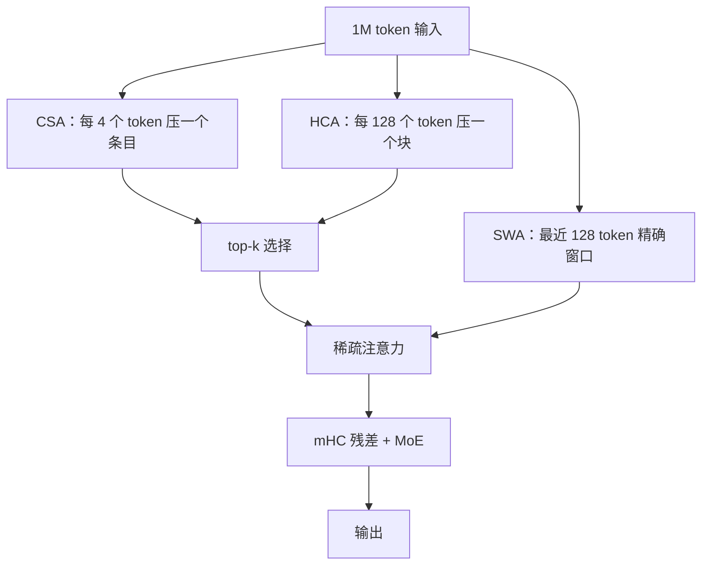

# 第 8 章：V4 代：百万上下文成为默认

- **难度**：★★★ | **预估学时**：4 小时 | **前置**：第 7 章、论文拆解第 8 章、架构篇第 10 章

## 学习目标

学完本章，你能：写出 V4-Pro 与 V4-Flash 的参数/层数/专家数；解释 token 维度压缩 + DSA 的组合；说出 mHC 与 Muon 各解决什么问题；区分 V4-Pro 与 V4-Flash 的适用场景；理解 1M 上下文为什么是架构问题。

## 一句话核心

V4 不是把 V3 的上下文“调大”，而是重新设计长上下文的成本结构：先在 token 维度压缩，再用 DSA 稀疏注意力只算相关 token，配合 mHC 稳定深层残差、Muon 优化训练。1M 上下文是这套结构的默认结果。

## 1. 配置

| 项 | V4-Pro | V4-Flash |
|---|---|---|
| 总参数 / 激活 | 1.6T / 49B | 284B / 13B |
| 层数 | 61 | 43 |
| 隐藏维 | 7168 | 4096 |
| 注意力头 | 128 | 64 |
| KV 头 | 1 | 1 |
| 路由专家 | 384 | 256 |
| 共享专家 | 1 | 1 |
| top-k | 6 | 6 |
| 专家中间维 | 3072 | 2048 |
| 上下文 | 1M | 1M |
| 精度 | FP4 + FP8 混合 | FP4 + FP8 混合 |

V4-Pro 的 1.6T 是总参数，49B 是每 token 激活；V4-Flash 是 284B/13B。两者不是简单的“同架构缩放”：层数、隐藏维、专家数都不同。

### 1.1 配置里还能读到什么

`config.json` 里有一批比“层数/专家数”更细的字段，直接对应论文里的机制：

| 字段 | V4-Pro | V4-Flash | 含义 |
|---|---|---|---|
| `head_dim` | 512 | 512 | 每头维度，比 V3 的 128 大很多 |
| `q_lora_rank` | 1536 | 1024 | Q 的低秩投影维度 |
| `o_lora_rank` | 1024 | 1024 | 输出投影的低秩维度 |
| `o_groups` | 16 | 8 | 输出分组数 |
| `index_n_heads` | 64 | 64 | DSA 索引器头数 |
| `index_head_dim` | 128 | 128 | 索引器每头维度 |
| `index_topk` | 1024 | 512 | 每个 query 选多少历史 token |
| `sliding_window` | 128 | 128 | SWA 窗口 |
| `hc_mult` | 4 | 4 | mHC 残差流扩展倍数 |
| `hc_sinkhorn_iters` | 20 | 20 | Sinkhorn 迭代次数 |
| `compress_ratios` | `[128,128,4,...]` | `[0,0,4,...]` | 每层压缩比，128 是 HCA，4 是 CSA，0 是不压缩 |

`head_dim=512` 是一个容易忽略的改动：V3 的 MLA 每头是 128 维（`qk_nope_head_dim=128`、`v_head_dim=128`），V4 把每头拉到 512 维，注意力的表达空间更大，但 Q/K/V 投影和 kernel 也要重写。

`num_hash_layers=3` 是配置里存在、但公开论文没有展开的字段。读模型卡时先记下它，不要据此推断“前 3 层一定是哈希路由”；参数估算按全 MoE 粗估即可，误差在 2% 以内。公开材料没讲清的机制，宁可标“待确认”，也不要补一个听起来合理的解释。

## 2. 注意力：token 压缩 + DSA

V4 的公开材料把注意力概括为“token 维度压缩 + DSA 稀疏注意力”。技术报告里进一步拆成两条压缩路径：

- **CSA（压缩稀疏注意力）**：每 $m$ 个 token 的 KV 压成一个条目，query 再对压缩条目做 top-k 选择。V4 里 $m=4$，Pro top-k 1024，Flash top-k 512。
- **HCA（重度压缩注意力）**：每 $m'$ 个 token 压成一个更粗的块表示，负责极远端历史。V4 里 $m'=128$，SWA 窗口 128。

再加上 DSA 的索引器/选择机制，整体复杂度从 $O(L^2)$ 降到接近 $O(Lk)$。代价是压缩会丢细节：代码里的一个括号、检索里的一个实体，可能在块表示里被平均掉。所以 V4 不是只用一种压缩，而是 CSA/HCA/SWA 混合。

## 3. mHC：残差流扩容 + 双随机约束

标准 Transformer 的残差是一条宽度为 $d$ 的流。mHC 把残差流扩展为 $n$ 倍（V4 取 $n=4$），让不同通道承担不同子空间，再用 Sinkhorn 迭代把混合矩阵归一化成双随机矩阵。

双随机矩阵：每行和为 1，每列和为 1，元素非负。Sinkhorn 交替做行归一化和列归一化：

$$
M_{ij}\leftarrow\frac{M_{ij}}{\sum_j M_{ij}},\quad M_{ij}\leftarrow\frac{M_{ij}}{\sum_i M_{ij}}
$$

重复 20 次，得到近似双随机矩阵。为什么不用普通 softmax：softmax 只保证行和为 1，列可能全挤到少数几列，深层残差会失衡；双随机让信息在通道间更均匀地混合。

代价是每次前向多 20 次归一化迭代，训练和推理都有额外开销；扩展 4 倍也增加激活显存。

## 4. Muon 优化器

V4 用 Muon 替代部分 AdamW。Muon 对矩阵参数做正交化更新，让更新方向更“均匀”，在大模型训练里通常能提升稳定性/样本效率。它不是网络结构，但会影响训练曲线和最终效果。

Muon 的代价是实现复杂、对超参敏感；不是“换个优化器就一定更好”。V4 论文报告的是它在这套架构和训练配方下的结果。

## 5. 1M 上下文的账

以 V4.1 的 890 B/token 为例，1M 单序列全局 KV 约 890 MB；50 并发约 44.5 GB。这还没算持久 KV、SWA、Engram、激活和框架开销。V3.2 的 48,068 B/token 在 1M 下单序列约 48 GB，50 并发约 2.4 TB。

所以 V4 的 1M 不是“把 RoPE 拉长”，而是把 KV 字节和注意力计算同时压下来。没有 CSA/HCA/DSA，1M 上下文在单机上跑不起来。

## 6. 图示

看图说明：三条路径分工——SWA 保最近细节，CSA 保中近程，HCA 保极远端。不是三选一，而是按距离分层。

## 7. V4-Pro 与 V4-Flash 怎么选

- **V4-Pro**：1.6T/49B，质量上限高，适合高质量长文档、复杂 Agent、评测。代价是算力/显存贵。
- **V4-Flash**：284B/13B，速度快、成本低，简单 Agent 任务与 Pro 接近，高难度任务有差距。
- **不要**把 V4-Pro 的分数直接套到 Flash 上；两者不是同一档。

官方口径：V4-Pro 在 Agentic Coding 上达到开源最佳，世界知识大幅领先其他开源模型，仅稍逊 Gemini-3.1-Pro；V4-Flash 推理接近 Pro，简单 Agent 任务旗鼓相当，高难度任务仍有差距。

## 8. 常见误解

- 别以为 1M 上下文就是“窗口大”——KV 显存和注意力计算才是瓶颈。
- 别以为 CSA 只是“每 4 个 token 取平均”——它是可学习的压缩 + top-k 选择，不是简单池化。
- 别以为 mHC 是“多加几层”——它是残差流的宽度扩展与混合约束。
- 别以为 Muon 是“推理加速器”——它是训练优化器，推理时不用。

## 9. 自测题

1. V4-Pro 的总参数/激活约多少？（答案：A；解析：1.6T 总参数、49B 激活。）
   - A. 1.6T/49B　B. 284B/13B　C. 671B/37B　D. 552B/8B
2. CSA 的 $m=4$ 表示什么？（答案：B；解析：每 4 个 token 的 KV 压成一个条目。）
   - A. 4 个头　B. 每 4 个 token 压一个条目　C. 4 层　D. top-k=4
3. mHC 的 Sinkhorn 迭代目标是什么？（答案：C；解析：把混合矩阵归一化成双随机矩阵。）
   - A. 稀疏矩阵　B. 单位矩阵　C. 双随机矩阵　D. 对角矩阵

## 10. 复习锚点

- V4-Pro 1.6T/49B，61 层，384 路由 + 1 共享，top-6，1M。
- V4-Flash 284B/13B，43 层，256 路由 + 1 共享。
- 注意力：token 压缩 + DSA，论文拆成 CSA/HCA/SWA 分层。
- mHC：残差扩容 4 倍 + Sinkhorn 双随机。
- 下一章看 V4.1：CED + CSA2 + Engram，把全局 KV 压到 890 B/token。
