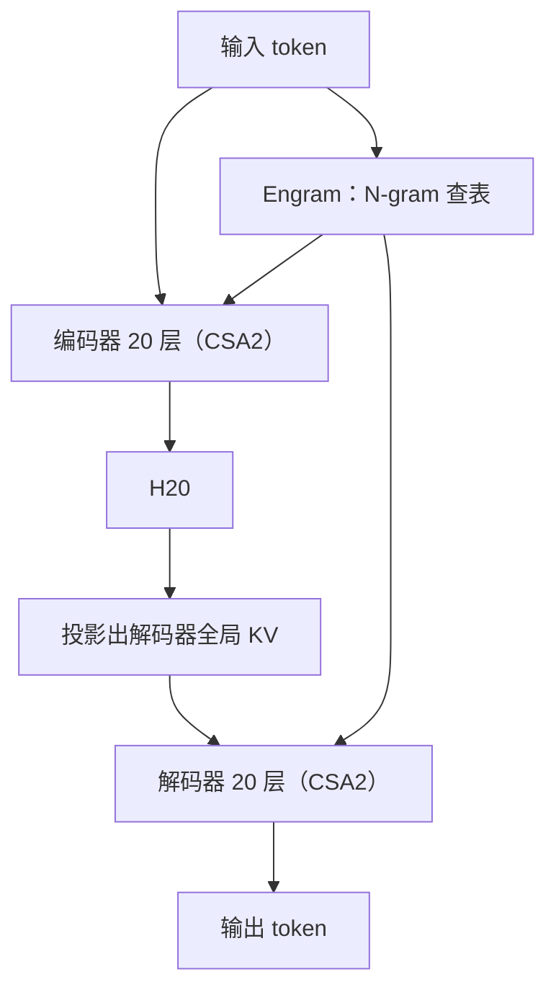

# 第 9 章：V4.1：把 KV cache 压到 890 B/token

- **难度**：★★★ | **预估学时**：4 小时 | **前置**：第 8 章、论文拆解第 9 章、架构篇第 14 章

## 学习目标

学完本章，你能：写出 V4.1-Flash 的 552B 主干 + 196B Engram 配置；解释 CED 为什么把编码阶段压到 20 层；说出 CSA2 的 Full/Reindex/Reuse 三模式；复算 890 B/token 的 1M 单序列与并发显存；判断它和 V4-Pro 的对比边界。

## 一句话核心

V4.1 的核心不是“再加参数”，而是把长上下文的 KV cache 当成第一瓶颈：CED 让编码器只算前 20 层，CSA2 跨层复用 KV/index，Engram 用查表替代部分矩阵计算，FP4 KV 再压一半。四件事叠加，才有 890 B/token。

## 1. 配置

| 项 | V4.1-Flash |
|---|---|
| 主干参数 | 552B |
| Engram | 196B |
| HuggingFace 总参数 | 约 763B |
| prefill 激活 | 8B |
| decode 激活 | 16B |
| 上下文 | 1M |
| 训练 token | 45T（多模态语料） |
| 视觉 | 原生图像输入，文本自回归输出 |
| 精度 | FP4 + FP8 混合 |

注意三个“总参数”口径：论文说 552B 主干 + 196B Engram；HuggingFace 模型卡显示约 763B 总权重；prefill/decode 激活分别是 8B/16B。写文章时要把这三个数分开，不能混成“763B 激活”。

### 1.1 配置里还能读到什么

V4.1 的 `config.json` 是嵌套的：文本参数在 `text_config`，视觉参数在 `vision_config`。关键字段如下：

| 字段 | 值 | 含义 |
|---|---|---|
| `text_config.hidden_size` | 5120 | 主干隐藏维 |
| `text_config.num_hidden_layers` | 40 | 20 编码 + 20 解码 |
| `text_config.num_attention_heads` | 64 | 查询头 |
| `text_config.head_dim` | 512 | 每头维度 |
| `text_config.n_routed_experts` | 384 | 路由专家 |
| `text_config.n_shared_experts` | 1 | 共享专家 |
| `text_config.num_experts_per_tok` | 6 | top-6 |
| `text_config.moe_intermediate_size` | 2304 | 专家中间维 |
| `text_config.q_lora_rank` | 1280 | Q 低秩维度 |
| `text_config.o_lora_rank` | 1024 | 输出低秩维度 |
| `text_config.o_groups` | 8 | 输出分组 |
| `text_config.sliding_window` | 128 | SWA 窗口 |
| `text_config.num_nextn_predict_layers` | 3 | MTP 头层数 |
| `text_config.engram_layer_ids` | `[1, 14]` | Engram 插在第 1、14 层 |
| `text_config.engram_max_ngram_size` | 4 | 4-gram 哈希 |
| `text_config.engram_vocab_size` | 16,000,000 | Engram 词表 |
| `text_config.engram_n_heads` | 8 | Engram 头数 |
| `text_config.engram_head_dim` | 256 | Engram 每头维度 |
| `vision_config.num_hidden_layers` | 32 | 视觉编码器层数 |
| `vision_config.hidden_size` | 1024 | 视觉隐藏维 |
| `vision_config.patch_size` | 14 | 视觉 patch |
| `vision_config.max_image_tokens` | 1024 | 单图最多 token |

这组字段解释了三件事：

1. **为什么 552B 主干能装进 40 层**：`hidden_size=5120` 比 V4-Pro 的 7168 小，专家中间维 2304 也比 3072 小；层数少、宽度小，参数自然降下来。
2. **Engram 不是每层都插**：只在第 1、14 层插，查表参数 196B，但不参与每 token 的稠密矩阵计算，所以 prefill 激活只有 8B。
3. **CED 的 20+20 不是拍脑袋**：`candidate_source_layer_id=20`、`kv_source_layer_ids=[2,8,14,20]` 说明全局 KV 的建立和复用都围绕第 20 层分界；解码器从第 21 层起不再自己建全局 KV。

`compress_ratios` 也值得看：V4.1 的文本配置是 `[0,0,2,2,...]`，前两层不压缩，从第 3 层起大量 `2`，对应 CSA2 的 $m=2$；最后几层是 `0,0,0`，对应解码器末端的特殊处理。V4-Pro 是 `[128,128,4,...]`，开头两个 128 是 HCA，后面 4 是 CSA。把这些数字和章节里的机制对上，配置就不再是天书。

## 2. CED：非对称编码器-解码器

标准 decoder 每层都要维护全局 KV。V4.1 把 40 层拆成：

- **编码器 20 层**：只做输入编码，建立全局 KV。
- **解码器 20 层**：不再自己算全局 KV，而是从编码器第 20 层的隐藏状态投影得到。

公式：

$$
C_l=H_{20}W_l^{KV},\quad l>20
$$

其中 $C_l$ 是解码器第 $l$ 层的全局 KV，$H_{20}$ 是编码器最后一层的隐藏状态，$W_l^{KV}$ 是第 $l$ 层的投影矩阵。

这样全局 KV 的建立只发生在 20 层编码器，解码器 20 层不再重复建立全局 KV；论文口径是 prefill 算力显著下降，但不是严格“减半”，因为解码器仍有 20 层的注意力与 FFN 计算。代价是解码器层的全局 KV 都来自同一个 $H_{20}$，表达能力受编码器末端限制；所以它不是“白嫖”，是用结构换成本。

## 3. CSA2：跨层复用 KV 与索引

CSA2 在 CSA 的基础上加了三档复用：

- **Full**：重新算完整 KV/index。
- **Reindex**：复用 KV，但重新建索引，处理分布漂移。
- **Reuse**：复用 KV 和上一层选好的 top-k 索引，只做少量更新。

编码器 18 层 CSA2，$m=2$，每 6 层一组：1 层 Full + 5 层 Reuse。解码器 20 层 CSA2，$m=1$，每 4 层一组：首组 1 Full + 3 Reuse，后四组 1 Reindex + 3 Reuse。

CSA2 的 indexer 有 32 头、128 维，分层索引器 2048 块 × 8 位置 = 16384 个候选。这个设计的目标不是“更准”，而是把 1M 上下文的索引成本压到可接受范围。

## 4. Engram：用查表替代矩阵计算

Engram 是一个 N-gram 哈希记忆模块：把输入里的 N-gram 哈希到固定表，查表得到记忆向量，再拼进隐藏状态。它是 O(1) 内存访问，不需要矩阵乘法。

196B 的 Engram 是“外挂”参数，不参与每 token 的稠密矩阵计算，所以 prefill 激活只有 8B。代价是表很大，显存/存储要装下；哈希冲突会丢信息；训练时要学表和主干怎么配合。

Engram 和 MoE 的区别：MoE 还是 FFN 矩阵，只是稀疏激活；Engram 是查表，不是矩阵乘。两者都增加总参数，但计算形态不同。

## 5. DSpark 与 FP4 KV

DSpark 是独立训练的投机解码 drafter：先让小模型猜几个 token，再由主模型验证，减少 decode 步数。它和 MTP 的分工是：MTP 偏训练信号，DSpark 是推理加速器。

FP4 KV 把每 token 的 KV 字节再压一半。890 B/token 是全局 KV 的稳态占用，不含持久 KV、SWA、Engram、激活和框架开销。按 1M 单序列：

$$
890\ \text{B}\times1{,}000{,}000=890\ \text{MB}
$$

50 并发约 44.5 GB。对比 V3.2 的 48,068 B/token：1M 单序列约 48 GB，50 并发约 2.4 TB。这就是 V4.1 能把 1M 上下文做成“可部署”的原因。

## 6. 基准怎么读

V4.1 论文给的 Terminal-Bench 3.0 是 30.0，DeepSWE 74.2，CyberGym 88.1，Automation-Bench 54.8。Terminal-Bench 不如 Opus 5 的 43.3。

读法：

- 先看基准版本与评测协议，不同论文的 Terminal-Bench 版本可能不同。
- 区分“平均分”和“某类任务分”。
- 区分“模型能力”和“Agent 框架能力”，工具调用、重试、上下文管理都会影响结果。
- V4.1 当前对标的是 V4-Flash，不是 V4-Pro；不能写“全面超越 V4-Pro”。

## 7. 图示

看图说明：编码器负责“读”，解码器负责“写”；解码器不再重复算全局 KV，而是复用编码器末端投影。Engram 是旁路，不参与注意力。

## 8. 常见误解

- 别以为 552B 就是全部参数——还有 196B Engram，HF 总权重约 763B。
- 别以为 prefill 8B 就是“模型只有 8B”——它是激活参数，权重仍要装 552B+196B。
- 别以为 CED 只是“少算 20 层”——解码器全局 KV 来自编码器末端，表达受限，是取舍。
- 别以为 890 B/token 是全部缓存——只是全局 KV，不含持久 KV/SWA/Engram。
- 别以为 V4.1 全面超过 V4-Pro——当前对标 V4-Flash，Terminal-Bench 仍低于 Opus 5。

## 9. 自测题

1. V4.1 的主干参数是多少？（答案：B；解析：552B 主干 + 196B Engram。）
   - A. 284B　B. 552B　C. 1.6T　D. 671B
2. CED 的解码器全局 KV 来自哪里？（答案：C；解析：编码器第 20 层隐藏状态投影。）
   - A. 每层自己算　B. 输入 embedding　C. 编码器第 20 层　D. Engram 查表
3. CSA2 的 Reuse 模式复用了什么？（答案：A；解析：主 KV 和上一层选好的 top-k 索引。）
   - A. KV 和索引　B. 只复用 Q　C. 只复用位置编码　D. 完全重算

## 10. 复习锚点

- V4.1：552B 主干 + 196B Engram，8B prefill / 16B decode，1M。
- CED：20 层编码 + 20 层解码，解码器 KV 由 H20 投影。
- CSA2：Full / Reindex / Reuse 三模式，跨层复用。
- Engram：N-gram 哈希查表，O(1) 访问，不是矩阵乘。
- 890 B/token 只是全局 KV；1M 单序列 890 MB，50 并发 44.5 GB。
