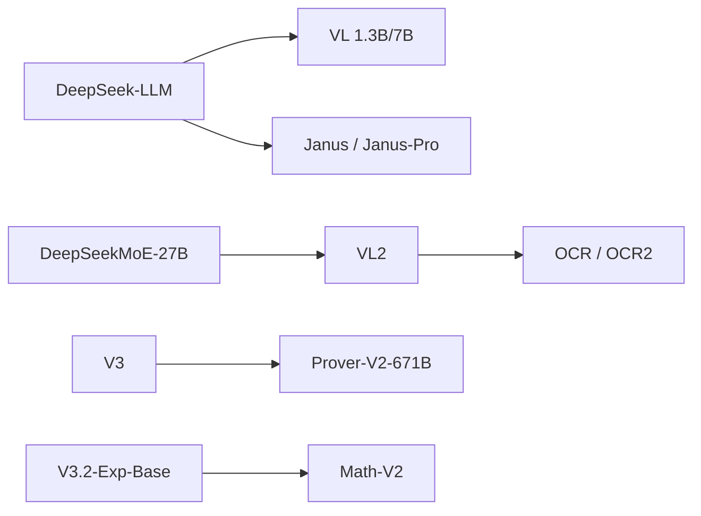

# 第 10 章：多模态与专用模型：VL、Janus、OCR、Prover、Math-V2

- **难度**：★★☆ | **预估学时**：3 小时 | **前置**：第 5–9 章

## 学习目标

学完本章，你能：区分 VL2 的“理解型 MoE”和 Janus 的“理解+生成统一”；说出 OCR 的光学压缩在做什么；解释 Prover-V2 与 Math-V2 的不同任务；把这些模型放回 DeepSeek 的主干代际。

## 一句话核心

这些模型不是另一条主线，而是把不同代的语言主干接上视觉编码器、形式化证明器或自验证训练器。看它们时先问“主干是哪一代”，再问“额外加了什么头/编码器”。

## 1. DeepSeek-VL / VL2：理解型视觉语言模型

### 1.1 VL

DeepSeek-VL 有 1.3B 和 7B 两个版本，使用混合视觉编码器，在固定 token 预算内处理 1024×1024 高分辨率图像。它做的是视觉问答、OCR、图表理解、视觉定位，不生成图像。

### 1.2 VL2

DeepSeek-VL2 建在 DeepSeekMoE-27B 上，是 MoE 视觉语言模型。三个变体的激活参数分别是：

| 变体 | 激活参数 |
|---|---|
| VL2-Tiny | 1.0B |
| VL2-Small | 2.8B |
| VL2-Base | 4.5B |

它支持动态切图（把高分辨率图切成多块，分别编码再拼），在视觉问答、OCR、文档/表格/图表理解、视觉定位上表现竞争力。注意：1.0B/2.8B/4.5B 是激活参数，总参数更高；不要把“Tiny”当成 1B dense。

## 2. Janus / Janus-Pro：理解与生成统一

Janus 的关键设计是**解耦视觉编码**：

- 理解路径：用 SigLIP-L 这类视觉编码器，把图像变成语义特征。
- 生成路径：用 VQ tokenizer（LlamaGen 那类）把图像变成离散 token，再自回归生成。
- 两条路径共享同一个 Transformer 主干，但视觉编码器分开。

为什么要分开：理解需要“语义”，生成需要“像素级重建”，同一个编码器很难同时做好。Janus-Pro 在此基础上升级，基于 DeepSeek-LLM-1.5B/7B，支持 384×384 输入，生成质量与理解能力都提升。

Janus 系列包括 Janus-1.3B、JanusFlow-1.3B、Janus-Pro-1B、Janus-Pro-7B。JanusFlow 用流式生成替代部分自回归；Janus-Pro 是更强的统一版。

## 3. DeepSeek-OCR：把图像压成视觉 token

OCR 的任务不是“识别文字”这么简单。DeepSeek-OCR 的核心是**光学压缩**：把一整页图像编码成少量视觉 token，再让语言模型从这些 token 里恢复文字/结构。

配置：3.3B 总参数，12 层，1280 隐藏维，64 路由 + 2 共享专家，top-6，8192 上下文。它基于 DeepSeek-VL2 的视觉语言骨架，但把重点放在“高压缩率下还能读对”。

DeepSeek-OCR 2 换成“视觉因果流”（Visual Causal Flow），用更接近人类阅读顺序的因果结构处理版面；默认配置 (0–6)×768×768 + 1×1024×1024，对应 (0–6)×144 + 256 个视觉 token。它仍然是 3B 级 MoE，许可证 Apache 2.0。

## 4. DeepSeek-Prover-V2：形式化定理证明

Prover-V2 做的是 Lean 4 形式化证明，不是自然语言数学。它有两个版本：

- Prover-V2-671B：直接用 V3 架构（61 层、7168 维、256 路由、top-8），在 Lean 证明数据上训练。
- Prover-V2-7B：小模型，用于子目标搜索/草稿。

它先把自然语言题目形式化成 Lean 命题，再搜证明。MiniF2F-test 通过率 88.9%，ProverBench 覆盖 AIME 24/25 与教材题。和 R1 的区别：R1 用自然语言长 CoT 做数学，Prover 用形式化证明器验证每一步。

## 5. DeepSeek-Math-V2：自验证数学推理

Math-V2 建在 V3.2-Exp-Base 上，核心是“自验证”：模型生成证明，另一个 LLM 验证器审查，验证不通过就重写。训练时用高难度样本持续优化，推理时用 scaled test-time compute。

结果：IMO 2025、CMO 2024 金牌水平，Putnam 2024 118/120。它和 Prover-V2 的分工：Math-V2 偏自然语言证明与自验证，Prover-V2 偏 Lean 形式化。

## 6. 代际归属

| 模型 | 语言主干 | 额外结构 | 任务 |
|---|---|---|---|
| VL 1.3B/7B | DeepSeek-LLM | 混合视觉编码器 | 视觉理解 |
| VL2 Tiny/Small/Base | DeepSeekMoE-27B | 动态切图 + MoE | 视觉理解/定位 |
| Janus / Janus-Pro | DeepSeek-LLM-1.5B/7B | 解耦视觉编码 + 生成 tokenizer | 理解 + 生成 |
| OCR / OCR2 | VL2 骨架 | 光学压缩 / 视觉因果流 | 文档 OCR |
| Prover-V2 671B | V3 | Lean 证明数据 | 形式化证明 |
| Math-V2 | V3.2-Exp-Base | 自验证训练 | 数学证明 |

## 7. 图示

看图说明：语言主干是根，视觉/证明/自验证是不同分枝。不要把 Janus 的生成路径和 VL2 的理解路径混为一谈。

## 8. 常见误解

- 别以为 VL2 的 1.0B/2.8B/4.5B 是总参数——是激活参数。
- 别以为 Janus 是“一个编码器同时做理解和生成”——它恰恰是解耦成两条视觉路径。
- 别以为 OCR 只是传统 OCR——它用视觉 token 压缩 + 语言模型恢复。
- 别以为 Prover-V2 和 R1 是同一个任务——一个 Lean 形式化，一个自然语言 CoT。
- 别以为 Math-V2 是“更大的 R1”——它换了自验证训练框架。

## 9. 自测题

1. VL2 的 1.0B/2.8B/4.5B 指什么？（答案：B；解析：激活参数，不是总参数。）
   - A. 总参数　B. 激活参数　C. 层数　D. 上下文长度
2. Janus 的解耦视觉编码指什么？（答案：A；解析：理解用语义编码器，生成用 VQ tokenizer。）
   - A. 理解和生成用不同视觉路径　B. 只用一种编码器　C. 不用视觉编码器　D. 只做生成
3. Prover-V2-671B 用哪代语言主干？（答案：C；解析：V3 的 61 层/7168 维/256 路由。）
   - A. V2　B. V4　C. V3　D. Janus

## 10. 复习锚点

- VL2 是 DeepSeekMoE-27B 的视觉版，Tiny/Small/Base 激活 1.0B/2.8B/4.5B。
- Janus 解耦理解与生成两条视觉路径。
- OCR 用光学压缩，OCR2 用视觉因果流，3B 级。
- Prover-V2 用 V3 主干做 Lean 证明；Math-V2 用 V3.2-Exp-Base 做自验证。
- 下一章把全部家族放进一张对比表，并给选型决策树。
