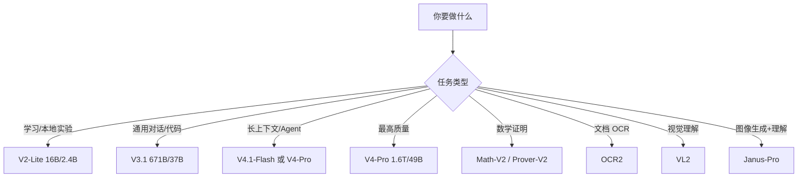

# 第 11 章：全家族对比与选型

- **难度**：★★☆ | **预估学时**：2 小时 | **前置**：第 1–10 章

## 学习目标

学完本章，你能：用一张表比较所有主要家族；按任务/显存/许可证做选型；说出每一代真正改动的结构件；拿到一张新模型卡时，用六个问题快速定位它。

## 一句话核心

选型不是“越大越好”，而是先看任务需要什么能力，再看显存能装下什么总参数、延迟能接受什么激活参数，最后看许可证是否允许你的用法。

## 1. 主家族对比

| 家族 | 代表 | 总/激活 | 层数 | 注意力 | FFN/路由 | 上下文 | 许可证 |
|---|---|---|---|---|---|---|---|
| LLM | 7B/67B | 7B/67B | 30/95 | MHA/GQA | dense | 4K | DeepSeek Model License |
| Coder | 1.3B/6.7B/33B | dense | 24/32/62 | GQA | dense | 16K | DeepSeek Model License |
| MoE | 16B | 16B/2.8B | 28 | MHA | 64 路由 + 2 共享，top-6 | 4K | DeepSeek Model License |
| V2 | 236B | 236B/21B | 60 | MLA | 160 路由 + 2 共享，top-6 | 128K | DeepSeek Model License |
| V2-Lite | 16B | 16B/2.4B | 27 | MLA | 64 路由 + 2 共享，top-6 | 128K | DeepSeek Model License |
| Coder-V2 | 236B | 236B/21B | 60 | MLA | 160 路由 + 2 共享，top-6 | 128K | DeepSeek Model License |
| V3 | 671B | 671B/37B | 61 | MLA | 256 路由 + 1 共享，top-8 | 128K | MIT |
| R1 | 671B | 671B/37B | 61 | MLA | 256 路由 + 1 共享，top-8 | 128K | MIT |
| V3.1 | 671B | 671B/37B | 61 | MLA | 256 路由 + 1 共享，top-8 | 128K | MIT |
| V3.2 | 671B | 671B/37B | 61 | DSA | 256 路由 + 1 共享，top-8 | 128K | MIT |
| V4-Pro | 1.6T | 1.6T/49B | 61 | 压缩 + DSA（CSA/HCA） | 384 路由 + 1 共享，top-6 | 1M | MIT |
| V4-Flash | 284B | 284B/13B | 43 | 压缩 + DSA（CSA/HCA） | 256 路由 + 1 共享，top-6 | 1M | MIT |
| V4.1-Flash | 763B | 552B 主干 + 196B Engram；8B/16B 激活 | 40（20+20） | CED + CSA2 | MoE + Engram | 1M | MIT |
| VL2 | Tiny/Small/Base | 激活 1.0B/2.8B/4.5B | — | — | DeepSeekMoE-27B | — | DeepSeek Model License |
| Janus-Pro | 1B/7B | dense | — | — | 解耦视觉编码 | — | MIT |
| OCR | 3.3B | 3.3B | 12 | — | 64 路由 + 2 共享，top-6 | 8K | MIT |
| OCR2 | 3B 级 | 3B 级 | 12 | — | 64 路由 + 2 共享，top-6 | 8K | Apache 2.0 |
| Prover-V2 | 671B/7B | 671B/37B；7B dense | 61 | MLA | 256 路由 + 1 共享 | 128K | DeepSeek Model License |
| Math-V2 | 671B 级 | 671B/37B | 61 | DSA | 256 路由 + 1 共享 | 128K | Apache 2.0 |

表中“—”表示官方模型卡没有给出统一口径，或者该模型不是纯文本 Transformer，不要硬填。

## 2. 许可证不是一回事

“开源”在 DeepSeek 这里分三档：

- **MIT**：V3、R1、V3.1、V3.2、V4、V4.1、Janus。限制最少，商用友好。
- **DeepSeek Model License**：LLM、Coder、MoE、V2、V2-Lite、Coder-V2、VL、VL2、Prover-V2。允许商用，但有使用条款，不是 OSI 意义上的完全开源。
- **Apache 2.0**：Math-V2、OCR2。商用友好，带专利授权条款。

严格说，只有 MIT/Apache 2.0 的权重是“OSI 开源许可证”；DeepSeek Model License 是“开放权重 + 自定义许可”。写“DeepSeek 全部开源”不准确。

## 3. 选型决策树

决策顺序：

1. **先看任务**：文本、代码、数学、OCR、视觉理解、图像生成，模型不是通用的。
2. **再看显存**：总参数决定能不能装下；V4-Pro 1.6T 不是单机能跑的。
3. **再看延迟**：激活参数决定每 token 算力；V4.1 的 8B/16B 激活适合高并发。
4. **再看上下文**：128K 够不够？要 1M 就只能在 V4 代里选。
5. **最后看许可证**：商用优先 MIT/Apache；DeepSeek Model License 要读条款。

## 4. 每一代真正改了什么

| 代 | 结构改动 | 训练改动 |
|---|---|---|
| Dense | LLaMA 式 decoder、GQA | 2T 中英文/代码预训练 |
| MoE | 细粒度专家、共享专家 | 负载均衡 |
| V2 | MLA、160 路由 | 8.1T token |
| V3 | 256 路由、MTP、无辅助损失均衡、FP8 | 14.8T token |
| R1 | 无结构改动 | GRPO、四阶段 RL、蒸馏 |
| V3.1 | 无结构改动 | 混合推理模板、Agent 后训练 |
| V3.2 | DSA 稀疏注意力 | Agent RL、1800+ 环境 |
| V4 | token 压缩 + DSA、mHC、Muon、1M | FP4+FP8、长上下文训练 |
| V4.1 | CED、CSA2、Engram、DSpark、FP4 KV | 45T 多模态语料 |

这张表回答一个常见问题：“为什么参数没翻倍，能力却提升了？”因为改动不一定在参数量上，可能在注意力、路由、训练目标、数据配比上。

## 5. 拿到新模型卡，问六个问题

1. `architectures` / `model_type` 是什么？属于哪一代？
2. 总参数多少，激活参数多少？层数、隐藏维、头数、KV 头数？
3. 注意力是 MHA/GQA/MLA/DSA/CSA/HCA/CSA2 中的哪一种？
4. FFN 是 dense 还是 MoE？多少路由专家、多少共享专家、top-k 多少？
5. 上下文多长？训练 token 多少？精度是什么？
6. 许可证是什么？权重、代码、数据分别开放到什么程度？

六个问题答完，你就知道它是“新架构”还是“同架构的新 checkpoint”。

## 6. 常见误解

- 别以为 V4.1 是 V4-Pro 的缩小版——它是新的 CED + CSA2 + Engram 结构。
- 别以为 V3.1 比 V3 结构新——只是模板和后训练。
- 别以为参数越大越适合你——显存、延迟、成本都是约束。
- 别以为“开源”= MIT——许可证要逐个看。
- 别以为 OCR/Janus/VL2 是“小玩具”——它们是不同任务上的专用架构。

## 7. 自测题

1. 哪一个模型首次引入 MLA？（答案：B；解析：V2。）
   - A. V3　B. V2　C. R1　D. V4
2. 哪一个模型引入 DSA？（答案：C；解析：V3.2-Exp。）
   - A. V2　B. V3.1　C. V3.2-Exp　D. V4.1
3. V4.1 的 552B 和 196B 分别是什么？（答案：A；解析：552B 主干 + 196B Engram。）
   - A. 主干 + Engram　B. 两次专家数　C. 训练/推理参数　D. 视觉/文本参数
4. 商用限制最少的是哪类许可证？（答案：A；解析：MIT/Apache 2.0 最宽松；DeepSeek Model License 有自定义条款。）
   - A. MIT/Apache 2.0　B. DeepSeek Model License　C. 无许可证　D. 仅研究许可

## 8. 复习锚点

- 四代结构主线：dense → MoE → MLA → DSA/CSA → CED/CSA2。
- 选型顺序：任务 → 显存 → 延迟 → 上下文 → 许可证。
- 同家族 checkpoint 先看 `architectures`，再看训练阶段。
- MIT / DeepSeek Model License / Apache 2.0 是三档，不要混。
- 下一章是附录：105+ 张模型卡索引，按家族列出全部公开 checkpoint。
