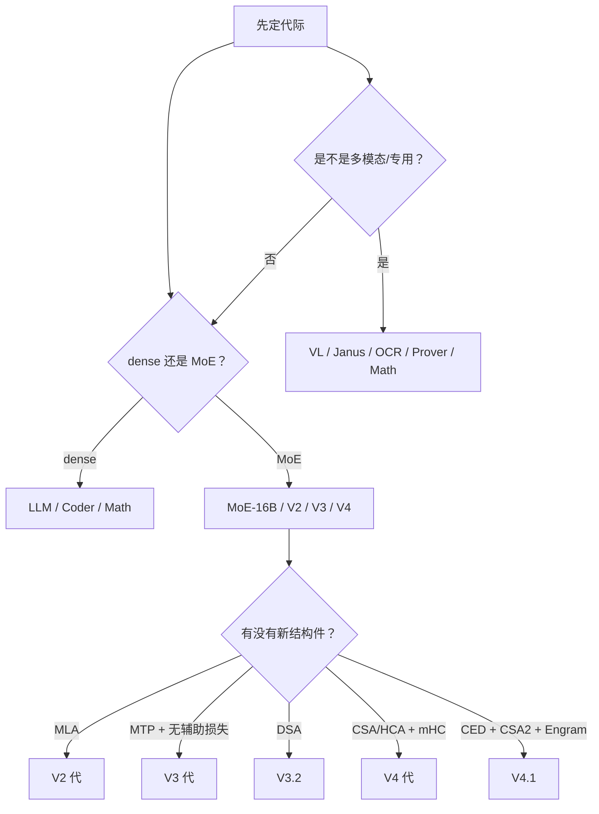

# 附录：105+ 张模型卡索引

- **难度**：★☆☆ | **预估学时**：30 分钟 | **前置**：第 1–11 章

## 说明

这张索引按家族列出 HuggingFace `deepseek-ai` 组织下的公开模型卡。同一家族的多个 checkpoint 通常共享网络结构，差别在训练数据、后训练、精度或用途；不要把它们当成不同架构。参数量优先按模型卡/命名口径，标注“激活”的是激活参数。

## 1. 索引怎么用

看图说明：先按“代际”分流，再按“有没有新结构件”定位；多模态和专用模型是旁支，不挡主线。用这张图查索引，比从 106 条里逐行翻快。

## A. Dense：LLM

| 模型 ID | 任务 | 参数量（约） | 许可证 |
|---|---|---|---|
| `deepseek-ai/deepseek-llm-67b-base` | text-generation | 67B | DeepSeek Model License |
| `deepseek-ai/deepseek-llm-67b-chat` | text-generation | 67B | DeepSeek Model License |
| `deepseek-ai/deepseek-llm-7b-base` | text-generation | 7B | DeepSeek Model License |
| `deepseek-ai/deepseek-llm-7b-chat` | text-generation | 7B | DeepSeek Model License |

## A. Dense：Coder

| 模型 ID | 任务 | 参数量（约） | 许可证 |
|---|---|---|---|
| `deepseek-ai/deepseek-coder-1.3b-base` | text-generation | 1.3B | DeepSeek Model License |
| `deepseek-ai/deepseek-coder-1.3b-instruct` | text-generation | 1.3B | DeepSeek Model License |
| `deepseek-ai/deepseek-coder-33b-base` | text-generation | 33B | DeepSeek Model License |
| `deepseek-ai/deepseek-coder-33b-instruct` | text-generation | 33B | DeepSeek Model License |
| `deepseek-ai/deepseek-coder-5.7bmqa-base` | text-generation | — | DeepSeek Model License |
| `deepseek-ai/deepseek-coder-6.7b-base` | text-generation | 6.7B | DeepSeek Model License |
| `deepseek-ai/deepseek-coder-6.7b-instruct` | text-generation | 6.7B | DeepSeek Model License |
| `deepseek-ai/deepseek-coder-7b-base-v1.5` | text-generation | 7B | DeepSeek Model License |
| `deepseek-ai/deepseek-coder-7b-instruct-v1.5` | text-generation | 7B | DeepSeek Model License |

## A. Dense：Math

| 模型 ID | 任务 | 参数量（约） | 许可证 |
|---|---|---|---|
| `deepseek-ai/deepseek-math-7b-base` | text-generation | 7B | DeepSeek Model License |
| `deepseek-ai/deepseek-math-7b-instruct` | text-generation | 7B | DeepSeek Model License |
| `deepseek-ai/deepseek-math-7b-rl` | text-generation | 7B | DeepSeek Model License |

## B. MoE：DeepSeekMoE

| 模型 ID | 任务 | 参数量（约） | 许可证 |
|---|---|---|---|
| `deepseek-ai/deepseek-moe-16b-base` | text-generation | 16B | DeepSeek Model License |
| `deepseek-ai/deepseek-moe-16b-chat` | text-generation | 16B | DeepSeek Model License |

## C. V2 家族：V2 / V2-Lite / V2.5

| 模型 ID | 任务 | 参数量（约） | 许可证 |
|---|---|---|---|
| `deepseek-ai/DeepSeek-V2` | text-generation | 236B | DeepSeek Model License |
| `deepseek-ai/DeepSeek-V2-Chat` | text-generation | 236B | DeepSeek Model License |
| `deepseek-ai/DeepSeek-V2-Chat-0628` | text-generation | 236B | DeepSeek Model License |
| `deepseek-ai/DeepSeek-V2-Lite` | text-generation | 16B | DeepSeek Model License |
| `deepseek-ai/DeepSeek-V2-Lite-Chat` | text-generation | 16B | DeepSeek Model License |
| `deepseek-ai/DeepSeek-V2.5` | text-generation | 236B | DeepSeek Model License |
| `deepseek-ai/DeepSeek-V2.5-1210` | text-generation | 236B | DeepSeek Model License |

## D. V2 家族：Coder-V2

| 模型 ID | 任务 | 参数量（约） | 许可证 |
|---|---|---|---|
| `deepseek-ai/DeepSeek-Coder-V2-Base` | text-generation | 236B | DeepSeek Model License |
| `deepseek-ai/DeepSeek-Coder-V2-Instruct` | text-generation | 236B | DeepSeek Model License |
| `deepseek-ai/DeepSeek-Coder-V2-Instruct-0724` | text-generation | 236B | DeepSeek Model License |
| `deepseek-ai/DeepSeek-Coder-V2-Lite-Base` | text-generation | 16B | DeepSeek Model License |
| `deepseek-ai/DeepSeek-Coder-V2-Lite-Instruct` | text-generation | 16B | DeepSeek Model License |

## E. V3 家族：V3

| 模型 ID | 任务 | 参数量（约） | 许可证 |
|---|---|---|---|
| `deepseek-ai/DeepSeek-V3` | text-generation | 671B | MIT |
| `deepseek-ai/DeepSeek-V3-0324` | text-generation | 671B | MIT |
| `deepseek-ai/DeepSeek-V3-Base` | — | 671B | MIT |

## E. V3 家族：V3.1

| 模型 ID | 任务 | 参数量（约） | 许可证 |
|---|---|---|---|
| `deepseek-ai/DeepSeek-V3.1` | text-generation | 671B | MIT |
| `deepseek-ai/DeepSeek-V3.1-Base` | text-generation | 671B | MIT |
| `deepseek-ai/DeepSeek-V3.1-Terminus` | text-generation | 671B | MIT |

## E. V3 家族：V3.2

| 模型 ID | 任务 | 参数量（约） | 许可证 |
|---|---|---|---|
| `deepseek-ai/DeepSeek-V3.2` | text-generation | 671B | MIT |
| `deepseek-ai/DeepSeek-V3.2-Exp` | text-generation | 671B | MIT |
| `deepseek-ai/DeepSeek-V3.2-Exp-Base` | text-generation | 671B | MIT |
| `deepseek-ai/DeepSeek-V3.2-Speciale` | text-generation | 671B | MIT |

## E. V3 家族：R1 / Distill

| 模型 ID | 任务 | 参数量（约） | 许可证 |
|---|---|---|---|
| `deepseek-ai/DeepSeek-R1` | text-generation | 671B | MIT |
| `deepseek-ai/DeepSeek-R1-0528` | text-generation | 671B | MIT |
| `deepseek-ai/DeepSeek-R1-0528-Qwen3-8B` | text-generation | 8B | MIT |
| `deepseek-ai/DeepSeek-R1-Distill-Llama-70B` | text-generation | 70B | MIT |
| `deepseek-ai/DeepSeek-R1-Distill-Llama-8B` | text-generation | 8B | MIT |
| `deepseek-ai/DeepSeek-R1-Distill-Qwen-1.5B` | text-generation | 1.5B | MIT |
| `deepseek-ai/DeepSeek-R1-Distill-Qwen-14B` | text-generation | 14B | MIT |
| `deepseek-ai/DeepSeek-R1-Distill-Qwen-32B` | text-generation | 32B | MIT |
| `deepseek-ai/DeepSeek-R1-Distill-Qwen-7B` | text-generation | 7B | MIT |
| `deepseek-ai/DeepSeek-R1-Zero` | text-generation | 671B | MIT |

## H. V4 家族：V4

| 模型 ID | 任务 | 参数量（约） | 许可证 |
|---|---|---|---|
| `deepseek-ai/DeepSeek-V4-Flash` | text-generation | 284B | MIT |
| `deepseek-ai/DeepSeek-V4-Flash-0731` | text-generation | 284B | MIT |
| `deepseek-ai/DeepSeek-V4-Flash-Base` | — | 284B | MIT |
| `deepseek-ai/DeepSeek-V4-Flash-DSpark` | text-generation | 284B | MIT |
| `deepseek-ai/DeepSeek-V4-Flash-Vision-Exp` | image-text-to-text | 284B | MIT |
| `deepseek-ai/DeepSeek-V4-Pro` | text-generation | 1.6T | MIT |
| `deepseek-ai/DeepSeek-V4-Pro-0813` | text-generation | 1.6T | MIT |
| `deepseek-ai/DeepSeek-V4-Pro-Base` | — | 1.6T | MIT |
| `deepseek-ai/DeepSeek-V4-Pro-DSpark` | text-generation | 1.6T | MIT |

## H. V4 家族：V4.1

| 模型 ID | 任务 | 参数量（约） | 许可证 |
|---|---|---|---|
| `deepseek-ai/DeepSeek-V4.1-Flash` | image-text-to-text | 763B | MIT |
| `deepseek-ai/DeepSeek-V4.1-Flash-1017` | image-text-to-text | 763B | MIT |

## F. 多模态：VL

| 模型 ID | 任务 | 参数量（约） | 许可证 |
|---|---|---|---|
| `deepseek-ai/deepseek-vl-1.3b-base` | — | 1.3B | DeepSeek Model License |
| `deepseek-ai/deepseek-vl-1.3b-chat` | image-text-to-text | 1.3B | DeepSeek Model License |
| `deepseek-ai/deepseek-vl-7b-base` | — | 7B | DeepSeek Model License |
| `deepseek-ai/deepseek-vl-7b-chat` | image-text-to-text | 7B | DeepSeek Model License |

## F. 多模态：VL2

| 模型 ID | 任务 | 参数量（约） | 许可证 |
|---|---|---|---|
| `deepseek-ai/deepseek-vl2` | image-text-to-text | 激活 1.0–4.5B | DeepSeek Model License |
| `deepseek-ai/deepseek-vl2-small` | image-text-to-text | 激活 1.0–4.5B | DeepSeek Model License |
| `deepseek-ai/deepseek-vl2-tiny` | image-text-to-text | 激活 1.0–4.5B | DeepSeek Model License |

## F. 多模态：Janus

| 模型 ID | 任务 | 参数量（约） | 许可证 |
|---|---|---|---|
| `deepseek-ai/Janus-1.3B` | any-to-any | 1.3B | MIT |
| `deepseek-ai/Janus-Pro-1B` | any-to-any | 1B | MIT |
| `deepseek-ai/Janus-Pro-7B` | any-to-any | 7B | MIT |
| `deepseek-ai/JanusFlow-1.3B` | any-to-any | 1.3B | MIT |

## F. 多模态：OCR

| 模型 ID | 任务 | 参数量（约） | 许可证 |
|---|---|---|---|
| `deepseek-ai/DeepSeek-OCR` | image-text-to-text | 3.3B | mit |
| `deepseek-ai/DeepSeek-OCR-2` | image-text-to-text | 3.3B | Apache 2.0 |

## G. 专用：Prover

| 模型 ID | 任务 | 参数量（约） | 许可证 |
|---|---|---|---|
| `deepseek-ai/DeepSeek-Prover-V1` | — | — | DeepSeek Model License |
| `deepseek-ai/DeepSeek-Prover-V1.5-Base` | — | — | DeepSeek Model License |
| `deepseek-ai/DeepSeek-Prover-V1.5-RL` | — | — | DeepSeek Model License |
| `deepseek-ai/DeepSeek-Prover-V1.5-SFT` | — | — | DeepSeek Model License |
| `deepseek-ai/DeepSeek-Prover-V2-671B` | text-generation | 671B | — |
| `deepseek-ai/DeepSeek-Prover-V2-7B` | — | 7B | — |

## G. 专用：Math-V2

| 模型 ID | 任务 | 参数量（约） | 许可证 |
|---|---|---|---|
| `deepseek-ai/DeepSeek-Math-V2` | text-generation | 671B | Apache 2.0 |

## I. 工具/实验权重：ESFT

| 模型 ID | 任务 | 参数量（约） | 许可证 |
|---|---|---|---|
| `deepseek-ai/ESFT-gate-code-lite` | text-generation | — | — |
| `deepseek-ai/ESFT-gate-intent-lite` | text-generation | — | — |
| `deepseek-ai/ESFT-gate-law-lite` | text-generation | — | — |
| `deepseek-ai/ESFT-gate-math-lite` | text-generation | — | — |
| `deepseek-ai/ESFT-gate-summary-lite` | text-generation | — | — |
| `deepseek-ai/ESFT-gate-translation-lite` | text-generation | — | — |
| `deepseek-ai/ESFT-token-code-lite` | text-generation | — | — |
| `deepseek-ai/ESFT-token-intent-lite` | text-generation | — | — |
| `deepseek-ai/ESFT-token-law-lite` | text-generation | — | — |
| `deepseek-ai/ESFT-token-math-lite` | text-generation | — | — |
| `deepseek-ai/ESFT-token-summary-lite` | text-generation | — | — |
| `deepseek-ai/ESFT-token-translation-lite` | text-generation | — | — |
| `deepseek-ai/ESFT-vanilla-lite` | text-generation | — | — |

## I. 工具/实验权重：DSpark

| 模型 ID | 任务 | 参数量（约） | 许可证 |
|---|---|---|---|
| `deepseek-ai/dspark_gemma4_12b_block7` | — | — | — |
| `deepseek-ai/dspark_qwen3_14b_block7` | — | — | — |
| `deepseek-ai/dspark_qwen3_4b_block7` | — | — | — |
| `deepseek-ai/dspark_qwen3_8b_block7` | — | — | — |

## I. 工具/实验权重：DFlash

| 模型 ID | 任务 | 参数量（约） | 许可证 |
|---|---|---|---|
| `deepseek-ai/dflash_gemma4_12b_block7` | — | — | — |
| `deepseek-ai/dflash_qwen3_14b_block7` | — | — | — |
| `deepseek-ai/dflash_qwen3_4b_block7` | — | — | — |
| `deepseek-ai/dflash_qwen3_8b_block7` | — | — | — |

## I. 工具/实验权重：Eagle3

| 模型 ID | 任务 | 参数量（约） | 许可证 |
|---|---|---|---|
| `deepseek-ai/eagle3_gemma4_12b_ttt7` | — | — | — |
| `deepseek-ai/eagle3_qwen3_14b_ttt7` | — | — | — |
| `deepseek-ai/eagle3_qwen3_4b_ttt7` | — | — | — |
| `deepseek-ai/eagle3_qwen3_8b_ttt7` | — | — | — |

## 读这张表的三个提醒

1. **`Base` / `Chat` / `Instruct` 是训练阶段**，不是不同结构。
2. **`DSpark` / `DFlash` / `Eagle3` 是投机解码或蒸馏权重**，不是主模型；`ESFT-*` 是专家微调的门控/token 权重，不是通用对话模型。
3. **许可证逐个看**：MIT、Apache 2.0、DeepSeek Model License 是三套条款，不能一句“开源”带过。

## 复习锚点

- 先按家族归类，再看 checkpoint。
- 参数量看总参数，算力看激活参数。
- 新模型卡先看 `architectures` / `model_type`。