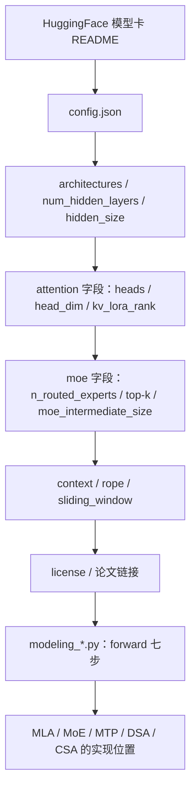

# 第 14 章：源码地图：拿到 config.json 和 modeling 文件怎么读

- **难度**：★★☆ | **预估学时**：3 小时 | **前置**：第 4–9 章、第 13 章

## 学习目标

学完本章，你能：从 `config.json` 的字段反推模型结构；按 forward 顺序找到 MLA、MoE、MTP 的实现位置；用 20 行伪代码复述 MLA 和 MoE；判断哪些代有公开代码、哪些只能读论文。

## 一句话核心

读源码不要从第一行读到最后一行。先读 `config.json` 拿到形状，再按“embedding → attention → MoE → norm → lm_head”的顺序找类，最后看 cache 和并行。

## 1. 公开代码覆盖到哪

| 代 | 公开 `modeling_*.py` | 说明 |
|---|---|---|
| DeepSeek-LLM / Coder | 有 | LLaMA 式实现，结构简单 |
| DeepSeekMoE 16B | 有 | `DeepseekForCausalLM`，MLA 之前的 MoE |
| V2 / V2-Lite / Coder-V2 | 有 | `DeepseekV2ForCausalLM`，MLA 首次完整公开 |
| V3 / V3.1 | 有 | `DeepseekV3ForCausalLM`，含 MTP、无辅助损失均衡 |
| V3.2 | 部分 | `DeepseekV32ForCausalLM`，DSA 的实现细节以技术报告为主 |
| V4 / V4.1 | 以技术报告为主 | 权重和配置公开，训练/推理框架未逐行公开 |

“权重公开”不等于“训练代码公开”。V4/V4.1 的 `config.json` 能告诉你形状，但 CSA/HCA、CED、Engram 的 kernel 级实现不一定在仓库里。

## 1.1 读模型卡的顺序



看图说明：先读模型卡，再读 `config.json`，最后才进 `modeling_*.py`。顺序反了会被几千行 Python 淹掉；先有字段地图，代码只是字段的实现。

## 2. config.json 的字段地图

拿到一份 `config.json`，先看这十几个字段：

| 字段 | 含义 | 典型值 |
|---|---|---|
| `architectures` | 模型类名 | `DeepseekV3ForCausalLM` |
| `num_hidden_layers` | 层数 | 61 |
| `hidden_size` | 隐藏维 | 7168 |
| `num_attention_heads` | 查询头数 | 128 |
| `num_key_value_heads` | KV 头数（GQA） | 1 或 8 |
| `kv_lora_rank` | MLA 潜向量维度 | 512 |
| `qk_nope_head_dim` | 非 RoPE 部分维度 | 128 |
| `qk_rope_head_dim` | RoPE 部分维度 | 64 |
| `v_head_dim` | V 每头维度 | 128 |
| `n_routed_experts` | 路由专家数 | 256 |
| `n_shared_experts` | 共享专家数 | 1 |
| `num_experts_per_tok` | top-k | 8 |
| `moe_intermediate_size` | 专家中间维 | 2048 |
| `first_k_dense_replace` | 前几层是 dense | 3 |
| `max_position_embeddings` | 最大位置 | 163840 |

看到 `architectures` 先判断代际：`DeepseekV2ForCausalLM` 是 V2，`DeepseekV3ForCausalLM` 是 V3/V3.1，`DeepseekV32ForCausalLM` 是 V3.2，`DeepseekV4ForCausalLM` 是 V4，`DeepseekV41ForCausalLM` 是 V4.1。

## 3. forward 的七步

不管哪一代，主干基本都是这个顺序：

```text
input_ids
  → token embedding
  → N 个 decoder layer
      → RMSNorm
      → attention（MLA / DSA / CSA）
      → residual
      → RMSNorm
      → FFN（dense 或 MoE）
      → residual
  → final RMSNorm
  → lm_head
  → logits
```

不同代改的是中间两个块：

- V2/V3：attention 是 MLA，FFN 是 DeepSeekMoE。
- V3.2：attention 里多一个 DSA 索引器 + top-k。
- V4：attention 里多 token 压缩（CSA/HCA），残差是 mHC。
- V4.1：编码器/解码器分开，解码器 KV 由编码器末端投影。

## 4. MLA 的 20 行伪代码

```python
# x: [B, L, d]
q_a = linear(x, W_q_a)          # d -> q_lora_rank
q = linear(q_a, W_q_b)          # -> heads * (qk_nope + qk_rope)
kv_a = linear(x, W_kv_a)        # d -> kv_lora_rank + qk_rope
c, k_pe = split(kv_a, [kv_lora_rank, qk_rope])
kv = linear(c, W_kv_b)          # -> heads * (qk_nope + v_head)
k_nope, v = split(kv, [qk_nope, v_head])
k = concat(k_nope, broadcast(k_pe), dim=-1)
q = concat(q_nope, q_pe, dim=-1)
scores = q @ k.transpose(-1, -2) / sqrt(d_head)
attn = softmax(scores)
out = attn @ v
out = linear(out, W_o)
# cache: c and k_pe only
```

关键点：`c` 和 `k_pe` 是缓存内容；`k_nope`、`v` 是计算时从 `c` 上投影还原出来的，不持久存。

## 5. DeepSeekMoE 的 15 行伪代码

```python
# x: [B, L, d]
gate_logits = linear(x, W_gate)          # [B, L, n_routed]
scores = softmax(gate_logits)
topk_val, topk_idx = topk(scores, k)
# 共享专家始终算
shared = shared_expert(x)
# 路由专家只算 top-k
routed = 0
for i in topk_idx:
    routed += gate_weight[i] * expert_i(x)
out = shared + routed
```

V3 的无辅助损失均衡在门控分数上加一个可学习偏置 `b_i`，只影响 top-k 选择，不影响选中后的加权。代码里通常能看到 `e_score_correction_bias` 这类参数。

## 6. MTP 的位置

MTP 不是主干的一层，而是挂在主干 hidden state 上的额外预测头。训练时：

```text
h_t = backbone(x_t)
logits_t1 = lm_head(h_t)
h_t2 = mtp_block(h_t, embedding(x_{t+1}))
logits_t2 = lm_head(h_t2)
loss = CE(logits_t1, x_{t+1}) + lambda * CE(logits_t2, x_{t+2})
```

HuggingFace 权重里那 14B 就是 `mtp_block` 的参数。推理不用投机解码时，可以只加载主干。

## 7. DSA 的代码位置

DSA 在 attention 里多两个东西：

1. **indexer**：给 query 和历史 token 打分。
2. **top-k gather**：只取分数最高的 k 个 K/V 做注意力。

伪代码：

```python
score = indexer(q, k_cache)          # [B, L, L_hist]
topk = topk(score, k)
k_sel = gather(k_cache, topk)
v_sel = gather(v_cache, topk)
attn = softmax(q @ k_sel.transpose(-1, -2)) @ v_sel
```

它不改 MLP，也不改 embedding；改的是 attention 的读取范围。

## 8. V4.1 的 CED / CSA2 / Engram 在代码里长什么样

这三块公开代码不完整，只能按论文描述给出“结构位置”：

- **CED**：模型分成 encoder 20 层、decoder 20 层；decoder 的全局 KV 由 `H20 @ W_l^KV` 得到。代码里会看到两个 stack，而不是一个 40 层 stack。
- **CSA2**：attention 里多一个 `mode` 选择（Full/Reindex/Reuse），以及跨层传递的 KV/index 缓存。
- **Engram**：embedding 旁边多一个 N-gram 哈希表，查表结果拼进 hidden state；它不是 FFN，也不是 attention。

读 V4.1 的 `config.json` 时，重点看 `num_hidden_layers` 是不是 40、是否有 `engram` 相关字段、`kv_lora_rank` 是否变小。不要拿 V3 的 61 层去套。

## 9. 读模型卡的顺序

1. `config.json`：确认 `architectures`、层数、隐藏维、专家数、上下文。
2. `README.md`：确认训练 token、许可证、评测口径。
3. `modeling_*.py`：确认 attention/MoE 的实现细节。
4. `generation_config.json`：确认默认解码参数、是否支持思考模式。
5. `tokenizer_config.json`：确认模板、特殊 token、上下文上限。

五份文件读完，基本能判断“这张卡能不能跑、要怎么跑、跑出来是什么”。

## 10. 常见误解

- 别以为 `config.json` 里 `num_hidden_layers=61` 就是 61 层全 MoE——还要看 `first_k_dense_replace`。
- 别以为 `num_key_value_heads=1` 就是 MQA——MLA 的 KV 压缩不走 GQA/MQA 那套，`kv_lora_rank` 才是关键。
- 别以为 HuggingFace 权重总量就是主模型——V3 的 685B 含 MTP，V4.1 的 763B 含 Engram。
- 别以为 V4/V4.1 的代码和 V3 一样能直接跑——结构类名、层数、KV 路径都变了。

## 11. 自测题

1. `architectures` 是 `DeepseekV32ForCausalLM`，最可能是哪代？（答案：C；解析：V3.2-Exp/V3.2 的结构标识。）
   - A. V2　B. V3　C. V3.2　D. V4
2. MLA 缓存的两个张量是什么？（答案：A；解析：潜向量 c 和 RoPE key。）
   - A. c 和 k_pe　B. q 和 k　C. k_nope 和 v　D. 全部 K/V
3. V3 的 `first_k_dense_replace=3` 意味着什么？（答案：B；解析：前 3 层是 dense FFN，之后才是 MoE。）
   - A. 前 3 层是 MoE　B. 前 3 层是 dense　C. 只有 3 层　D. 3 个共享专家

## 12. 复习锚点

- 先读 `config.json`，再读 `modeling`；不要从第一行读到最后一行。
- MLA 缓存 `c` 和 `k_pe`，`k_nope/v` 是计算时还原的。
- MoE 门控先 softmax 再 top-k；V3 的偏置只影响选择。
- MTP 是挂在 hidden state 上的额外头，不是主干层。
- V3.2 之后的结构，代码覆盖不完整，以技术报告为准。
