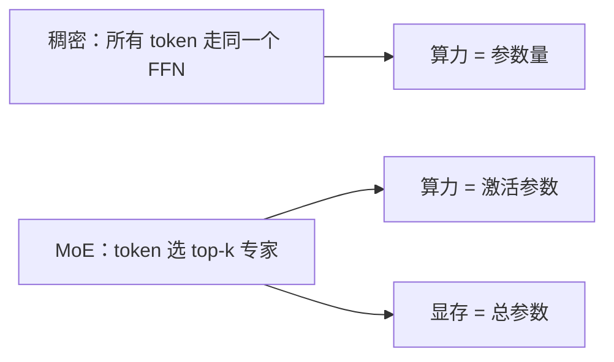

# 稠密模型与 MoE

- **难度**：基础 | **涉及章节**：第 1–4 章

## 一句话定义

稠密模型每个 token 都走同一套 FFN；MoE 把 FFN 拆成多个专家，每个 token 只走其中一部分。

## 为什么重要

这是 DeepSeek 从第一代走到 V2/V3 的主线。不理解稠密与 MoE 的差别，就看不懂“总参数 671B、激活 37B”这类数字。

## 图示

## 详解

稠密模型的 FFN 是一个固定矩阵，所有 token 都经过它。参数量多大，每个 token 的矩阵乘法就多大，算力和显存基本同向增长。

MoE 的 FFN 由多个专家组成，门控给每个 token 选 top-k 个专家。总参数包含所有专家，显存要全装；但每个 token 只算被选中的专家，算力按激活参数估。DeepSeekMoE 16B 是 16B 总参数、2.8B 激活；V3 是 671B 总参数、37B 激活。

MoE 的代价是路由、负载均衡、专家并行通信；收益是同样算力下容量更大。它适合“显存宽裕、算力紧张”的推理场景，不适合显存受限的单机。

## 常见误解

- 别以为 MoE 每个 token 都算所有专家——只算 top-k。
- 别以为总参数大就一定慢——算力看激活参数，但显存和通信会拖后腿。
- 别以为专家越多越好——路由组合爆炸、负载不均、通信成本都会上升。

## 在书中出现的脉络

| 章节 | 语境 | 关键结论 |
|---|---|---|
| 第 3 章 | DeepSeekMoE | 细粒度专家 + 共享专家 |
| 第 4 章 | V2 | 160 路由 + 2 共享 |
| 第 5 章 | V3 | 256 路由 + 1 共享，top-8 |

## 相关概念

- 前置：FFN、门控
- 后续：总参数与激活参数、DeepSeekMoE、负载均衡
