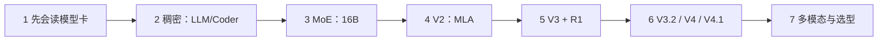

# 学习路径：7 步主线（零基础版）

面向数学/代码接近零基础、但想把 DeepSeek 全家族架构讲清楚的人。不按模型名背，按“每一代解决了什么问题”走。全程约 6 周，每天 1–2 小时。

## 路径总览

## 步骤 1：先会读模型卡（第 1 章 + 第 2 章前半）

**目标**：拿到一张模型卡，能说出它属于哪一代、总参数/激活参数、注意力类型、专家数、上下文、许可证。

**阅读**：ch01、ch02 的 2.1–2.2。

**检查点**：把 V2、V3、V4-Pro、V4.1 四张卡的六个问题各答一遍；答不出就回到第 1 章的代际表。

**复习**：抽认卡 `参数`、`主线` 标签。

## 步骤 2：稠密模型（第 2 章）

**目标**：能解释 LLM 7B/67B 的层数/头数/GQA，Coder 的 FIM，以及为什么第一代 Coder 不是 MoE。

**阅读**：ch02 全章。

**检查点**：手画 67B 的 95 层、8192 维、64 头/8 KV 头；口述 FIM 的训练方式。

**复习**：概念 `GQA`；抽认卡 `LLM`、`Coder`。

## 步骤 3：MoE 与专家（第 3 章 + 基础篇第 5 章）

**目标**：能解释“总参数 vs 激活参数”，说清 DeepSeekMoE 的细粒度分割、共享专家、top-k、负载均衡。

**阅读**：ch03；如果门控/FFN 没看懂，回 `01-foundations` 第 5 章。

**检查点**：手算 16B 的激活比例（2.8/16=17.5%）；解释为什么显存按总参数、算力按激活参数。

**复习**：概念 `稠密与 MoE`、`DeepSeekMoE`。

## 步骤 4：V2 与 MLA（第 4 章 + 架构篇第 7 章）

**目标**：能写出 V2 的 60 层/160 专家/top-6；用形状解释 MLA 缓存 512+64，不缓存完整 K/V；手算 69 KB/token。

**阅读**：ch04；架构篇第 7 章。

**检查点**：不看书画出 MLA 的缓存路径与计算路径；算一遍 576×2×60=69,120 字节。

**复习**：概念 `MLA`；抽认卡 `MLA`、`V2`。

## 步骤 5：V3 与 R1（第 5–6 章 + 论文拆解第 6–7 章）

**目标**：能写出 V3 的 671B/37B、61 层、256 路由/top-8；解释 MTP、无辅助损失均衡、FP8；复述 R1 四阶段和 GRPO 公式。

**阅读**：ch05、ch06；论文拆解第 6–7 章。

**检查点**：解释 685B=671B+14B MTP；用四个奖励 [1,0,0,-1] 算一遍 GRPO 优势；说出 R1-Zero 与 R1 的差别。

**复习**：概念 `MTP`、`GRPO`；抽认卡 `V3`、`R1`。

## 步骤 6：V3.2 / V4 / V4.1（第 7–9 章）

**目标**：能解释 DSA 的索引器+top-k；写出 V4-Pro/V4-Flash/V4.1 的配置；解释 CSA/HCA、mHC、CED、CSA2、Engram；复算 890 B/token 的 1M 账。

**阅读**：ch07、ch08、ch09、ch13；论文拆解第 8–9 章；架构篇第 10、14 章。

**检查点**：画 V4 的 CSA/HCA/SWA 三条路径；算 890 B×1M=890 MB、50 并发=44.5 GB；说出 CED 的 KV 来源；用第 13 章公式粗估 V3 的 671B/37B。

**复习**：概念 `DSA`、`CSA/HCA`、`mHC`、`CED/CSA2`、`Engram/DSpark`；抽认卡 `V4`、`V4.1`。

## 步骤 7：多模态、专用模型与选型（第 10–11 章）

**目标**：能区分 VL2/Janus/OCR/Prover/Math-V2 的主干与额外结构；按任务/显存/延迟/许可证做选型。

**阅读**：ch10、ch11、第 12 章索引、ch14 源码地图。

**检查点**：给三个场景各选一个模型并说明理由（本地实验、1M 文档 Agent、Lean 证明）；说出 MIT/Apache/DeepSeek Model License 的差别；打开一份 config.json 说出六个关键字段。

**复习**：概念 `视觉压缩`；抽认卡 `许可证`、`VL2`、`Janus`。

## 学完全程后

- 你能：读任何一张 DeepSeek 模型卡，判断它的代际、结构、规模和适用场景。
- 你能：解释“为什么参数没翻倍，能力却提升”——改动可能在注意力、路由、训练目标、数据配比。
- 综合检验：选一个家族（比如 V4.1），用 10 句话向一个没学过的人讲清楚它解决了什么问题，不许用“显然”。
