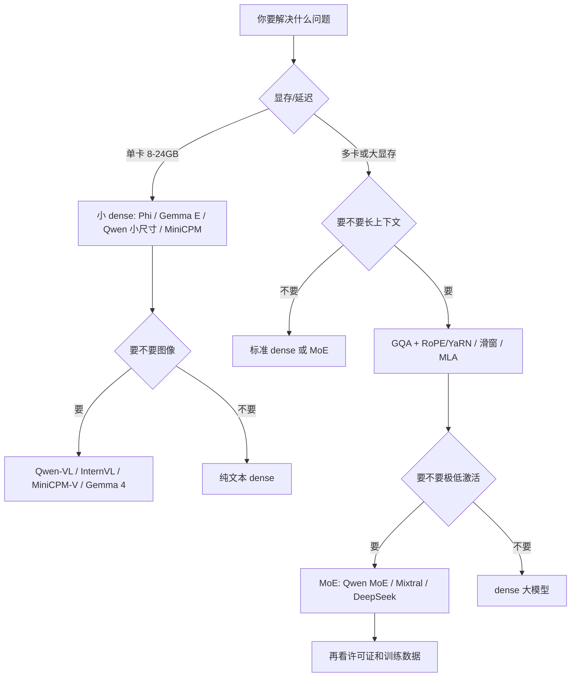

# 第 2 章 世界地图：六种骨架，而不是六个公司

> 难度：入门 · 建议 50 分钟 · 前置：第 1 章
> 学习目标：能用“骨架 / 规模 / 注意力 / 训练目标 / 模态 / 许可证”六个维度给任意开放模型定位；能画出一张不按公司分类的架构地图。

## 一句话核心

**公司是产地，架构是物种。** Llama、Qwen、Gemma、Phi 都是 decoder-only Transformer，但它们的注意力、归一化、激活、位置编码、MoE 路由、模态融合方式不同；反过来，同一个公司也会同时做 dense、MoE、线性注意力和多模态。

## 2.1 先看骨架：模型由哪几块组成

一个自回归语言模型，拆到最小，只有五块：

1. **tokenizer**：把文本切成 token，决定词表大小。
2. **embedding**：把 token id 变成向量。
3. **重复的层**：每层包含注意力 + FFN（或 MoE）+ 归一化 + 残差。
4. **输出头**：把最后一层隐藏状态映射回词表。
5. **训练目标**：下一个 token 预测，或掩码恢复，或扩散去噪。

不同家族改的，基本是第 3 块里的四个旋钮：

| 旋钮 | 可选值 | 影响 |
|---|---|---|
| 注意力 | MHA / MQA / GQA / MLA / 滑窗 / 线性 / SSM | KV cache、长上下文、吞吐 |
| FFN | dense / MoE / 共享专家 | 总参数、激活参数、显存 |
| 归一化 | LayerNorm / RMSNorm / QK-Norm | 训练稳定性、数值范围 |
| 位置 | 绝对位置 / RoPE / YaRN / iRoPE / 无位置 | 长度外推、长文本 |
| 激活 | ReLU / GELU / SwiGLU / GeGLU | 参数量、非线性 |
| 模态 | 纯文本 / 图文 / 音频 / 视频 | 编码器、连接器、token 预算 |

> 读任何模型卡，先找这六个旋钮；找不到就说明模型卡写得不完整，不是你的问题。

## 2.2 六种骨架

### A. decoder-only dense

代表：Llama 1–3、Mistral 7B、Gemma 2、Phi-4、Qwen2.5 小尺寸、Yi、Baichuan。

每层所有参数都参与每个 token 的计算。结构最简单，工程最成熟，KV cache 和算力都好估。缺点是总参数和计算量绑定：想要更强，通常要更多层/更宽，推理成本同步上涨。

### B. decoder-only MoE

代表：Mixtral、DeepSeek V2/V3/V4、Qwen3.5/3.8 大尺寸、Kimi K2/K3、GLM-5、MiniMax M3、Llama 4、Mistral Large 4。

每层有多个专家 FFN，路由器只激活 top-k 个。总参数可以很大，但每 token 只算激活的一部分。代价是显存要装下全部专家、路由和专家并行通信复杂、微调更挑数据。

### C. encoder-decoder

代表：T5、Flan-T5、BART、mT5、UL2、ByT5。

编码器双向读输入，解码器自回归生成。输入理解强，输出长度可控；但在通用对话上，decoder-only 更灵活。今天新发的“大模型”少用这条路线，仍大量用于翻译、摘要、结构化生成和检索增强。

### D. 线性注意力 / SSM / 混合

代表：RWKV、Mamba、Jamba、Griffin、xLSTM、Falcon-H1、Kimi Linear、Qwen3-Next。

把 $O(n^2)$ 的注意力换成 $O(n)$ 的递归或状态空间，长序列显存更省。代价是“精确回看任意位置”的能力被压缩到状态里；混合模型用少量全注意力层补回这一点。

### E. 多模态融合

代表：LLaVA、Qwen-VL、InternVL、Pixtral、Gemma 4、Llama 4、Janus、Chameleon、MiniCPM-V。

图像先被 ViT 切成 patch，再经连接器变成若干 token，接进语言模型。融合发生在输入端叫“早期融合”，发生在中间层叫“中期融合”，只把视觉特征当外挂叫“晚期融合”。早期融合训练更贵，但模态交互更深。

### F. 扩散语言模型

代表：LLaDA、Dream、DiffusionGemma。

不按从左到右逐个 token 生成，而是从噪声开始迭代去噪。理论上能并行生成、能全局修改；工程上训练目标、采样步数、KV cache 都不沿用 Transformer 那套。它是 2025–2026 年的新分支，不是主流，但值得知道。

## 2.3 一张按“约束”排序的地图

这张图不按公司分，按“你的约束”分。选型时先回答显存、延迟、上下文、模态，再看家族。

## 2.4 六个维度的读卡模板

拿到任意模型卡，按这个顺序填一遍：

| 维度 | 要读的字段 | 典型坑 |
|---|---|---|
| 骨架 | `architectures`、`model_type` | `LlamaForCausalLM` 和 `Qwen3_5MoeForCausalLM` 不是同一套实现 |
| 规模 | 总参数、激活参数、层数、hidden | 名字里的 `A22B` 是激活，不是总参数 |
| 注意力 | heads、KV heads、sliding window、rope | 只写了“GQA”不等于知道 KV 头数 |
| FFN | intermediate size、专家数、top-k | `num_experts` 和 `num_experts_per_tok` 容易混 |
| 上下文 | `max_position_embeddings`、`rope_scaling` | 训练长度和标称最大长度可能不同 |
| 许可证 | license、商用条款 | “open” 不是许可证 |

## 2.5 一个具体对比：同是 7B，为什么形状不同

| 模型 | 层数 | hidden | heads | KV heads | FFN | 上下文 |
|---|---|---|---|---|---|---|
| Llama 2 7B | 32 | 4096 | 32 | 32（MHA） | 11008 | 4096 |
| Mistral 7B | 32 | 4096 | 32 | 8（GQA） | 14336 | 32768（滑窗 4096） |
| Gemma 2 9B | 42 | 3584 | 16 | 8（GQA） | 14336 | 8192 |
| Qwen2.5 7B | 28 | 3584 | 28 | 4（GQA） | 18944 | 131072 |

它们都叫“7B 级”，但 KV cache、长文本能力、每层计算量完全不同。**参数规模只是体重，不是骨架。**

## 2.6 常见误解

- **“decoder-only 就是 GPT。”** 错。GPT 是早期实现之一，今天所有 Llama/Qwen/Mistral 都是 decoder-only，但细节差异很大。
- **“MoE 一定比 dense 强。”** 错。MoE 买到的是容量，不是免费能力；路由训不好、专家不均衡，效果会倒退。
- **“线性注意力一定更快。”** 只在长序列、够大的 batch 下才明显；短序列和训练前期，核函数与实现开销可能吃掉收益。
- **“多模态就是加一个 ViT。”** 连接器、token 压缩、融合层、训练数据配比都会改变效果。

## 2.7 自测

1. 用六个维度描述 Llama 3.1 8B 和 Qwen3.8 2.4T-A95B 的差别。
2. 为什么同是 7B，Mistral 7B 的 KV cache 比 Llama 2 7B 小？
3. 线性注意力和 MoE 分别解决什么问题？它们能同时用吗？
4. “早期融合”和“晚期融合”各有什么代价？
5. 如果显存只有 24GB，想跑长上下文，优先看哪几个结构特征？

> 参考答案：1）前者 dense/MHA?（实际 GQA 8 KV）/RoPE/128K；后者 MoE/4 KV/262K/多模态；2）Mistral 用 8 个 KV 头，Llama 2 是 32 个；3）线性注意力解决序列长度，MoE 解决参数容量与激活算力；可以，Kimi/Qwen3-Next 就是混合；4）早期融合交互深但训练贵，晚期融合便宜但模态交互浅；5）GQA/MLA、RoPE/YaRN、滑窗或线性注意力、量化。

## 2.8 复习锚点

- 六旋钮：注意力、FFN、归一化、位置、激活、模态。
- 六骨架：dense、MoE、encoder-decoder、线性/SSM、多模态、扩散。
- 读卡六维：骨架、规模、注意力、FFN、上下文、许可证。
- 下一章：从 Llama 开始，看一条 decoder-only 主线怎么演进。
