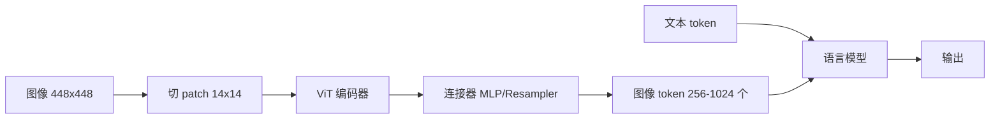

# 第 12 章 多模态开放模型：图像怎么变成 token

> 难度：中高 · 建议 70 分钟 · 前置：第 4、6、11 章
> 学习目标：能画出“视觉编码器 → 连接器 → 语言模型”的三段式；能区分早期融合、晚期融合、双系统；能算图像 patch 数与 token 预算；能列出 LLaVA、Qwen-VL、InternVL、Pixtral、Gemma 4、Llama 4、Janus 的差异。

## 一句话核心

多模态不是“加一个 ViT”就完了。图像先被切成 patch，经视觉编码器变成特征，再由连接器压缩成若干 token，最后和文本 token 一起进语言模型。**融合发生在哪一层、图像 token 压到多少、视觉塔训不训，决定了模型的能力和成本。**

## 12.1 三段式

### 视觉编码器

常见是 ViT（CLIP/SigLIP/InternViT）。它把图像切成 $P\times P$ 的 patch，每个 patch 展平成向量，过若干 Transformer 层。输出 patch 特征。

### 连接器

- **MLP**：把每个 patch 特征线性投到语言模型维度；简单、token 多。
- **Resampler / Q-Former**：用固定数量的查询向量把变长 patch 压成固定 token；省 token，但丢细节。
- **Cross-attention**：语言模型层直接对视觉特征做交叉注意力；融合深，工程复杂。

### 语言模型

图像 token 和文本 token 拼成一个序列，走同一个 decoder。图像 token 也占上下文、也进 KV cache。

## 12.2 四种融合路线

| 路线 | 代表 | 融合层 | 优点 | 缺点 |
|---|---|---|---|---|
| 晚期融合 / 外挂 | LLaVA、InternVL、Pixtral、MiniCPM-V | 输入端拼 token | 实现简单、可复用 LLM | 视觉-语言交互浅 |
| 早期融合 | Llama 4、Chameleon、Gemma 4 Unified | 早期层拼 token | 交互深、可统一训练 | 训练贵、数据配比难 |
| 双系统 | Janus / Janus-Pro | 理解头 + 生成头 | 理解与生成解耦 | 两套头、训练复杂 |
| 任意到任意 | Gemma 4 12B、Qwen2.5-Omni、MiniCPM-o | 文本/图/音统一序列 | 模态交互最全 | token 预算、编码器多 |

## 12.3 代表模型

| 模型 | 视觉塔 | 连接器 | 语言模型 | 备注 |
|---|---|---|---|---|
| LLaVA-1.5 7B | CLIP ViT-L/14 | 2 层 MLP | Vicuna/LLaMA 7B | 经典外挂式 |
| Qwen2.5-VL 7B/72B | ViT + 动态分辨率 | MLP/Resampler | Qwen2.5 | M-RoPE、视频 |
| Qwen3-VL | ViT | 连接器 | Qwen3 | 更强 OCR/视频 |
| InternVL 2.5/3 | InternViT-6B | MLP | InternLM/Qwen | 动态 tiling |
| Pixtral 12B | Pixtral ViT | MLP | Mistral 12B | 2D RoPE |
| Gemma 3 27B | SigLIP 类 | 投影 | Gemma 3 | 128K、视觉 |
| Gemma 4 12B | 统一视觉塔 | 统一 | Gemma 4 | any-to-any |
| Llama 4 Scout/Maverick | 早期融合 | 早期拼 token | Llama 4 | 图文 |
| Janus-Pro 7B | 理解/生成双头 | 双系统 | 7B | 图像生成 |
| MiniCPM-V 4.7 | 视觉塔 | Resampler | MiniCPM | 35B-A3B |
| Molmo 7B/72B | CLIP? | 连接器 | OLMo/Qwen | AI2 开放 |

> 表中视觉塔/连接器的具体型号在不同版本会变；读模型卡时以“视觉编码器名称 + 连接器类型 + 输入分辨率”为准。

## 12.4 图像 token 预算

一张 $448\times448$ 的图，patch 14：

$$
N=\left(\frac{448}{14}\right)^2=32^2=1024
$$

1024 个 patch，每个 patch 一个 token，就是 1024 个图像 token。若做 2×2 合并：

$$
1024/4=256\ \text{token}
$$

若动态分辨率 1024×1024、patch 14：

$$
(1024/14)^2\approx73^2=5329\ \text{patch}
$$

再 2×2 合并 ≈1332 token。**高分辨率 OCR 的 token 成本是平方涨的。**

### KV 成本

图像 token 和文本 token 一样进 KV。以 Qwen3.8-27B 为例，每 token 0.25 MiB：

- 256 图像 token：64 MiB；
- 1024 图像 token：256 MiB；
- 4096 图像 token：1 GiB。

一张图看似小，几十张图就吃掉几 GB KV。

## 12.5 动态分辨率与 tiling

InternVL 的 dynamic tiling：把大图切成多个 448×448 tile，每个 tile 单独过 ViT，再拼起来。好处是高分辨率细节；坏处是 token 数随 tile 数线性涨。

Qwen2-VL/Qwen2.5-VL 用动态分辨率 + M-RoPE（多模态旋转位置），让不同长宽比的图像有自己的位置编码。Qwen3-VL 继续加强 OCR/视频。

## 12.6 早期融合：Llama 4 与 Gemma 4

- **Llama 4**：图像 token 在较早层进入语言模型，视觉和语言一起训练；官方叫 early fusion。
- **Gemma 4 12B**：`Gemma4UnifiedForConditionalGeneration`，文本/图像/音频统一进一个自回归序列，模型卡标 any-to-any。
- **Chameleon**：把图像离散化成 token，和文本同一词表；真正“一个 Transformer 处理所有模态”。代价是视觉 tokenization 复杂、图像生成质量难。

早期融合的训练成本高：视觉塔和语言模型一起更新，数据配比、冻结策略、分辨率都要调。晚期融合更容易复用现成 LLM，但模态交互浅。

## 12.7 Janus：双系统

Janus/Janus-Pro 把“理解”和“生成”分开：

- 理解头：视觉编码器 + 语言模型，做图文问答；
- 生成头：用离散图像 token 做自回归生成。

好处是理解不被生成目标拖累，生成不被理解目标拖累；坏处是两套头、两套训练，部署更复杂。

## 12.8 常见误解

- **“图像 token 不占上下文。”** 占，而且和文本 token 一样进 KV。
- **“分辨率越高越好。”** token 平方涨，KV 和延迟都涨；OCR 要分辨率，普通问答 256–1024 token 就够。
- **“多模态模型一定能生成图。”** 大多数只能理解；生成要看是否有图像生成头（Janus、Qwen-Image 等）。
- **“视觉塔越大越好。”** 视觉塔参数量和 token 数要跟语言模型匹配；6B 视觉塔 + 7B LLM 可能头重脚轻。

## 12.9 自测

1. 画出“图像 → patch → ViT → 连接器 → LLM”的流程。
2. 448×448、patch 14，图像 token 数是多少？2×2 合并后呢？
3. 晚期融合和早期融合各有什么代价？
4. Janus 的双系统解决什么问题？
5. 1024 个图像 token 在 Qwen3.8-27B 下占多少 KV？

> 参考答案：1）见 12.1；2）1024，合并后 256；3）晚期融合交互浅但便宜，早期融合交互深但训练贵；4）理解与生成解耦，避免目标冲突；5）0.25 MiB×1024=256 MiB。

## 12.10 复习锚点

- 三段式：视觉编码器 → 连接器 → 语言模型。
- 四种融合：晚期、早期、双系统、any-to-any。
- Token 公式：$(H/P)\times(W/P)$，合并除以 $m^2$。
- 代表：LLaVA、Qwen-VL、InternVL、Pixtral、Gemma 4、Llama 4、Janus。
- 下一章：注意力与长上下文，把 KV 账算到底。
