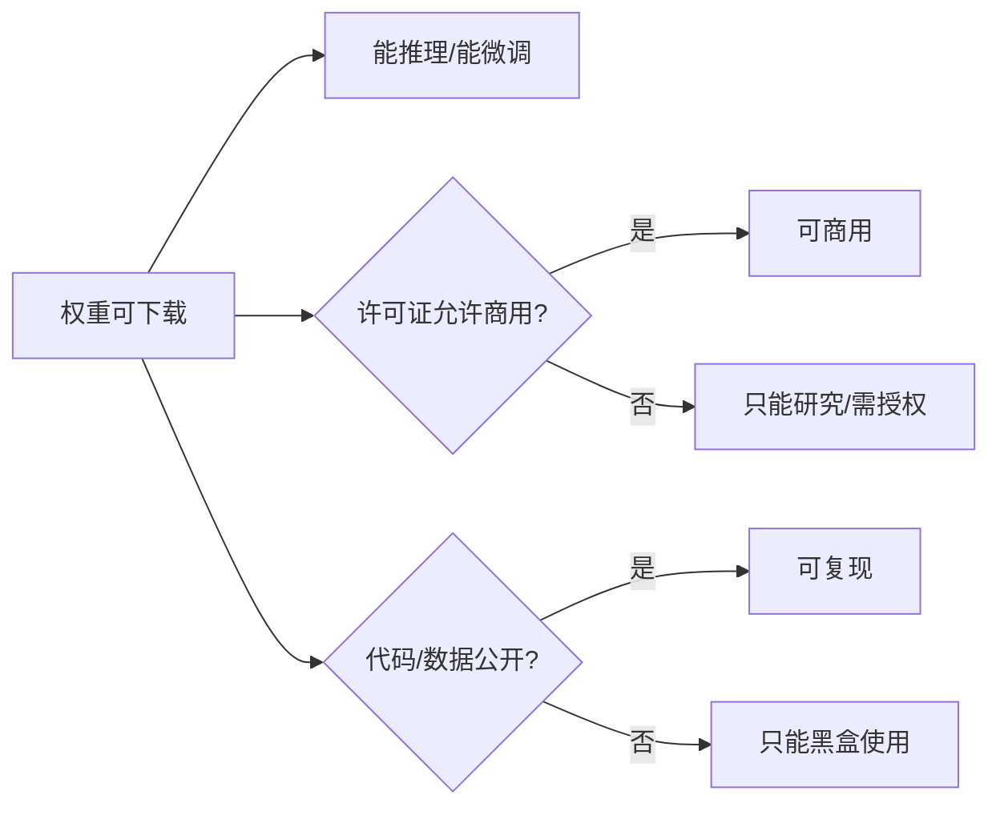

# 开放权重与开源

- **难度**：基础 | **涉及章节**：第 1、8、9 章

## 一句话定义

开放权重指模型参数可下载；开源还要求代码、许可证、数据/训练流程足以复现。大多数“开源大模型”只是开放权重。

## 为什么重要

这决定了你能不能商用、能不能改、能不能复现训练。把两者混为一谈，会在选型和合规上同时踩坑。

## 图示

## 详解

权重是模型参数文件；代码是结构/推理/训练实现；数据是预训练语料与配比。三者可以分开开放。OLMo/Pythia 开放三层；Llama/Gemma 只开放权重和部分代码；Command R+ 开放权重但禁止商用。

## 常见误解

- “Hugging Face 能下载就是开源”——下载只代表权重可获取。
- “Apache 2.0 就是随便用”——要保留声明、注意专利/商标。
- “模型卡写了 architecture 就是架构开源”——架构描述不等于可运行训练代码。

## 相关概念

- 前置：模型、权重、许可证
- 后续：许可证族、模型卡审计
