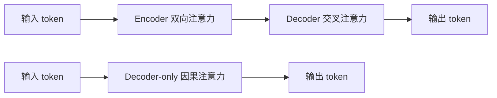

# decoder-only 与 encoder-decoder

- **难度**：基础 | **涉及章节**：第 2、8 章

## 一句话定义

decoder-only 只用自回归解码器，按下一个 token 预测训练；encoder-decoder 先用编码器双向读输入，再用解码器生成输出。

## 为什么重要

今天大多数开放大模型是 decoder-only，但翻译、摘要、结构化生成仍有 encoder-decoder 的位置。看懂骨架才知道为什么有的模型不能做双向注意力。

## 图示

## 详解

decoder-only 每层用因果掩码，token 只能看左边；训练目标简单，生成灵活，容易扩展到多模态。encoder-decoder 的编码器没有因果掩码，能看全输入；解码器通过交叉注意力读编码器输出，适合输入理解强、输出长度可控的任务。

T5/Flan-T5/BART/mT5/UL2 是 encoder-decoder 代表；Llama/Qwen/Mistral/Gemma 是 decoder-only。

## 常见误解

- “decoder-only 就是 GPT，GPT 就是唯一实现”——今天所有 Llama 式模型都是 decoder-only，但细节不同。
- “encoder-decoder 过时了”——通用对话少了，翻译/摘要/检索增强仍在用。
- “decoder-only 不能看全输入”——它把输入当前缀，因果掩码仍然只能看左边；要做双向理解需额外设计。

## 相关概念

- 前置：注意力、因果掩码
- 后续：多模态融合、T5/BART
