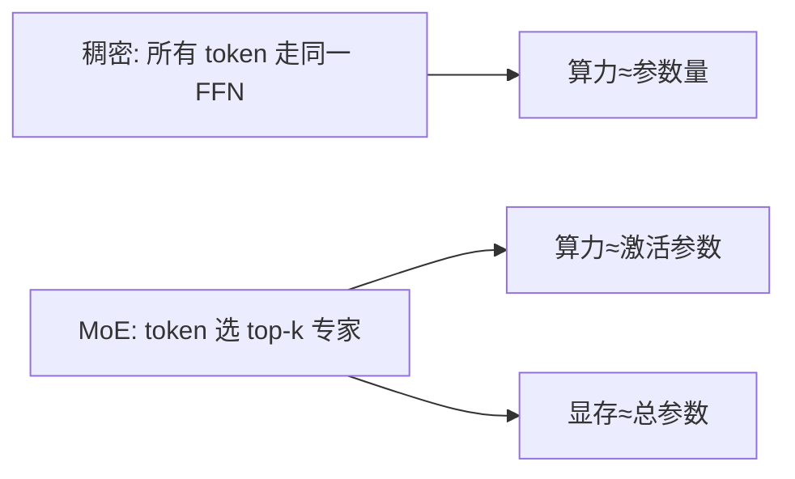

# 稠密与 MoE

- **难度**：基础 | **涉及章节**：第 11 章

## 一句话定义

稠密模型每个 token 都走同一套 FFN；MoE 把 FFN 拆成多个专家，每个 token 只走 top-k 个。

## 为什么重要

这是理解“总参数 2.4T、激活 95B”这类数字的前提。MoE 是容量与算力解耦的核心手段。

## 图示

## 详解

稠密 FFN 是一个固定矩阵，所有 token 都过它；参数量多大，每 token 矩阵乘就多大。MoE 有多个专家，门控选 top-k，总参数包含所有专家，显存要全装；但每 token 只算被选中的专家。

MoE 的代价是路由、负载均衡、专家并行通信；收益是同算力下容量更大。它适合显存宽裕、算力紧张的场景，不适合显存受限的单机。

## 常见误解

- “MoE 每个 token 都算所有专家”——只算 top-k。
- “总参数大就一定慢”——算力看激活参数，但显存/通信会拖后腿。
- “专家越多越好”——路由组合爆炸、负载不均、通信成本都会上升。

## 相关概念

- 前置：FFN、门控
- 后续：总参数与激活参数、专家并行
