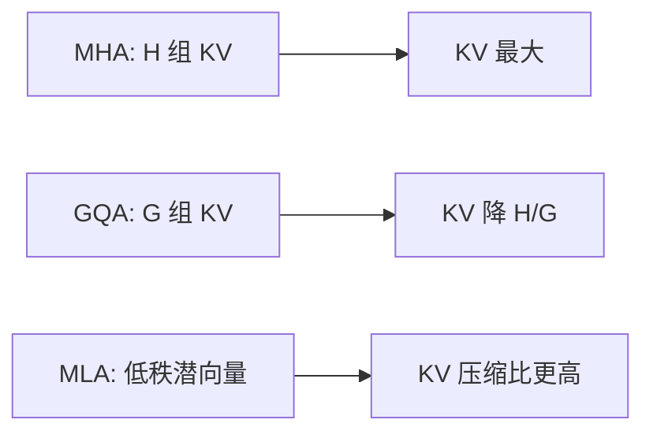

# MHA、GQA 与 MLA

- **难度**：中高 | **涉及章节**：第 13 章

## 一句话定义

MHA 每个 Q 头有独立 K/V；GQA 让多组 Q 头共享 K/V；MLA 把 K/V 压成低秩潜向量再投影。

## 为什么重要

长上下文的第一成本是 KV cache。注意力的 KV 结构直接决定 128K/1M 能不能部署。

## 图示

## 详解

KV/token/layer 的公式是 $2\times H_{kv}\times d_{head}\times b$。MHA 的 $H_{kv}=H$；MQA 的 $H_{kv}=1$；GQA 的 $H_{kv}=G<H$。Llama 3.3 70B 是 64 Q/8 KV；Qwen3.8 27B 是 24 Q/4 KV；Gemma 3 27B 是 32 Q/16 KV。

MLA 不直接存 K/V，而是存低秩潜向量 $c_t$，推理时投影出 K/V；DeepSeek V2/V3 用。它把 KV 从每层 $2Hd_{head}$ 降到 $d_c$ 量级，但实现复杂、有低秩信息损失。

## 常见误解

- “KV 头数等于 Q 头数”——只有 MHA 是。
- “GQA 一定比 MHA 差”——多数模型用 GQA 换长上下文/吞吐，效果靠训练补。
- “MLA 是免费压缩”——低秩压缩有损失，需要训练设计配合。

## 相关概念

- 前置：注意力、KV cache
- 后续：RoPE/YaRN、长上下文
