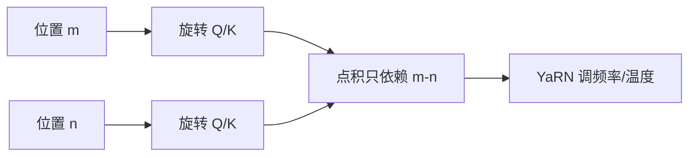

# RoPE 与 YaRN

- **难度**：中高 | **涉及章节**：第 13 章

## 一句话定义

RoPE 把 Q/K 按位置旋转，让注意力只看相对位置；YaRN 改旋转频率/温度，把训练长度外推到更长。

## 为什么重要

模型标称 128K/1M，不等于训练过那么长。RoPE 缩放决定“能不能外推”，也影响长文本退化。

## 图示

## 详解

二维旋转：$R_{\theta,m}$ 把向量按 $m\theta$ 旋转。注意力分数只依赖 $m-n$，所以是相对位置。YaRN 通过 `factor`、`original_max_position_embeddings`、`beta_fast/beta_slow` 改频率，把 8K 训练外推到 64K/128K。

外推不是免费：超过训练分布，注意力会退化；通常要长文本继续训练。Qwen3.5/3.8 直接训到 262K，Llama 3.1 用 `llama3` 类型缩放 8K→128K。

## 常见误解

- “max_position_embeddings 就是训练长度”——可能是外推后的标称值。
- “factor 越大越好”——外推过头会退化。
- “RoPE 是绝对位置编码”——它是相对位置，通过旋转实现。

## 相关概念

- 前置：注意力、位置编码
- 后续：长上下文、滑窗
