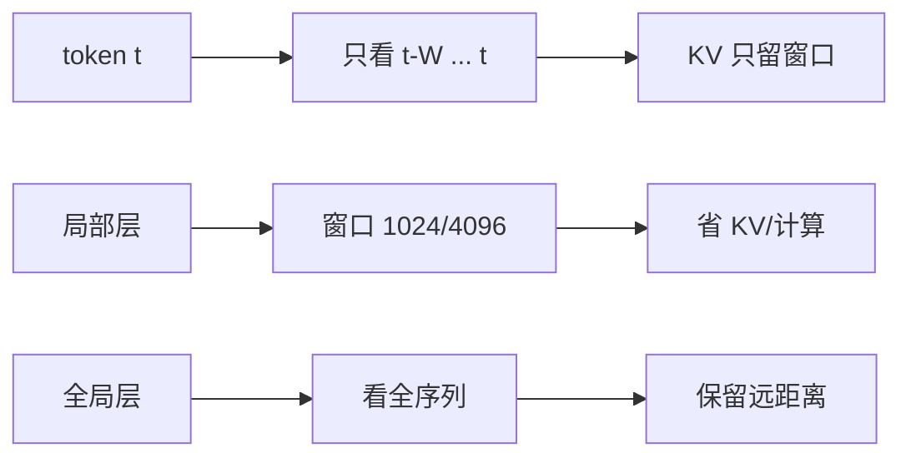

# 滑窗与局部/全局交替

- **难度**：中高 | **涉及章节**：第 5、6 章

## 一句话定义

滑窗让每个 token 只看最近 W 个 token；局部/全局交替让多数层看局部、少数层看全局。

## 为什么重要

它把长上下文的 KV 和计算从“全序列”降到“窗口”，是 Mistral/Gemma 长上下文的核心手段。

## 图示

## 详解

Mistral 7B 用 4096 滑窗，序列超过窗口后旧 token 滚出；KV 只保留窗口。Gemma 2 约 1:1 局部/全局，Gemma 3 是 5:1（每 6 层 1 层全局），局部窗口 1024。局部层省成本，全局层补远距离。

代价：不能精确回看窗口外原文；全局层仍是长上下文瓶颈。

## 常见误解

- “滑窗模型能精确检索 32K 前的原文”——不能，只靠层间传递。
- “局部/全局就是两种注意力二选一”——是交替堆叠。
- “窗口越小越好”——太小会丢上下文，效果退化。

## 相关概念

- 前置：注意力、KV cache
- 后续：长上下文、稀疏注意力
