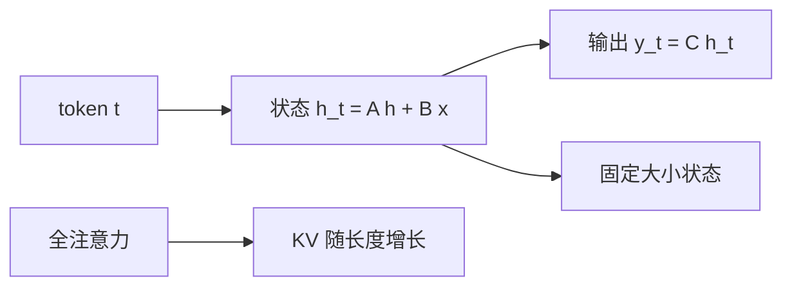

# 线性注意力与 SSM

- **难度**：中高 | **涉及章节**：第 10 章

## 一句话定义

线性注意力用核函数/递归状态替代 softmax 两两注意力；SSM 用固定状态递推 $h_t=Ah_{t-1}+Bx_t$。两者都把序列复杂度降到 $O(n)$。

## 为什么重要

长序列的 $O(n^2)$ 注意力和 KV 是瓶颈；线性/SSM 是替代路线，Kimi/Qwen3-Next/Falcon-H1 都在用混合版本。

## 图示

## 详解

SSM 每来一个 token 只更新固定维度状态，不保存全部 K/V；Mamba 的“选择性”让 B/C/Δ 由输入决定，能选择记住/忘记。线性注意力用核函数把 $QK^\top V$ 变成 $Q(K^\top V)$，先算 KV 再乘 Q，复杂度 $O(n)$。

代价：状态容量固定，精确回看弱；混合架构用少量全注意力层补回。

## 常见误解

- “线性注意力一定更快”——短序列/训练前期可能被核函数开销吃掉。
- “Mamba 不能检索”——它能选择性记忆，只是不能精确回看所有位置。
- “非 Transformer 就没有注意力”——混合模型仍保留全注意力层。

## 相关概念

- 前置：注意力、RNN
- 后续：Jamba、Kimi Linear、Qwen3-Next
