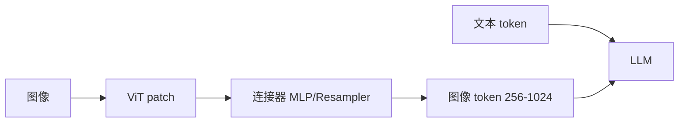

# 多模态连接器

- **难度**：中高 | **涉及章节**：第 12 章

## 一句话定义

连接器把视觉/音频编码器的特征压成语言模型能吃的 token，常见 MLP、Resampler/Q-Former、交叉注意力。

## 为什么重要

多模态不是“加个 ViT”就完了；连接器决定图像 token 数、融合深度和训练成本。

## 图示

## 详解

MLP 把每个 patch 特征投到 LLM 维度，token 多、细节保留好；Resampler 用固定查询把变长 patch 压成固定 token，省 token 但丢细节；交叉注意力在 LLM 层直接读视觉特征，融合深但工程复杂。

图像 token 和文本 token 一样进 KV。448×448、patch 14 是 1024 token；2×2 合并后 256。动态分辨率/ tiling 会让 token 数平方涨。

## 常见误解

- “图像 token 不占上下文”——占，而且进 KV。
- “分辨率越高越好”——token 和 KV 平方涨。
- “多模态都能生成图”——多数只理解；生成要看生成头。

## 相关概念

- 前置：ViT、注意力
- 后续：LLaVA、Qwen-VL、Janus
