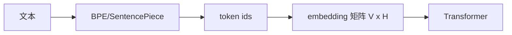

# Tokenizer 与词表

- **难度**：基础 | **涉及章节**：第 15 章

## 一句话定义

Tokenizer 把文本切成 token，词表大小决定 embedding/输出头参数量和语言覆盖。

## 为什么重要

词表影响参数量、推理速度、中文/代码切分质量。Llama 3 从 32K 词表换到 128K，是为了提高压缩率和多语言效率。

## 图示

## 详解

词表 $V$ 越大，embedding 和输出头越大（$VH$），但同样文本的 token 数可能更少。Llama 3 128K 词表、Qwen 151K/248K、Gemma 256K/262K、DeepSeek 128K。中文模型通常词表更大，减少中文被切碎。

## 常见误解

- “词表越大越好”——embedding 参数和 softmax 变大，小模型不划算。
- “同一个文本在不同模型 token 数一样”——tokenizer 不同，token 数不同。
- “tokenizer 不影响架构”——它决定输入长度和输出头大小。

## 相关概念

- 前置：embedding、softmax
- 后续：参数量估算、多语言
