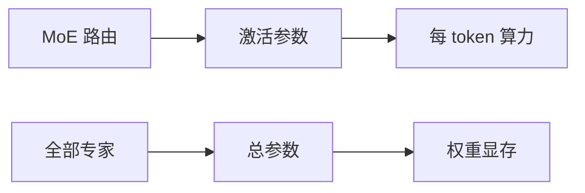

# 总参数与激活参数

- **难度**：基础 | **涉及章节**：第 11 章

## 一句话定义

总参数是模型全部权重，决定显存；激活参数是每 token 实际参与计算的权重，决定算力。

## 为什么重要

`2.4T-A95B`、`671B/37B`、`109B/17B` 这些写法都要求你分开读；混了就会估错显存和成本。

## 图示

## 详解

稠密模型总参数=激活参数。MoE 总参数包含所有专家，激活只含 top-k 专家 + 注意力/embedding。Qwen3.8-2.4T-A95B：2.4T 总、95B 激活，比例约 4%。Llama 4 Scout：109B 总、17B 激活，比例约 15.6%。

显存按总参数估（FP16 每 B 约 2GB），算力按激活参数估；但 MoE 还有专家并行通信和路由开销。

## 常见误解

- “A95B 是总参数”——A 是 active。
- “MoE 显存按激活算”——权重全装，按总参数。
- “激活小就一定快”——通信/路由/显存带宽可能拖后腿。

## 相关概念

- 前置：MoE、FFN
- 后续：专家并行、部署
