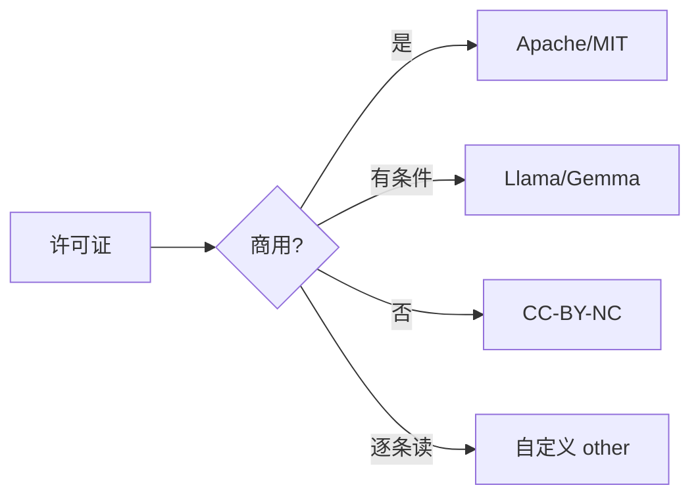

# 许可证族

- **难度**：基础 | **涉及章节**：第 1、8、9、14 章

## 一句话定义

许可证决定你能不能商用、修改、再分发；Apache/MIT 最宽松，Llama/Gemma 有条件，CC-BY-NC 禁止商用，自定义 `other` 逐条读。

## 为什么重要

模型再好，许可证不允许商用就不能上线；这是选型的第一道门。

## 图示

## 详解

Apache 2.0 允许商用/修改/再分发，有专利授予；MIT 更短更宽松；Llama Community 有月活/命名/衍生条款；Gemma Terms 不是 OSI 认证；CC-BY-NC 禁止商用；`other` 可能是研究许可、社区许可、自定义商用限制。

## 常见误解

- “open weights 就是开源许可证”——不是。
- “Apache 2.0 不用署名”——要保留声明/NOTICE。
- “CC-BY-NC 可以内部商用”——NC 通常禁商用，内部商用也算。

## 相关概念

- 前置：开放权重
- 后续：模型卡审计、合规
