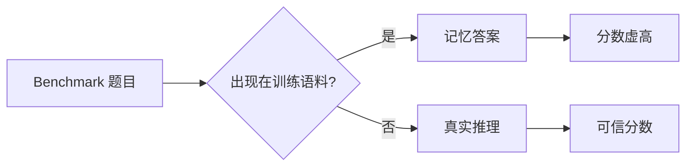

# Benchmark 污染

- **难度**：中高 | **涉及章节**：第 14 章

## 一句话定义

评测题出现在预训练/微调数据里，模型靠记忆而不是推理得分；排行榜分数因此失真。

## 为什么重要

开放模型常报 MMLU/GSM8K/HumanEval 分数；不查污染，选型会被“高分低能”骗。

## 图示

## 详解

检测方法：看模型卡是否报告 decontamination；用改写/换数字/换语境的题重测；对比新题与原题分数；检查训练数据 n-gram 重叠。公开 benchmark 越老，污染风险越高。

## 常见误解

- “排行榜第一就是最强”——任务/数据/评测方法不同。
- “模型卡说去污染就干净”——方法可能不彻底。
- “分数高就能上线”——还要看你的任务分布。

## 相关概念

- 前置：训练/测试集、评测指标
- 后续：模型选型、LLM-as-judge
