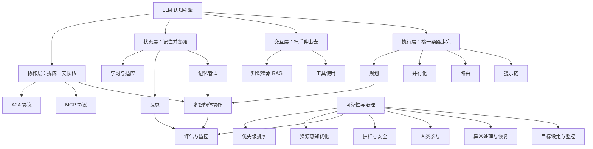

# 智能体设计模式 · 点化学习系统

## 这本书在讲什么

这本书回答一个问题：把一个能聊天的 LLM 变成能可靠干活的智能体系统，中间缺的那些结构该长什么样。作者的答案是 21 个可复用的设计模式，按"执行与任务分解、与外部环境交互、状态与自我提升、协作与沟通"四类归位。全书的主线不是让模型更聪明，而是用工程结构把模型的认知能力约束成可预测的行为。

## 全书心智模型

看图说明：左列是"一个智能体自己怎么办事"，右列是"多个智能体怎么配合"，底部是"出问题时怎么兜住"。箭头只画真实依赖：规划是多智能体协作的前置，记忆管理是多智能体共享上下文的前置，反思的产出是评估要量化的对象。

## 学习路径（推荐顺序）

| 步骤 | 章节 | 主题 | 前置 | 检查点 |
|---|---|---|---|---|
| 01 | ch00 | 导论：什么是智能体系统 | 无 | 能说出 Level 0 到 Level 3 的差别 |
| 02 | ch01 | 提示链 | ch00 | 能画出一条两步链并说明每一步的输出契约 |
| 03 | ch02 | 路由 | ch01 | 能判断一个需求该用路由还是提示链 |
| 04 | ch03 | 并行化 | ch02 | 能区分截面并行与投票并行 |
| 05 | ch05 | 工具使用（函数调用） | ch01 | 能写出一个带参数校验的工具描述 |
| 06 | ch04 | 反思 | ch05 | 能说清"检查你的工作"和"内部批评者"的差别 |
| 07 | ch06 | 规划 | ch04 | 能说清 ReAct 与显式计划列表的适用边界 |
| 08 | ch14 | 知识检索 RAG | ch05 | 能解释向量检索为什么比关键词检索更抗同义改写 |
| 09 | ch08 | 记忆管理 | ch06 | 能区分短期上下文与长期记忆的存储策略 |
| 10 | ch11 | 目标设定与监控 | ch08 | 能设计一个带可验证判据的目标 |
| 11 | ch12 | 异常处理与恢复 | ch11 | 能写出重试、降级、上报三种策略的触发条件 |
| 12 | ch13 | 人类参与 | ch11 | 能指出四个必须插入人类审批的节点 |
| 13 | ch20 | 优先级排序 | ch11 | 能给出一套带权重的任务排序规则 |
| 14 | ch16 | 资源感知优化 | ch20 | 能估算一次任务调用的 token 预算 |
| 15 | ch07 | 多智能体协作 | ch06、ch08 | 能画出协调者与专家的分工图 |
| 16 | ch10 | 模型上下文协议 MCP | ch05 | 能说清 MCP 解决的是 N×M 接口爆炸 |
| 17 | ch15 | 智能体间通信 A2A | ch07、ch10 | 能说明消息总线与直连的取舍 |
| 18 | ch09 | 学习与适应 | ch04、ch08 | 能区分上下文内学习与权重更新 |
| 19 | ch17 | 推理技术 | ch06 | 能对比 CoT、ToT、ReAct 的代价 |
| 20 | ch18 | 护栏与安全模式 | ch13 | 能列出输入、工具、输出三层护栏 |
| 21 | ch19 | 评估与监控 | ch04 | 能设计结果导向与过程导向两类指标 |
| 22 | ch21 | 探索与发现 | ch20 | 能说出探索预算和收敛判据 |
| 23 | ch24 | 附录 A：高级提示工程 | ch17 | 能写出一个带示例轨迹的系统提示 |
| 24 | ch22、ch23、ch25 | 收尾：结论、术语、附录速览 | 全部 | 能用一个真实项目串起五个模式 |

## 章节索引

- ch00 导论：什么是智能体系统（★☆☆）→ chapters/ch00-introduction.md
- ch01 提示链（★☆☆）→ chapters/ch01-prompt-chaining.md
- ch02 路由（★☆☆）→ chapters/ch02-routing.md
- ch03 并行化（★★☆）→ chapters/ch03-parallelization.md
- ch04 反思（★★☆）→ chapters/ch04-reflection.md
- ch05 工具使用（★★☆）→ chapters/ch05-tool-use.md
- ch06 规划（★★★）→ chapters/ch06-planning.md
- ch07 多智能体协作（★★★）→ chapters/ch07-multi-agent.md
- ch08 记忆管理（★★★）→ chapters/ch08-memory.md
- ch09 学习与适应（★★★）→ chapters/ch09-learning.md
- ch10 模型上下文协议（★★☆）→ chapters/ch10-mcp.md
- ch11 目标设定与监控（★★☆）→ chapters/ch11-goal-setting.md
- ch12 异常处理与恢复（★★☆）→ chapters/ch12-exception-handling.md
- ch13 人类参与环节（★★☆）→ chapters/ch13-human-in-the-loop.md
- ch14 知识检索 RAG（★★★）→ chapters/ch14-rag.md
- ch15 智能体间通信（★★★）→ chapters/ch15-a2a.md
- ch16 资源感知优化（★★★）→ chapters/ch16-resource-aware.md
- ch17 推理技术（★★★）→ chapters/ch17-reasoning.md
- ch18 护栏与安全模式（★★★）→ chapters/ch18-guardrails.md
- ch19 评估与监控（★★★）→ chapters/ch19-evaluation.md
- ch20 优先级排序（★★☆）→ chapters/ch20-prioritization.md
- ch21 探索与发现（★★★）→ chapters/ch21-exploration.md
- ch22 结论：模式怎么组合（★☆☆）→ chapters/ch22-conclusion.md
- ch23 术语表与常见问题（★☆☆）→ chapters/ch23-glossary-faq.md
- ch24 附录 A：高级提示工程（★★☆）→ chapters/ch24-appendix-a-prompt-engineering.md
- ch25 附录 B-G 速览（★★☆）→ chapters/ch25-appendix-bg.md

## 前置知识（大二基线缺口补讲）

| 缺口 | 对应补讲位置 | 学完标志 |
|---|---|---|
| 什么是 token、上下文窗口为什么有限 | ch00 零基础讲解 + glossary | 能解释"超出窗口的信息会被忽略" |
| 向量、余弦相似度 | ch14 精讲第 2 节 | 能手算两个三维向量的余弦相似度 |
| 概率采样与 temperature | ch01 常见误解 + ch17 | 能解释 temperature 为什么影响可复现性 |
| 状态机与有向图 | ch01、ch06 | 能把一条链画成 DAG 并找出可并行的分支 |
| HTTP / JSON / 函数签名 | ch05、ch10 | 能写出一个合法的工具 JSON Schema |
| 分布式系统的重试与幂等 | ch12 | 能解释为什么重试必须配幂等键 |

## 术语表 / 模式库 / 速查表

- 术语表：glossary.md（77 条，含书中原义与大二白话解释）
- 模式库：patterns.md（21 个模式 + 8 条决策规则 + 11 个反模式）
- 测验：quiz.md（58 题，含 6 道综合题 + 1 个项目式最终检验）
- 抽认卡：flashcards.md（52 张，每章 2 张）
- 学习路径：paths/learn.md（12 步，按依赖拓扑而非书序）
- 概念页：concepts/（11 篇跨章概念）
- 速查表：cheatsheet.md（参数表、判据表、常见错误对照）
