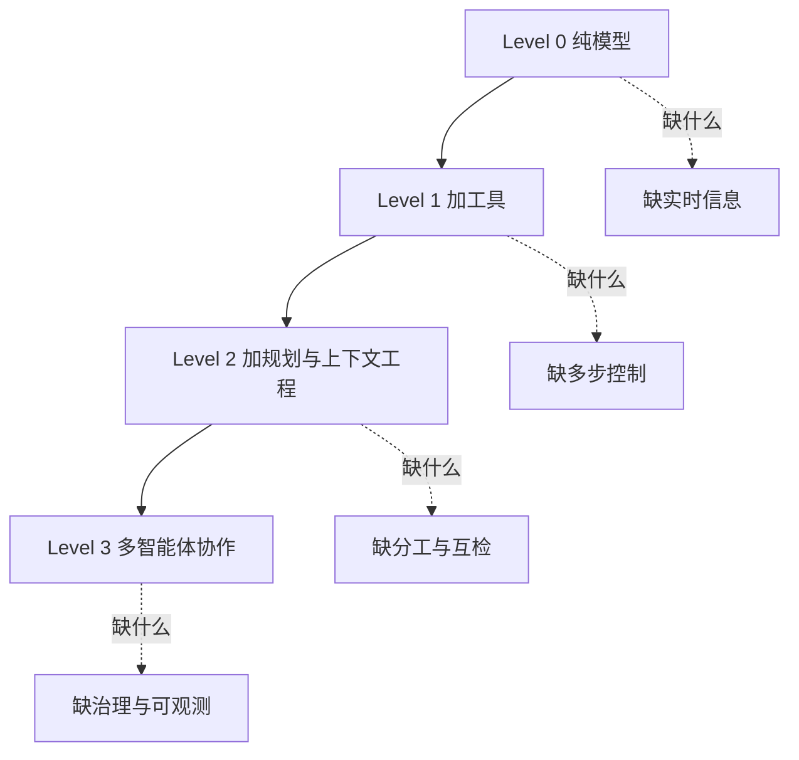

# 第 0 章：导论——什么是智能体，为什么要用设计模式

- **难度**：★☆☆ | **预估学时**：1 小时 | **前置**：无

## 学习目标

学完本章，你能：
1. 用五个特征说出智能体与传统程序的区别。
2. 按自主程度给智能体分级（Level 0 到 Level 3），并对一个真实产品定位。
3. 解释"设计模式"在这本书里的具体含义，以及它为什么不是可以随便套的模板。

## 一句话核心

智能体 = 认知引擎（LLM）+ 架构（状态、工具、通信、控制流）。前者决定它"能懂多少"，后者决定它"能靠得住多少"——这本书讲的 21 个模式，全部在解决后一半问题。

## 零基础讲解

### 概念 1：智能体的五个特征（难度：基础）

书里的定义是：能感知环境、依据感知与目标做决策、自主执行动作以达成目标的系统。与传统软件的区别落在五个特征上：

1. **自主性**：不需要每步都等人指令；
2. **主动性**：会主动采取行动推进目标，而不是只应答；
3. **响应性**：能对环境变化做出反应；
4. **工具使用**：能调外部 API、数据库、服务，突破自身限制；
5. **记忆与通信**：能跨交互保留信息，能与其他系统或智能体交流。

**一个具体对比**：传统客服系统按固定脚本走；智能体客服能识别问题的细微差别、查知识库、调订单系统、主动反问澄清、预判后续需求。

**类比**：自动售货机 vs 便利店店员。售货机按按钮出货（固定流程）；店员会看你要什么、缺货时推荐替代品、记着上次你买过什么。失效边界：店员有常识和责任，智能体没有——所以第 13、18 章要补"人在环"和"护栏"。

### 概念 2：四层自主等级（难度：基础）

书里用 Level 0~3 描述复杂度，这个分级很实用：

| 等级 | 名称 | 有什么 | 典型局限 |
|---|---|---|---|
| Level 0 | 核心推理引擎 | 只有 LLM | 不知道训练数据之后的事 |
| Level 1 | 连接型问题解决者 | 加工具（搜索、RAG、API） | 不会多步规划，容易跑偏 |
| Level 2 | 战略型问题解决者 | 加规划 + 上下文工程 | 状态管理复杂，错误会累积 |
| Level 3 | 多智能体系统 | 加协作、分工、评审 | 通信成本、一致性问题 |

**用法**：拿到一个需求先定位它在哪一级。很多被描述为"要智能体"的需求，其实 Level 1 就够（查数据 + 汇总）；直接上 Level 3 会付出几倍成本换来一点提升。

**书里对 Level 2 的描述值得注意**：它强调"上下文工程"——为每一步战略性筛选、打包、管理最相关的信息。举例：查两地之间的咖啡馆，先用地图工具拿到街道名，**精简后**再传给本地搜索工具，避免信息过载。这个"裁剪"动作是 Level 2 与 Level 1 的实际分界线。

### 概念 3：为什么需要"模式"（难度：进阶）

书里把构建智能体比作在"画布"上创作：画布 = 底层基础设施（状态管理、通信、工具访问、流程控制）。

模式是**经过验证的可复用解法**，作用有三：
1. **不重复造轮子**：对话流程、工具集成、多智能体协作这些基础问题已有成熟做法；
2. **提供通用语言**：团队说"这里用路由"，比说"这里加个 if 判断让模型自己选"更清楚；
3. **直接提升健壮性**：错误处理、状态管理类的模式本身就是可靠性设计。

**但要警惕一个误读**：模式不是"必须用的清单"。书里每个模式都附带适用场景与限制，用错了比不用更糟——比如只有 3 个工具就上 MCP（第 10 章），只有一条路径就上多智能体（第 7 章）。

### 概念 4：全书的地图（难度：基础）

书里 21 章可以按四层分组（这也是本知识库学习路径的组织方式）：

- **执行层**（怎么把一件事做完）：提示链、路由、并行化、规划、优先级排序；
- **交互层**（怎么和世界打交道）：工具使用、MCP、A2A、RAG；
- **状态层**（怎么记住、怎么变好）：记忆管理、反思、学习与适应、推理技术；
- **协作层**（怎么让别人一起干）：多智能体、人类参与、目标监控；
- **治理层**（怎么不出事）：异常处理、护栏、评估、资源优化。

**作者的立场**（前言里说得明白）：AI 变化太快，所以更该写那些"正在固化的底层原则"。RAG、反思、路由、记忆正在成为基础模块，学会它们比追每一个新框架划算。

## 图示

看图说明：每一级的箭头不是"升级路线"，而是"这一级解决不了什么"。选等级的方法是先看当前需求缺哪一块，而不是默认往上堆。

## 类比与实例

- **类比**：装修。Level 0 是买了一堆好材料（水泥、瓷砖）；Level 1 是请了会用电钻的工人；Level 2 是有施工图纸的工长；Level 3 是一个施工队。材料再好，没有图纸和工长，也装不出能住的房子。
- **失效边界**：装修有验收标准（水电、防水），智能体没有现成的验收标准——这正是第 19 章评估要解决的问题。
- **实例**：同一个"帮我安排会议"需求。Level 0 只会说"你可以这样安排"；Level 1 能查日历、查邮件、查联系人；Level 2 会先定计划（确认时间 → 查空闲 → 发邀请 → 更新日历），并在冲突时重排；Level 3 会分出"日历智能体"和"邮件智能体"并互相校验。四级的实现成本大约差 1 : 3 : 10 : 30 倍。

## 常见误解

- **别以为用了 LLM 就是智能体**——实际上 Level 0 的纯模型没有工具、记忆、环境交互，它只是推理引擎。
- **别以为等级越高越好**——实际上每升一级，成本、延迟、故障面都成倍增加。很多需求停在 Level 1 就是最优解。
- **别以为模式可以照抄**——实际上每个模式都有失效条件，书里每章的"适用场景"部分就是限制说明。
- **别以为框架决定一切**——实际上书里跨 LangChain/LangGraph、CrewAI、ADK 给例子，正是说明模式不依赖框架。

## 自测题（答案）

1. （单选）一个系统能调用搜索 API 获取最新信息，但不会做多步规划。按书里的分级，它属于？
   - A. Level 0
   - B. Level 1
   - C. Level 2
   - D. Level 3

   **答案**：B。**解析**：有工具连接但没有战略规划与上下文工程，属于 Level 1 连接型问题解决者。

2. （简答）为什么"AI 变化快"反而是写这本书的理由？
   **答案**：因为变化快的是框架与模型，稳定下来的是模式（RAG、反思、路由、记忆）。掌握底层结构比追每一个新框架更有长期价值，新框架往往是这些模式的重新组合。**解析**：见前言中作者的说明。

3. （多选）智能体区别于传统程序的特征包括？
   - A. 自主性
   - B. 主动性
   - C. 工具使用
   - D. 完全确定性

   **答案**：A、B、C。**解析**：D 恰恰相反，智能体是概率性的，这也是评估困难的根源。

4. （填空）智能体 = ______ + 架构（状态、工具、通信、控制流）。
   **答案**：认知引擎（大语言模型）。**解析**：这是全书的基本框架。

## 复习锚点

- 五特征：自主、主动、响应、工具、记忆通信。
- 四级：纯模型 → 加工具 → 加规划 → 加协作。
- 模式是复用解法，不是必用清单。
- 先定位等级，再选模式。
