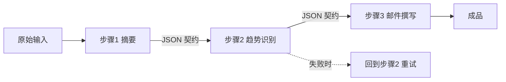
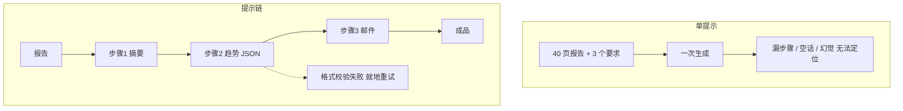

# 第 1 章：提示链（Prompt Chaining）

- **难度**：★☆☆ | **预估学时**：1.5 小时 | **前置**：ch00、一次 LLM 调用的基本形态

## 学习目标

学完本章，你能：
1. 把一个多层任务拆成 3~5 步的链，并为每一步写清"输入契约"和"输出契约"。
2. 解释为什么"单条大提示"在多层任务上会失败，且失败方式是可预测的。
3. 判断一个任务该用链、该用路由（第 2 章）还是该并行（第 3 章）。

## 一句话核心

提示链的本质不是"多问几次"，而是把一次不可验证的整体推断，拆成若干次可验证的局部转换——每一步的输出都能被人或程序检查，错误不会一路带到底。

## 零基础讲解

### 概念 1：提示链（Prompt Chaining，难度：基础）

**白话定义**：把一个大任务切成若干小任务，每次 LLM 调用只干其中一件，上一步的输出直接作为下一步的输入，串成一条线。

链这个词容易让人联想"链式反应"，这里不是。它更像工厂流水线：工位 1 收到原料，产出半成品，工位 2 只认半成品的规格。

**类比**：写毕业论文。你不会给导师发一句"帮我写篇关于量子计算的论文"，而是先定题目、再列提纲、再分节写、最后通稿润色。每一环节的产出都能被下一环节直接用，也都能被导师单独打回。类比失效的地方：论文的提纲可以反复改，而提示链里如果第二步的输出格式错了，第三步通常不会自己纠正，只会顺着错下去。

**图示**：



看图说明：看三件事——箭头方向是单向的，说明前一步的上下文会累积下来；箭头上的"JSON 契约"说明步骤之间传的是结构化数据而不是散文；虚线说明链是可以有回退点的，纯线性链做不到，这已经踩到第 6 章"规划"的边界。

**实例（带数字）**：任务是"分析一份市场调研报告，提取趋势，写一封给市场团队的邮件"。

单提示版本：把 40 页报告和 3 条要求一起塞进去，让模型一次输出邮件。实测常见结果是模型抓住了报告前 1/3 的内容，中间的数据点被跳过，邮件里出现"数据显示消费者偏好显著变化"这种没数字的空话。这不是模型笨，是它要同时做摘要、找趋势、组织语气三件事，注意力被摊薄。

链式版本：
1. 步骤 1 提示"总结以下报告的主要发现"，输出 5 条要点，人工/程序检查条数与来源页码。
2. 步骤 2 提示"根据以下 5 条要点，识别 3 个新兴趋势，每条附一个支持数据点，输出 JSON"，输出形如：

```json
{"trends":[{"trend_name":"AI 驱动个性化","supporting_data":"73% 消费者更愿意与使用个人信息提升体验的品牌合作"}]}
```

3. 步骤 3 提示"根据以下 JSON 的 3 个趋势写一封 200 字以内的邮件，必须引用每个 data 字段的数字"。

第三步引用不到数字就是硬失败，你能立刻发现。这就是链的价值：**错误被局部化**。

### 概念 2：输出契约（难度：基础）

**白话定义**：对每一步输出的格式、字段、取值范围做出的强制约定。它不是"最好输出 JSON"，而是"必须是这 4 个字段，缺一个就算失败"。

**为什么必须有**：自然语言输出对下一步是"软输入"。步骤 2 写了"趋势大概有三到四个"，步骤 3 收到的就是一句模糊描述，它可能编出第四个趋势。契约把软输入变成硬输入。

**类比**：食堂打饭的餐盘格子。菜必须先装进格子，下一道工序（称重、结算）才认得。失效边界：如果任务本身是创作（写诗、写文案），过度结构化会杀死风格，这时契约只约束长度和必含信息，不约束表达。

### 概念 3：上下文工程 vs 提示工程（难度：进阶）

**白话定义**：提示工程优化"你这句话怎么说"；上下文工程优化"模型在生成之前，眼前摆着哪些材料"——包括系统提示、检索到的文档、工具返回结果、用户身份、历史交互、环境状态。

书里把前者称为后者的一个子集。这个判断有依据：同一个问题，换措辞的收益通常在几个百分点，而换掉喂进去的材料，收益可以是数量级的。

**实例**：日程助手要回复"帮我把周三的会和客户改到周四"。提示工程的做法是雕琢这句话；上下文工程的做法是先把日历事件、客户时区、会议室占用、上周邮件里客户提到的偏好全部装进上下文，再让模型生成。后者才可能得出"周四上午客户在另一个时区不方便，建议周四下午 3 点"。

**类比**：医生看病。提示工程是"怎么描述症状"，上下文工程是"化验单、既往史、用药记录都在不在手上"。失效边界：上下文不是越多越好，无关材料会稀释注意力，这一点在第 16 章"资源感知优化"里会量化。

## 图示



看图说明：上半部分是"一个盒子装三件事"，出错时你只知道成品不对；下半部分每个盒子只装一件事，出错时你知道是哪个盒子，还能就地重来。这个差别就是可调试性。

## 类比与实例

- **类比**：编译器的多趟（multi-pass）设计。前端解析成 AST，中端优化，后端生成目标码。每一趟只干一件事，输出是下一趟的合法输入，出错能精确指到某一趟。
- **失效边界**：编译器每趟的输入输出都是形式化的，提示链的"契约"只靠提示词和校验兜底，模型仍可能输出合法 JSON 但内容胡编。所以契约管格式，不管真假；真假要靠第 4 章"反思"和第 19 章"评估"。
- **实例**：发票字段提取。步骤 1 抽取字段 → 程序校验字段是否齐全、金额是否为数字 → 缺失则带失败上下文重试（这一步是确定性代码，不是模型）→ 把"壹仟零五十"这类中文数字交给工具转换成 1050 → 最终结构化输出。注意这里链里插了代码，链不必是"模型-模型-模型"。

## 常见误解

- **别以为链越长越好**——实际上每多一步就多一次调用成本、多一个失败点、多一次上下文传递损耗。3 步能解决的任务做成 7 步，延迟会翻倍且错误率上升。经验判据：只有当某一步的输出能被独立验证时，才值得单开一步。
- **别以为"上一步输出"就是原样复制过去**——实际上要裁剪。步骤 1 的 2000 字摘要直接喂给步骤 3 会淹没重点，正确做法是只传步骤 3 需要的字段。
- **别以为 temperature=0 就能复现**——实际上不同批次、不同硬件、不同版本仍可能给出不同 token 序列，链式系统必须假设每一步都可能抖动，靠校验而不是靠祈祷。
- **别以为提示链等于反思**——实际上链只是顺序执行，第二步并不会回头看第一步错没错。真正的自我纠错要专门构造"批评-修正"结构，见第 4 章。

## 自测题（答案）

1. （单选）一个任务包含"抽取发票字段 → 校验金额 → 生成报销单"三个环节，其中校验金额用确定性代码实现。这个设计属于？
   - A. 违反提示链，链里不能有代码
   - B. 提示链的合理形态，链的每一步可以是 LLM 也可以是确定性逻辑
   - C. 属于多智能体协作
   - D. 属于 RAG

   **答案**：B。**解析**：书中明确指出提示链可在步骤间插入确定性逻辑做中间数据处理与验证。链的单位是"处理步骤"，不是"模型调用"。

2. （简答）为什么说"步骤 2 输出 JSON"比"步骤 2 输出一段描述"更能提升整链可靠性？
   **答案**：自然语言是软输入，下游模型需要再解释一遍，解释过程会引入歧义和编造；JSON 是硬输入，字段缺失、类型错误可以被程序直接判定为失败，从而把错误挡在进入下一步之前。**解析**：关键在于"可校验"——契约让失败变可见。

3. （单选）下列哪种任务**最不适合**用提示链？
   - A. 从 40 页报告生成一封摘要邮件
   - B. 需要同时从 8 个独立数据源取数再汇总
   - C. 把非结构化简历转成结构化 JSON
   - D. 多轮对话中维持上下文

   **答案**：B。**解析**：8 个数据源彼此独立，顺序执行会串行浪费 8 倍时间；这类任务应先并行（第 3 章）再链式汇总。

4. （填空）提示链中，把每一步的输出写成结构化格式，本质是把"软输入"变成______，从而使失败______。
   **答案**：硬输入；可被程序判定（可定位）。**解析**：见概念 2。

## 复习锚点

- 链的价值是**错误局部化**，不是"多问几次更准"。
- 每步都要有**输出契约**；契约管格式，不管真假。
- 判断该不该多开一步：这一步的输出**能不能被独立验证**。
- 链里可以插代码，链 ≠ 模型串联。
