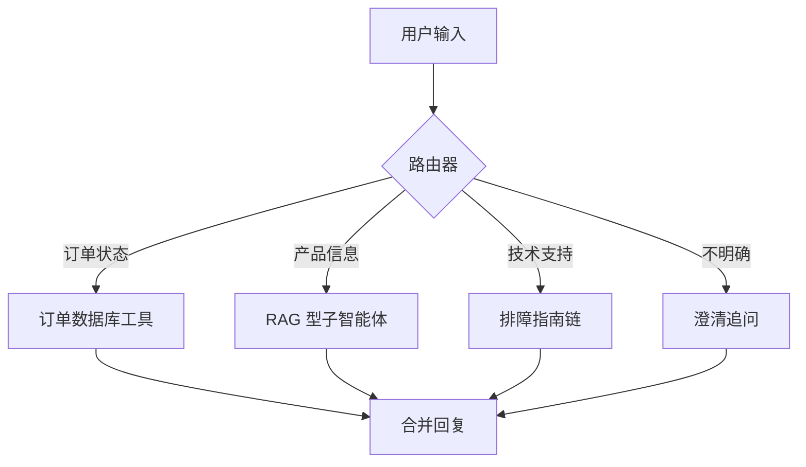
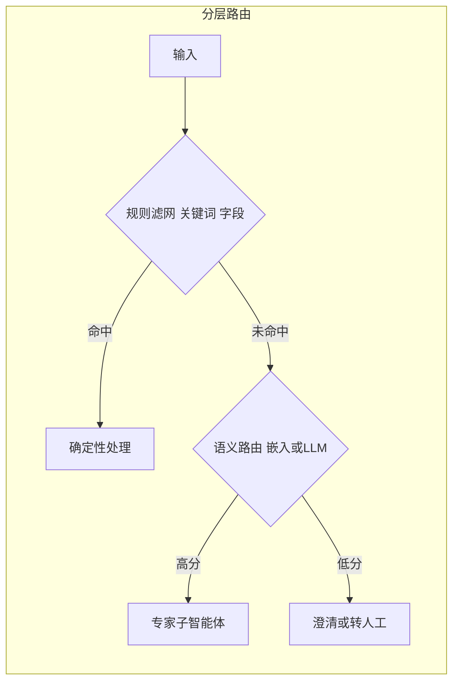

# 第 2 章：路由（Routing）

- **难度**：★☆☆ | **预估学时**：1.5 小时 | **前置**：ch01 提示链、分类器的基本概念

## 学习目标

学完本章，你能：
1. 说清路由与提示链的本质差别（谁在决定下一步）。
2. 列出四种路由实现方式，并为每种给出一个适用场景和一个失效场景。
3. 为一个客服系统设计路由表，包括"不明确"分支。

## 一句话核心

提示链把路径写死在代码里，路由把路径决定权交给输入本身——它是在运行时选一条路，而不是提前选好。

## 零基础讲解

### 概念 1：路由（Routing，难度：基础）

**白话定义**：先判断这个输入属于哪一类，再把控制流交给对应的处理者（工具、子智能体、子流程）。判断用的可以是模型、规则、向量相似度或一个微调过的分类器。

**类比**：医院分诊台。病人进门先被问几句，然后被分到内科、外科、牙科。分诊护士不治病，她只做一件事：把人对到科室。类比失效的地方：医院分诊错了病人还能重挂，路由错了请求会被送进一个根本不处理这类问题的子智能体，它可能硬着头皮答，给出看似合理实则错误的输出。

**图示**：

看图说明：看两个地方——路由器本身不产出业务内容，只产出"去向标签"；必有一条默认分支（不明确），否则未匹配的输入会掉进空洞，这是路由最常见的线上故障。

**实例**：客服系统收到"我上周买的那台机器开不了机"。
- 基于规则的路由会命中关键词"开不了机"→ 技术支持。快、稳，但"我的设备怎么没像宣传的那样省电"里有"设备"没"故障"，会走错。
- 基于 LLM 的路由会理解语义 → 技术支持。慢一点，贵一点，但抗改写。
- 两种都判不出来时，落到"不明确"分支追问"请提供订单号"。

### 概念 2：四种路由实现（难度：进阶）

**（1）基于 LLM 的路由**。提示模型"只输出类别之一"，读它的输出做分支。

- 优点：零训练、抗改写、能处理没见过的说法。
- 代价：每次路由多一次模型调用，有延迟和费用；模型可能输出"booker。"带句号，或输出一段解释，所以**必须先做输出规范化**（去空白、小写、映射到枚举），再分支。
- 失效场景：类别之间语义接近时（"产品信息"vs"售前咨询"），模型会在两个标签之间摇摆，且同一条输入两次调用可能给出不同标签。

**（2）基于嵌入的路由**。把输入编码成向量，与每个路由代表句的向量比相似度，取最近的那条。

- 优点：比 LLM 快、便宜，语义能力保留。
- 代价：需要为每条路由准备有代表性的样例句；样例覆盖不到的说法会误判。
- 失效场景：需要多步推理才能判断归属的输入（"我账户里那笔钱为什么少了两块"既可能是账单查询也可能是技术故障）。

**（3）基于规则的路由**。if/else、正则、关键词、结构化字段（比如工单里的 type 字段）。

- 优点：确定、零延迟、零成本、可审计。
- 代价：脆弱。用户换个说法就漏。
- 正确用法：不是拿它替代语义路由，而是当**前置过滤器**——能明确判定的先判掉，剩下的交给模型。这样大部分流量走廉价路径。

**（4）基于判别模型的路由**。在标注数据上微调一个小分类器，推理时只做一次前向传播，不生成文本。

- 优点：延迟最低（毫秒级）、成本最低、行为稳定。
- 代价：需要标注数据；分布漂移后要重训；只能输出训练时见过的类别。
- 与 LLM 路由的差别容易被忽略：LLM 路由是"推理时执行提示的生成模型"，判别路由是"已固化的权重"。书中明确说 LLM 可以用来生成合成训练数据，但**不参与实时决策**。

### 概念 3：路由的三个插入位置（难度：进阶）

路由不只用在入口。它可以在：
1. **入口分类**：判断这次请求属于哪类业务。
2. **链中间**：提示链走到一半，根据上一步结果决定下一步走哪条。
3. **工具选择**：在一组工具里挑一个最合适的（第 5 章会看到，模型选工具本质就是路由）。

第三种最容易被忽视，却最常见：工具使用模式的"选工具"环节就是一个路由决策，只不过路由标签是工具名。

## 图示

看图说明：这张图讲的是"别只用一种路由器"。把规则放前面做廉价筛选，把语义判断留给贵的那层，低置信度直接转人工——三层结构把成本、准确率、可解释性同时照顾到。

## 类比与实例

- **类比**：快递分拣。传送带旁先有扫码枪（规则）读面单上的城市编码，读不出编码的包裹才上人工台看地址（语义）。这不浪费人工，也不漏件。
- **失效边界**：包裹的目的地是写死的，用户意图不是。同一个"我要退货"背后可能是退款、换货、投诉三种诉求，路由标签设计得越粗，下游越难做对。
- **实例（带数字）**：某客服系统日请求 10 万条。规则层命中 62%，平均耗时 1ms，成本 0；语义层处理剩余 38%，其中 LLM 路由每次约 0.3 秒、按 token 计费。若全部走 LLM，日成本按 10 万次 × 约 300 token 计；分层后只有 3.8 万次付费。这就是把路由当成**成本结构**来设计，而不是只当成功能。

## 常见误解

- **别以为路由就是多智能体协作**——实际上单智能体内部的工具选择也是路由。多智能体协作（第 7 章）是多出来的架构层，路由是控制流机制，两者可以嵌套但不能划等号。
- **别以为 LLM 路由器必须"想清楚"**——实际上它只该输出一个标签。让它解释理由，输出会变长、格式会飘、分支代码要写更多特判。理由可以另外记日志，但不该混在决策通道里。
- **别以为没有默认分支也没关系**——实际上所有路由都必须有兜底。缺少默认分支的路由在遇到新类别时会直接崩溃或返回空。
- **别以为一次分类就够**——实际上意图会漂移。多轮对话里，"那它多少钱"在上下文里属于产品信息，单独拿出来则无法判断；所以路由的输入应当是**最近若干轮 + 当前轮**，不是只有当前轮。

## 自测题（答案）

1. （单选）一个系统先判断用户问的是"退款"还是"物流"，再把请求交给对应的处理链。这属于？
   - A. 提示链
   - B. 路由
   - C. 反思
   - D. 记忆管理

   **答案**：B。**解析**：控制流根据输入类别动态决定，路径不是预先写死的，这是路由的定义特征。

2. （多选）关于"基于判别模型的路由"，下列说法正确的是？
   - A. 推理时执行一次分类前向传播，不生成文本
   - B. 路由逻辑固化在权重里
   - C. LLM 可以在训练数据准备阶段参与
   - D. 它的灵活性高于 LLM 路由

   **答案**：A、B、C。**解析**：D 反了。判别模型的类别集合在训练时就定了，遇到新类别只能重训，灵活性低于 LLM 路由，代价是延迟与成本更低。

3. （简答）为什么"规则路由 + 语义路由"的分层比单用语义路由更好？
   **答案**：规则层能以零成本、零延迟、可审计的方式处理掉大量格式明确或关键词明确的请求；语义层只处理规则层兜不住的长尾。这样既降低平均成本与延迟，又保留了对新说法的适应能力。**解析**：这是把路由当资源分配问题看（第 16 章会展开）。

4. （填空）路由最常见的线上故障是缺少______分支，导致未匹配输入______。
   **答案**：默认（兜底）；掉进空洞或崩溃。**解析**：见概念 1 的图示说明。

## 复习锚点

- 路由 = **运行时决定走哪条路**；提示链 = 路径写死。
- 四种实现：LLM、嵌入、规则、判别模型；差别在**成本、延迟、灵活度**三点上取舍。
- 路由可以插在入口、链中间、工具选择三处。
- 必须有一条兜底分支。
