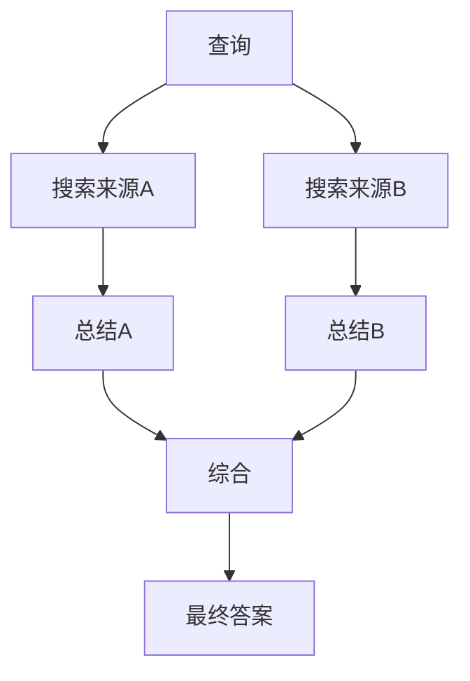
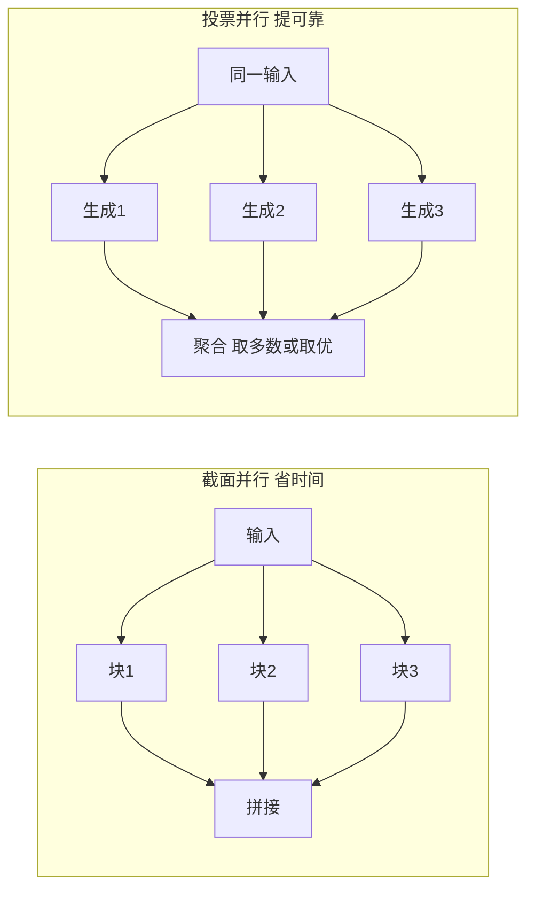

# 第 3 章：并行化（Parallelization）

- **难度**：★★☆ | **预估学时**：1.5 小时 | **前置**：ch02、异步编程（asyncio / Promise）

## 学习目标

学完本章，你能：
1. 在一张流程图上标出哪些分支可以并行、哪些必须串行，并说出判据。
2. 区分"截面并行"与"投票并行"两种形态，各自解决什么问题。
3. 用公式算出串行与并行的耗时差，并说明为什么这个差值受最长分支限制。

## 一句话核心

并行化只对**彼此无依赖**的子任务有效，收益上限由最长的那条分支决定，而调用方被拖慢的原因永远是"慢的那一个"，不是"慢的那些"。

## 零基础讲解

### 概念 1：并行化（Parallelization，难度：基础）

**白话定义**：把流程中互相不看对方结果的部分同时发起，全部完成后再进入下一步。

**判据只有一条**：B 需不需要 A 的输出？不需要，就能并行；需要，就只能串行。这条判据比任何框架 API 都重要，因为框架只能执行你画出来的图，画错了它不会救你。

**类比**：做饭。烧水、切菜、腌肉三件事互不依赖，可以同时进行；下锅炒必须等切完。总时长不是三件事相加，而是被最慢的那件事决定。类比失效的地方：厨房里人和灶是有限资源，同时开四个火会互相挤占；并行调用也一样，并发数上来后会被 API 限流、配额、连接数卡住，实际收益远低于理论值。

**图示**：

看图说明：看"扇出"和"汇合"两个位置。扇出点（Q 分出两条）是并行的开始，汇合点（C 收两条）是同步点，程序必须等两条都回来才能继续。任何一条慢，整体就慢——这就是为什么并行系统的优化重点是**消除尾巴**，而不是提高平均速度。

**实例（带数字）**：设搜索一次 1.2 秒，总结一次 0.8 秒。
- 串行：1.2 + 0.8 + 1.2 + 0.8 + 综合 0.5 = 5.0 秒。
- 并行：max(1.2, 1.2) + max(0.8, 0.8) + 0.5 = 1.2 + 0.8 + 0.5 = 2.5 秒。

注意综合那一步不能并行，因为它需要两个摘要。**并行不消除依赖，只压缩无依赖部分**。

### 概念 2：截面并行与投票并行（难度：进阶）

书里把并行化当成一种模式，实际上它有两种完全不同的用法，混在一起会做错设计。

**截面并行（sectioning）**：把任务横切成互不依赖的块，同时处理，最后拼起来。上面那个搜索-总结的例子就是。目标是**省时间**。

**投票并行（voting）**：同一份输入，用多个提示/多个模型/多次采样各生成一份答案，再聚合（取多数、取最优、取并集）。目标是**提可靠性**。

两者的判据也不同：
- 截面并行看"块之间有没有数据依赖"。
- 投票并行看"单次生成的不确定性是否会造成不可接受的错误"。代码审查、事实核查、关键决策适用；写文案标题也可以用（A/B 测试那一类），但不必用在所有输出上。

**实例**：内容审核场景。同一段文本并发交给三个不同提示版本的审核器，三份判定投票。两票"违规"即拦截。这里并行的目的不是快，而是把单模型的误判率压下来：若单模型误判率 10%，三个相对独立的判断取多数，误判率会明显低于 10%（独立性不成立时会打折扣，这点必须诚实）。

### 概念 3：并行的三种粒度（难度：进阶）

1. **模型调用级**：同一轮里发多个 LLM 请求。
2. **工具调用级**：同时查机票、酒店、天气。
3. **子智能体级**：整个子智能体并发跑（第 7 章的多智能体协作大量用这个）。

粒度越粗，收益越大，管理成本也越大：子智能体级并行要考虑状态共享、结果冲突、谁负责汇总；模型调用级并行只要 `asyncio.gather` 一下。

**实现方式的差异**（书里对比了两种框架思路）：
- LangChain 的 LCEL 用 `RunnableParallel`（或把多个 runnable 放进一个字典/列表）声明并行，运行时并发执行。
- LangGraph 用图拓扑表达并行：同一节点连出的多个节点自动并发，再在汇聚节点合并。
- Google ADK 则靠协调者智能体委托，由模型决定把子任务分给多个子智能体并发执行——这时"并行结构"不是写死的，而是模型决策出来的。

## 图示

看图说明：两种结构的图形几乎一样，差别在输入。左边输入被切开，每块不同；右边输入是同一份，三份输出再聚合。设计时先问自己"我在切任务还是在复制判断"，答案决定后面要不要做聚合逻辑、要不要付出三倍成本。

## 类比与实例

- **类比**：考试时先做会做的题。会做的题彼此独立，可以任意顺序快速推进；压轴题依赖前面的推导，必须放后面。并行调度的本质是"先把能同时做的做完"。
- **失效边界**：如果多个并行分支调用同一个有速率限制的 API（比如每分钟 20 次），并发 30 个请求会被拒一批。并行不是免费的，它把"延迟问题"换成了"限流问题"。
- **实例**：旅行规划智能体。串行查机票→酒店→当地活动→餐厅，各 1 秒，共 4 秒；并行后约 1 秒，但如果机票接口最慢要 2.5 秒，整体就是 2.5 秒。此时优化机票接口比优化其他三个更有价值——这就是"盯最慢分支"。

## 常见误解

- **别以为并行一定更快**——实际上并发数超过后端承载能力时，排队、限流、超时会让总耗时反而上升，还增加失败率。
- **别以为并行分支可以共享可变状态**——实际上并发写入同一个上下文对象会产生竞态。并行分支应当各自产出独立结果，由汇合点统一合并。
- **别以为投票并行能消除幻觉**——实际上如果多个分支用同一个模型、同一份上下文，它们的错误是相关的，投票只能压住随机性错误，压不住系统性错误。
- **别以为框架会自动帮你并行**——实际上 LCEL 只有在你把多个 runnable 放进同一个结构时才会并发；写成 `a()` 然后 `b()` 的顺序调用，框架不会替你改。

## 自测题（答案）

1. （单选）四个子任务耗时分别为 2.0、1.5、1.0、0.5 秒，彼此无依赖，并行执行后总耗时最接近？
   - A. 5.0 秒
   - B. 2.0 秒
   - C. 1.25 秒
   - D. 0 秒

   **答案**：B。**解析**：并行总耗时由最长分支决定，约 2.0 秒；平均 1.25 秒是错的，那是"总工作量除以并发数"，忽略了木桶效应。

2. （简答）什么时候该用投票并行而不是截面并行？
   **答案**：当单次生成的不确定性会造成不可接受的错误、且错误主要由随机性而非系统性偏差导致时（如审核判定、事实核查、关键代码审查）。若瓶颈是任务本身的串行工作量，用截面并行更划算。**解析**：两者的目标不同——一个换时间，一个换可靠性。

3. （多选）关于并行的粒度，正确说法有？
   - A. 粒度越粗收益通常越大
   - B. 粒度越粗管理成本越高
   - C. 子智能体级并行需要处理结果汇总与状态冲突
   - D. 模型调用级并行不需要考虑限流

   **答案**：A、B、C。**解析**：D 错。任何粒度都要考虑限流，模型调用级并发几十个请求一样会被 API 拒绝。

4. （填空）并行化只压缩无依赖部分，因此整体耗时的下界是______。
   **答案**：关键路径（最长依赖链）的耗时。**解析**：见图示说明。

## 复习锚点

- 判据一句话：**B 需不需要 A 的输出**。
- 两种形态：截面并行换时间，投票并行换可靠性。
- 总耗时由**最慢分支**决定，优化要盯尾巴。
- 并行把延迟问题换成了限流与状态冲突问题。
