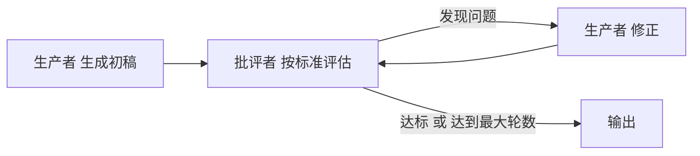
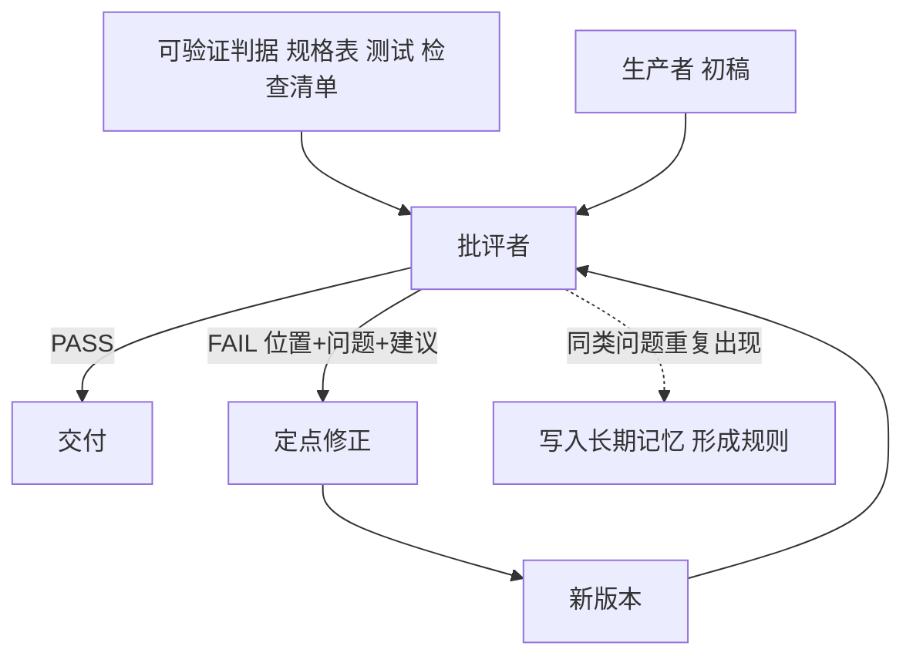

# 第 4 章：反思（Reflection）

- **难度**：★★☆ | **预估学时**：2 小时 | **前置**：ch01、ch02、一次完整的生成-校验循环经验

## 学习目标

学完本章，你能：
1. 画出"生产者-批评者"的反馈循环，并指出循环的终止条件应该怎么写。
2. 区分"检查你的工作"与"内部批评者"两种反思，说出各自的失败模式。
3. 解释反思为什么会退化（越改越差），以及怎样用可验证判据避免它。

## 一句话核心

反思不是"再让模型看一遍"，而是**先定义什么叫对，再让一个与生成者视角不同的角色去对照这个标准找错**；没有标准的反思只是在让模型自我安慰。

## 零基础讲解

### 概念 1：反思循环（难度：基础）

**白话定义**：智能体先产出一版东西，然后评估这版东西（对着事实、对着要求、对着质量标准），再根据评估结果产出下一版。四步：执行 → 评估 → 修正 → 迭代。

**和提示链的差别**：提示链是一条射线，A→B→C，走完就结束。反思是一个环，C 的输出会回到评估环节，直到满足条件才跳出。这条"回边"是它唯一的本质特征。

**类比**：改论文。写初稿 → 通读找问题 → 改 → 再通读。类比失效的地方：人改论文时"读得懂自己写的东西"，模型读自己的输出时同样带着生成时的偏见，它会觉得"这样写挺合理"，所以**同一个角色自评往往找不到真问题**——这正是需要批评者角色的原因。

**图示**：

看图说明：看两个点——回边的存在说明这不是链；出口有两个条件（达标 / 轮数上限），只写"直到满意"的循环在工程上等于死循环。

**实例**：生成一段产品介绍。初稿 120 字很流畅但把"续航 12 小时"写成了"全天续航"。批评者的任务是逐条核对：文中的每个数字能否在规格表里找到原文？"全天"是否等价于 12 小时？核对结果给出结构化批评：`{"status":"INACCURATE","reasoning":"'全天续航'与规格'12 小时'不一致，且夸大了时长"}`。生产者据此改写。

这个例子里，批评者的标准是**可验证的**（规格表里能不能查到），不是"写得好不好"。这个区别决定了反思是否真的有效。

### 概念 2：两种反思（难度：进阶）

**（1）"检查你的工作"（self-review）**：让同一个智能体回头检查自己的输出。

- 擅长抓：明显的遗漏（"我漏掉了第三点要求"）、格式错误、自相矛盾。
- 抓不到：生成阶段就深信不疑的错误（幻觉出来的数字、错误的因果关系）。
- 书里的判断：这种方式适合捕捉简单错误。

**（2）"内部批评者"（critic / producer-critic）**：另起一个角色（另一个系统提示，或另一个智能体），站在不同立场审。

- 擅长抓：事实错误、逻辑漏洞、不符合特定标准的表达。
- 代价：多一次调用；批评者的标准如果写得太笼统（"请检查质量"），它会给出同样笼统的反馈，等于没审。
- 书里的做法：批评者要有明确的角色（"你是一名严谨的事实核查员"）和明确的输出格式（`status` + `reasoning`），这样批评结果才能被程序消费，而不只是被下一轮模型"感受"到。

**关键差别**：self-review 修的是"我忘了什么"，critic 修的是"我认为对但其实错的东西"。后者的价值大得多，也难得多。

### 概念 3：反思的三条退化路径（难度：高难）

这一节书里点了但没展开，实际工程里最容易踩。

（1）**越改越差（over-correction）**。批评者提出十条修改建议，生产者全盘照改，结果把原本正确的部分也改坏了。防止办法：批评必须指明"位置 + 问题 + 建议"，生产者只改被指出的位置。

（2）**批评空转**。每一轮都说"建议补充更多细节"，于是一轮轮加字，字数膨胀但质量不变。防止办法：批评必须给出可判定的结论（PASS / FAIL + 理由），而不是建议清单。

（3）**上下文窗口溢出**。每一轮都把初稿、批评、修订版全塞回去，几轮之后上下文被挤爆，后面的"反思"其实看不到完整材料。书里明确提示这是该模式的代价之一。防止办法：只保留最新版本 + 最新批评，历史的轮次压缩成一句"已修正的问题清单"。

### 概念 4：反思与记忆、目标设定的关系（难度：进阶）

书里给了两个值得记住的判断：
- 反思 + 目标设定与监控（第 11 章）：目标是反思的**判据来源**。没有可验证的目标，反思就没有对照物。
- 反思 + 记忆（第 8 章）：没有记忆时，每次反思都是独立事件，同样的错会重复犯；有记忆时，批评意见可以沉淀成"这类问题以后别再犯"的规则，反思从一次性事件变成累积过程。

## 图示

看图说明：左侧那个框是全图的根——判据。没有它，整张图就退化成"模型自我评价模型"。右下那条虚线是把反思成果沉淀成规则，这是从"这一版更好"升级到"以后都更好"的关键一步。

## 类比与实例

- **类比**：论文的盲审。作者自己读十遍看不出问题，换一个不知道你写了什么的评审，一眼就看到方法部分缺少对照组。盲审有效的条件是评审手里有评价标准，而不是"你随便看看"。
- **失效边界**：盲审专家也可能误判，尤其在他不熟悉的细分方向上。模型批评者同理，它可能在正确的内容上挑刺。所以批评结果需要**可验证的锚**（测试用例、原文引用、规格表），不能全信。
- **实例（带数字）**：代码生成。生产者写一个 `parse_date(s)` 函数；批评者不评价"代码是否优雅"，而是**跑测试**：`parse_date("2024-02-30")` 应返回错误而不是 3 月 1 日。测试失败 → 批评结构化输出 `{"status":"FAIL","reasoning":"2 月 30 日未做日期合法性校验"}` → 生产者定点修正。这里判据是测试，不是模型意见，因此反思不会空转。

## 常见误解

- **别以为反思 = 让模型"再检查一遍"**——实际上没有标准的复查只会让模型重复确认自己的结论。判据（测试、原文、清单）必须在循环之外准备好。
- **别以为轮数越多越好**——实际上 2~3 轮之后收益急剧下降，成本和上下文膨胀却线性上升。工程上通常设 max_rounds = 2 或 3，并记录每轮是否真的改动了内容。
- **别以为批评者越严格越好**——实际上过严的批评者会让生产者把正确内容改错。批评应该"定位到具体位置"，而不是"整体重写"。
- **别以为反思能解决知识缺失**——实际上模型不知道的事，反思一万遍也变不出来。知识缺口要靠检索（第 14 章），不是靠自省。

## 自测题（答案）

1. （单选）反思模式与提示链最本质的区别是？
   - A. 反思用了更多 token
   - B. 反思存在从评估回到生成的反馈边
   - C. 反思必须用两个模型
   - D. 反思只能用于写作

   **答案**：B。**解析**：控制结构上有环才是反思；用几个模型、用在什么任务上都不是判据。

2. （简答）为什么"内部批评者"通常比"检查你的工作"更有效？它又依赖什么前提？
   **答案**：因为生成者对自己产出的内容带有生成时的偏见，倾向于认为自己的推理合理；独立角色的批评者以不同视角和不同标准审查，能发现生成阶段就固化的错误。前提是批评者手里有明确、可验证的判据与结构化输出格式，否则批评会退化为泛泛而谈。**解析**：有效性来自"视角分离 + 判据外部化"。

3. （多选）下列哪些是反思模式公认的代价？
   - A. 每轮迭代增加一次模型调用，成本和延迟上升
   - B. 对话历史随轮次膨胀，可能撑爆上下文窗口
   - C. 需要状态管理来维护多轮修订
   - D. 会让模型的知识量增加

   **答案**：A、B、C。**解析**：D 错。反思改变的是表达与推理的组织方式，不增加模型内部知识。

4. （填空）反思循环的出口条件必须写死两个：______ 与 ______。
   **答案**：达到质量标准（判据通过）；达到最大轮数上限。**解析**：只写"直到满意"在工程上等于死循环。

## 复习锚点

- 反思 = **有回边的控制结构**，不是"多问一遍"。
- 有效的反思 = 生产者 + 批评者 + **外部判据**（测试、原文、清单）。
- 三种退化：过度修正、批评空转、上下文溢出。
- 反思治表达与推理，不治知识缺失；缺知识去第 14 章。
