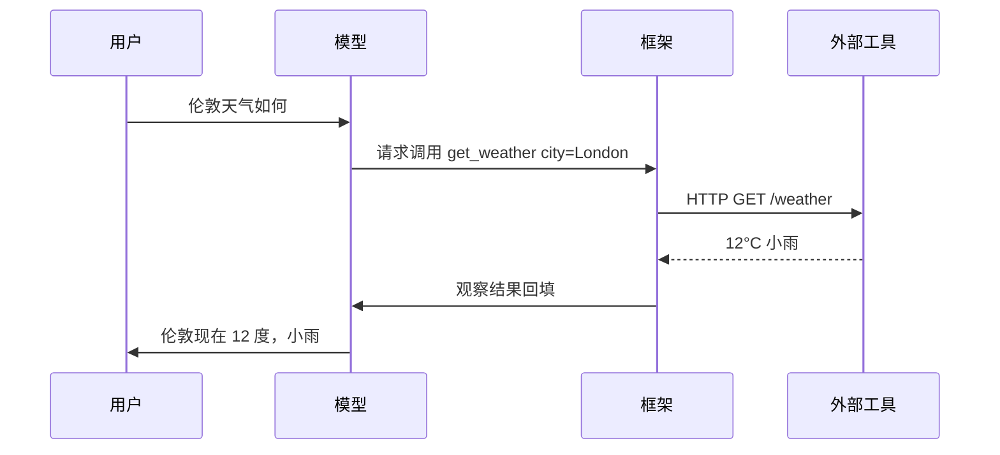
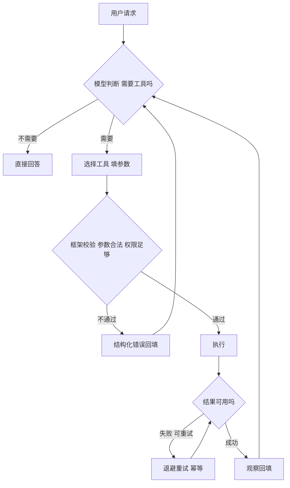

# 第 5 章：工具使用（函数调用）

- **难度**：★★☆ | **预估学时**：2 小时 | **前置**：ch01、JSON Schema、一次 HTTP 请求的实操经验

## 学习目标

学完本章，你能：
1. 写出一个合法的工具定义（名称、用途、参数类型、约束），并解释为什么"用途描述"比"函数名"更重要。
2. 完整走一遍"定义→决策→生成调用→执行→观察→再决策"的六步循环。
3. 指出工具使用在错误处理、安全、权限三方面的典型故障，并给出对应处理方式。

## 一句话核心

工具使用把模型从"会说话"变成"能动手"，代价是把"模型可能会错"升级成"模型可能会做错事"——所以工具设计的重心不只在"能不能调用"，更在"调错了会怎样"。

## 零基础讲解

### 概念 1：工具调用六步（难度：基础）

**白话定义**：把一组外部能力（查天气、查库存、发邮件、跑代码）连名字带参数说明书一起交给模型，模型自己决定要不要用、用哪个、参数填什么，框架负责真的去执行，执行结果再回给模型。

六步对应：

| 步骤 | 谁在做 | 产出 |
|---|---|---|
| 1 工具定义 | 开发者 | 一份带描述的 schema |
| 2 LLM 决策 | 模型 | "需要调用 X" 或 "不需要" |
| 3 生成调用 | 模型 | 结构化 JSON：工具名 + 参数 |
| 4 执行 | 框架/代码 | 真实 API 的返回 |
| 5 观察 | 框架 | 结果回填进上下文 |
| 6 再决策 | 模型 | 最终答复或继续调用 |

**类比**：给新来的实习生配一张工位卡和一份"系统操作手册"。手册写得越含糊，他越可能点错按钮。类比失效的地方：实习生会犹豫、会来问，模型不会，它会自信地填一个看起来合理的参数然后提交。

**图示**：



看图说明：注意框架是**唯一**的执行者，模型从不直接接触网络。这条边界是安全设计的起点：所有权限控制、参数校验、审计日志都可以塞在框架这一层，不必信任模型。

### 概念 2：工具定义的质量决定一切（难度：进阶）

一个工具定义至少包含四样：

1. **名称**：动词开头，语义明确（`search_orders` 而不是 `order_tool`）。
2. **用途描述**：什么情况下该用它、什么情况下不该用。这一条最关键，模型选错工具时，九成原因是描述里没写"什么时候别用"。
3. **参数 schema**：类型、是否必填、取值范围、枚举。
4. **返回结构**：成功与失败分别长什么样。

**实例（可验证）**：

```json
{
  "name": "get_order_status",
  "description": "查询某个订单的当前状态。仅当用户提供了订单号时使用；用户只描述商品问题时不要调用。",
  "parameters": {
    "type": "object",
    "properties": {
      "order_id": {"type": "string", "pattern": "^[0-9]{12}$", "description": "12 位数字订单号"},
      "include_logistics": {"type": "boolean", "default": false}
    },
    "required": ["order_id"]
  }
}
```

注意 `description` 里那句"用户只描述商品问题时不要调用"。这是**负向说明**，它把误触发的概率直接压下来。只写"查询订单状态"的描述，会让模型在"我的快递怎么还没到"这种没有订单号的场景里硬造一个订单号。

参数里的 `pattern` 是第二道防线：模型填了不合规的值，框架在执行前就能拒掉，而不是把脏参数送进数据库。

### 概念 3：ReAct——边想边做（难度：进阶）

**白话定义**：Reason + Act。模型不是一次性输出所有工具调用，而是循环：思考（我下一步要知道什么）→ 行动（调一个工具）→ 观察（读结果）→ 再思考。

**为什么需要它**：有些任务无法预先规划，比如"找出这家公司去年的营收并判断是否达到行业平均"。第一步查营收，结果里发现是港币计价，第二步才需要汇率工具——汇率这个需求是第一步的输出**才暴露出来**的。预先规划做不到，只能边做边看。

**代价**：每一轮都要一次模型调用，轮数不定，延迟和成本不可预测；而且容易在原地打转（反复调同一个工具）。

**判据**：任务的前置需求能被第一次调用揭示 → 用 ReAct；任务的需求在开始时就完全明确 → 用显式计划（第 6 章）更稳、更省钱。

### 概念 4：三个必须处理的故障面（难度：高难）

书里的 FAQ 明确列出三条，工程上要当硬性要求：

**（1）错误处理**。工具会失败：超时、返回空、返回错误码、返回格式变了。模型看到报错文本时倾向于"我再试一次同样的调用"。正确做法是框架层区分错误类型：
- 可重试（超时、限流）→ 带退避重试，且**必须幂等**；
- 不可重试（参数非法、权限不足）→ 直接把结构化错误回给模型，让它换参数或换工具；
- 需要人（涉及付款、删除）→ 中断并请求确认（第 13 章）。

**（2）安全性**。工具是模型伸出去的手，手能碰到什么由你决定。至少三层：工具白名单（不给模型不该有的能力）、参数校验（防注入、防越权 ID）、敏感操作人工审批。

**（3）提示设计**。工具调用的可靠性取决于模型能否产出格式正确的调用。系统提示里要写清调用格式、可用工具清单、以及"不确定时先问用户"这条规则。

## 图示



看图说明：这张图的重点是**所有箭头都要回到模型再判断**，不能执行完就直接给用户。另外注意校验节点在模型之后、执行之前——它是唯一能挡住"模型编造参数"的位置。

## 类比与实例

- **类比**：银行的柜员。柜员（模型）能发起转账，但真正的转账由核心系统（框架）执行，大额要主管授权（人工审批），每一笔都有流水（审计日志）。柜员再熟练也不能绕过核心系统。
- **失效边界**：柜员至少能看懂业务规则，模型可能把"帮我转 500"理解成"转 500 万"。所以金额、ID、日期这类关键参数必须有格式与范围双重校验。
- **实例**：电商助手。用户："X 产品有货吗？"→ 模型调 `get_inventory(sku="X")` → 返回 `{"stock": 3, "reserved": 3}` → 可用量 = 3 - 3 = 0。如果模型只读 `stock` 就回答"有 3 件"，是错的。这说明返回结构要写清字段含义，且**计算不应该交给模型心算**——加一个 `available = stock - reserved` 的字段，或者把算术交给计算工具。

## 常见误解

- **别以为工具越多越好**——实际上工具数量超过十几个后，模型选错的概率明显上升，描述之间的细微差别它也分不清。正确做法是分组暴露：先路由到领域，再在该领域内暴露 3~5 个工具。
- **别以为模型会自己处理报错**——实际上它常会原样重试。错误分类与重试策略是框架的职责。
- **别以为工具返回的文本可以随便拼**——实际上返回内容会进入上下文，如果里面有"忽略之前指令"这类文本，就是提示注入。工具返回应当结构化，且被当作**数据**而不是指令。
- **别以为"技能"和"工具"是一回事**——实际上工具是外部资源（天气 API、计算器），技能是已学会的组合能力（"订票"这个技能内部可能调用日历与航空两个工具）。混用会导致你在错误的层级上做设计。

## 自测题（答案）

1. （单选）模型生成了一个工具调用 `get_order_status(order_id="ABC123")`，而 schema 要求 12 位数字。框架应该？
   - A. 照样执行，让数据库报错
   - B. 执行前按 schema 校验并拒绝，把结构化错误回给模型
   - C. 静默丢弃这次调用
   - D. 让模型自己重试同一参数

   **答案**：B。**解析**：校验必须在执行之前，且错误要显式回填，否则模型不知道该怎么改。静默丢弃会让模型以为调用成功了。

2. （简答）为什么工具描述里要写"什么情况下不要用这个工具"？
   **答案**：模型选错工具的主要原因是描述只覆盖了"能做什么"，没有覆盖"边界在哪"。负向说明能显著降低在相似场景下的误触发，例如阻止它在用户没提供订单号时编造一个订单号。**解析**：工具描述是给模型看的"使用说明书"，边界与用途同等重要。

3. （多选）使用 ReAct 循环而不是一次性规划，代价包括？
   - A. 每轮一次模型调用，延迟与成本不确定
   - B. 可能在同一工具上反复打转
   - C. 无法处理需要多步信息才能确定的后续动作
   - D. 需要框架支持状态维护

   **答案**：A、B、D。**解析**：C 反了。ReAct 恰恰擅长处理"下一步依赖上一步结果"的情况。

4. （填空）工具使用把模型的错误从"说错"升级为"______"，因此必须在框架层加入______与______。
   **答案**：做错事；参数校验（权限控制）；人工审批（审计）。**解析**：见概念 4。

## 复习锚点

- 六步循环：定义→决策→生成→执行→观察→再决策。
- 工具描述要写**什么时候别用**。
- 所有校验与权限都在框架层，不信任模型。
- ReAct 适用于"需求靠第一次调用才暴露"的任务；显式计划适用于需求一开始就明确的任务。
