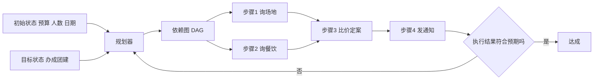
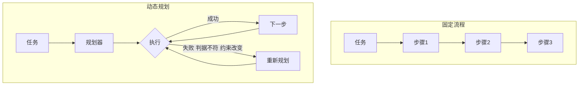

# 第 6 章：规划（Planning）

- **难度**：★★★ | **预估学时**：2.5 小时 | **前置**：ch05 工具使用、有向图与拓扑序

## 学习目标

学完本章，你能：
1. 把一个高层目标拆成带依赖关系的步骤图，并判断哪些步骤可并行、哪些必须等。
2. 说清"动态规划"与"固定流程"的取舍判据，以及这个判据为什么是"怎么做是否需要探索"。
3. 设计一个带重新规划（re-plan）能力的执行循环，写出触发重规划的三个条件。

## 一句话核心

规划的价值不在"生成一张漂亮的步骤表"，而在**把"怎么做"从提示词里搬到结构里**——让"做什么"由人给，"怎么做"由系统动态决定并能被检查和修改。

## 零基础讲解

### 概念 1：规划（难度：基础）

**白话定义**：给定初始状态和目标状态，找出一条（或一组）行动序列，使系统从前者走到后者。

三个要素缺一不可：初始状态（预算多少、有几个人、期限几天）、目标状态（成功办成团建）、中间的可执行动作（订场地、定餐、排日期）。只给目标不给初始状态，规划出来的东西必然空泛。

**类比**：导航软件。你给起点和终点，它算路径；路上堵了，它重算。类比失效的地方：导航的"路"是给定的图，智能体的"动作"是要自己发明的（比如它得先意识到"需要打电话确认场地容量"这个动作存在）。所以智能体的计划里经常出现"我没想到还有这一步"。

**图示**：

看图说明：看两处——步骤 1 和步骤 2 没有箭头相连，说明它们可以并行（接第 3 章）；从"执行结果"有一条回到规划器的边，说明计划不是一次性产物，而是可修订的中间状态。

### 概念 2：计划的三种形态（难度：进阶）

书里没有明说分类，但从例子可以抽出来：

1. **清单式计划**：编号步骤列表，顺序执行。适合流程固定、步骤间依赖线性的任务（新员工入职：开账号→分培训→协调部门）。代价是遇到意外不会调整。
2. **图式计划**：用 DAG 表示步骤与依赖，允许并行与条件分支。适合有并行空间的任务（研究任务：同时查多个来源）。LangGraph 的状态图就是这个形态。
3. **迭代式计划（边做边规划）**：只规划下一小段，执行完根据结果决定下一步。ReAct 是它的极端形式，Google Deep Research 是它的工业级形态——它先拆出多点研究计划给用户审，然后进入"搜索→发现知识空缺→调整查询"的循环。

三者的差别不在"谁更先进"，而在**不确定性放在哪一层**：任务不确定 → 用 3；任务确定但分支多 → 用 2；任务确定且线性 → 用 1。

### 概念 3：可预测性与适应性的取舍（难度：进阶）

书里给了一条很实在的判断：动态规划不是万能的。**当"怎么做"已知且可重复时，约束智能体走固定流程更有效**，因为固定流程限制了自主性，减少了不确定性，结果可靠一致。

反过来，如果"怎么做"需要探索（场地可能满、供应商可能放假、用户的约束可能互相冲突），才需要规划器。

这条判据可以写成一句话：**如果同一个任务跑十次，你希望十次路径完全一样，就别用规划。**

### 概念 4：重新规划（re-plan，难度：高难）

执行中出问题时，系统有三种反应，选错会造成完全不同的后果：

| 反应 | 适用 | 风险 |
|---|---|---|
| 重试当前步骤 | 瞬时故障（超时、限流） | 非瞬时故障会死循环 |
| 局部改计划 | 某步骤失败但目标不变 | 改动可能破坏后续依赖 |
| 全局重规划 | 约束变了（预算砍半、日期提前） | 成本高，可能把已完成的正确工作推翻 |

触发条件要写死，不能靠模型"感觉不对就重规划"。推荐的三个触发条件：
1. 某步骤连续失败 N 次（N=3）；
2. 执行结果与预期判据不符（比如查回来 0 个场地，而计划假设至少有 3 个）；
3. 外部约束发生显式变化（用户改了预算）。

**实例（带数字）**：团建规划。初始计划 5 步，执行到第 1 步（询场地）返回"预算内可用场地只有 1 个，且需提前 3 周预订"，而计划假设"至少 3 个可选、提前 1 周"。这是判据不符，触发局部改计划：把"比价定案"降级为"确认唯一场地 + 争取延期"，同时把"备选场地"这个新步骤插到第 1 步之后。后续 3 步的计划不变。这就是局部改，而不是全局重来。

## 图示

看图说明：上面一条直线没有任何回边，所以它不可能适应意外；下面有两条回边（失败→重规划、成功→下一步），适应能力就来自这两条边。设计规划系统时，先问"我需要几条回边"。

## 类比与实例

- **类比**：装修。固定流程是"按图纸施工"；动态规划是"先量房、出方案、报价、开工，中途发现墙里有管道就改方案"。没有人会在不知道房型的情况下先画好全套施工图。
- **失效边界**：装修队有经验，改方案时知道哪些改动会影响水电；模型的重新规划可能只顾眼前，改完第一步之后忘了第三步的前置条件。所以重规划必须**重新检查全部依赖**，而不是只改失败的那一步。
- **实例**：Google Deep Research 的公开流程——先把用户请求拆成多点研究计划，**展示给用户审核和修改**（协同规划），确认后才进入迭代搜索。这一步把"规划错了"的成本从"跑完几十分钟才发现"降到"看一眼就能改"。

## 常见误解

- **别以为计划越长越专业**——实际上步骤超过 8~10 步后，模型很难保持一致的前置条件，且中途失败的概率随步数指数上升。正确做法是分层：顶层 3~5 步，每步展开成子计划。
- **别以为计划必须一次成型**——实际上边做边规划是工业界主流（Deep Research 系列产品都是这样）。一次成型的计划只适合确定性高的任务。
- **别以为重规划是免费的**——实际上它会丢弃已完成的部分工作，并可能引发连锁修改；触发条件必须显式。
- **别以为规划可以替代工具**——实际上计划里的每一步最终都要靠工具执行（第 5 章）。没有工具的计划就是一张愿望清单。

## 自测题（答案）

1. （单选）"新员工入职：开账号→分配培训→协调部门"这类任务，最合适的计划形态是？
   - A. 迭代式计划
   - B. 清单式计划，顺序执行
   - C. 完全自由的自主探索
   - D. 投票并行

   **答案**：B。**解析**：路径已知、可重复、步骤线性，固定流程能保证一致性和可靠性，不需要探索。

2. （简答）重规划的触发条件为什么必须写死，而不能让模型自行判断？
   **答案**：模型倾向在遇到任何不顺时重新规划，会造成已完成工作的丢弃和成本失控；写死条件（连续失败 N 次、判据不符、约束显式变化）把"该不该重来"变成一个可审计的判定，避免模型凭感觉推翻整个计划。**解析**：规划的成本主要在"改"，不在"做"。

3. （多选）动态规划相对固定流程的优势包括？
   - A. 能处理初始计划未预见的障碍
   - B. 能根据中间结果调整后续步骤
   - C. 结果更可预测、更一致
   - D. 能适应约束变化

   **答案**：A、B、D。**解析**：C 是固定流程的优势，动态规划恰恰牺牲可预测性换取适应能力。

4. （填空）规划的三要素是______、______、以及连接两者的可执行动作序列。
   **答案**：初始状态；目标状态。**解析**：缺初始状态的计划必然是空泛的。

## 复习锚点

- 规划 = 给定初始状态与目标状态，找行动序列。
- 三种形态：清单式、图式、迭代式；按"不确定性放在哪一层"选。
- 判据：**同一任务跑十次，你希望路径一样吗**。
- 重规划要写死触发条件，且必须重新检查全部依赖。
