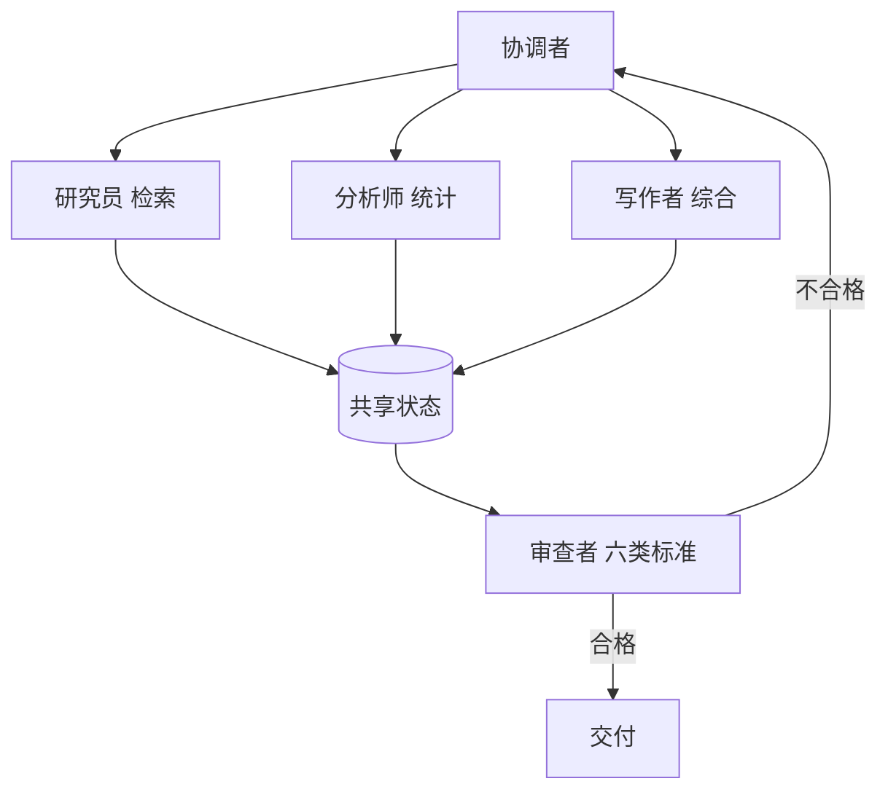

# 第 7 章：多智能体协作（Multi-Agent Collaboration）

- **难度**：★★★ | **预估学时**：3 小时 | **前置**：ch06 规划、ch08 记忆、ch05 工具使用

## 学习目标

学完本章，你能：
1. 画出六种协作拓扑（单体、网络、监督者、工具型监督者、层级、定制），说出各自的单点故障在哪。
2. 判断一个任务该不该拆成多智能体，判据是什么。
3. 解释"批评-审查者"结构为什么能降低幻觉，以及它的通信成本从哪来。

## 一句话核心

多智能体不是"人多力量大"，而是**把不同的判据放在不同的人手里**：分工的价值主要不在并行提速，而在让每个环节都有一个不为自己产出辩护的检查者。

## 零基础讲解

### 概念 1：为什么拆（难度：基础）

单智能体的问题有三类：
1. **上下文拥挤**：一个智能体同时装着检索规则、写作风格、事实核查标准，提示词互相打架。
2. **能力冲突**：要它既大胆发散又想严格核实，这两件事在同一个提示里很难同时成立。
3. **错误无对照**：它自己产出、自己检查，偏差无人纠正（第 4 章的老问题）。

拆成多个智能体，每一类都能缓解：上下文变窄、角色变纯、判据分离。

**类比**：一家餐馆。一个人既采购又掌勺又收银，忙起来必出错；分工之后，采购知道什么该买、厨师知道怎么烧、收银只管对账。类比失效的地方：餐馆的分工靠人自觉协调，智能体之间的协调要靠消息格式和状态传递，写不清楚就会互相甩锅。

### 概念 2：六种拓扑（难度：进阶）

书里给了六种关系结构，这是本章最有价值的一张表：

| 拓扑 | 结构 | 优点 | 单点故障 |
|---|---|---|---|
| 单智能体 | 独立运行 | 简单、可控 | 能力上限低 |
| 网络型 | 点对点，去中心 | 弹性高、无瓶颈 | 一致性难保证，消息爆炸 |
| 监督者 | 一个协调者指挥多个下属 | 层级清晰、易管理 | 协调者是单点，也是瓶颈 |
| 工具型监督者 | 协调者只提供资源与指导，不强制指挥 | 灵活性高，下属自主 | 责任边界模糊 |
| 层级型 | 多层监督者 | 可扩展，适合大系统 | 层数越多，信息损耗越大 |
| 定制型 | 按问题设计 | 最优性能 | 设计成本高，易出现涌现的意外行为 |

**选择判据**：智能体数量少（≤5）且任务线性 → 监督者；任务彼此独立且需要横向比对 → 并行 + 汇总；需要长期运行、动态增减成员 → 层级或定制；一致性要求极高（比如金融对账）→ 慎用网络型。

### 概念 3：六种协作形式（难度：进阶）

书里另列了一组"协作形式"，和拓扑是两回事，别混：

1. **顺序交接**：A 做完交给 B。类似提示链，但跨智能体，通常带不同的工具与角色。
2. **并行处理**：多个智能体同时处理不同部分，再合并（第 3 章）。
3. **辩论与共识**：多个智能体基于不同视角讨论，达成共识或选出更优方案。
4. **层级委托**：管理者按能力动态分配，再综合结果。
5. **专家团队**：研究员、写作者、编辑各司其职。
6. **批评-审查者**：一方产出，另一方按政策、安全、合规、正确性、质量、目标对齐六类标准评审，原作者据此修订。

**批评-审查者为什么有效**：它把"产出"和"判定"分给了两个上下文。审查者不需要为"这个方案是我提的"负责，所以能挑刺。书里说这在代码生成、研究写作、逻辑检查、伦理对齐上尤其有效。

### 概念 4：协调的三种机制（难度：高难）

书里点了一句关键："高效不仅源于分工，更依赖通信机制——需要标准化的通信协议和共享本体"。

三种常见机制：
1. **共享状态（黑板）**：所有智能体读写同一块状态（第 8 章的 state）。简单，但并发写要加锁，且容易出现"谁都能改"的责任模糊。
2. **消息传递**：智能体之间发结构化消息。清晰，但需要协议（第 15 章 A2A 讲的就是这个）。
3. **协调者中转**：所有信息经协调者转发。可控，但协调者成为瓶颈和单点。

**ADK 的三种编排范式**正好对应：`SequentialAgent`（顺序）、`ParallelAgent`（并行）、`LoopAgent`（循环，带终止条件与最大迭代次数）。这三种基本构件能拼出大多数拓扑。

另外 ADK 有一个很实用的设计叫"**智能体即工具**"：把子智能体包装成一个工具，父智能体像调函数一样调它，子智能体内部可以用自己的模型和工具。这让层级结构可以用"工具调用"这一已有机制实现，不必新造一套协议。

## 图示

看图说明：注意"共享状态"这个中心节点——它既是协作的基础（大家读写同一份材料），也是风险来源（并发修改、版本冲突）。右下审查者把结果打回协调者，形成质量闭环，这正是多智能体比单智能体可靠的地方。

## 类比与实例

- **类比**：影视剧组。导演（协调者）定调，编剧、摄影、剪辑各管一摊，样片要给审片人看。没人能既拍又审。
- **失效边界**：剧组有明确的行业规范与共同语言（分镜、场记），智能体之间如果没有共享的数据格式，"交给下一个人"就会变成"重新解释一遍"，信息在传递中衰减。
- **实例（带数字）**：博客生产流水线。研究员（检索 12 篇资料，输出 5 条要点 + 来源）、写作者（据要点写 500 字，必须引用至少 3 条来源）、审查者（核对每条引用是否真实存在、是否支持对应结论）。第三环节拦下 2 条编造引用。若三者合一，这 2 条编造引用会直接进成品。这就是"分工换可靠性"的具体收益。

## 常见误解

- **别以为智能体越多越好**——实际上每增加一个智能体，就多一份 token 成本、一次通信开销、一个可能失配的接口。3 个够用就别上 8 个。
- **别以为多智能体能自动解决一致性问题**——实际上没有共享本体（统一的字段定义、术语表），各智能体会用不同口径描述同一件事，汇总时必然冲突。
- **别以为协调者一定更强**——实际上协调者的能力上限决定了整个系统的能力上限。它拆错任务，下面全白干。
- **别以为辩论总能收敛**——实际上没有裁决机制（投票规则、优先级、外部判据）的辩论会无限循环或草草收场。

## 自测题（答案）

1. （单选）一个系统由 3 个智能体组成，所有消息都必须经一个协调者转发，协调者挂了整个系统停摆。这属于哪种拓扑？
   - A. 网络型
   - B. 监督者（中心化协调）
   - C. 工具型监督者
   - D. 单智能体

   **答案**：B。**解析**：存在明确的中心协调者且其为单点，是监督者拓扑的特征。

2. （简答）"批评-审查者"结构为什么能降低幻觉？它依赖什么前提？
   **答案**：因为产出与判定被分到两个上下文，审查者不为产出的正确性辩护，能按外部标准（事实、政策、合规、逻辑）挑错。前提是审查者手里有可验证的判据（来源、规则、测试），并具备结构化的反馈格式，否则批评会流于形式。**解析**：与第 4 章反思同理——视角分离 + 判据外部化。

3. （多选）多智能体系统的隐性成本包括？
   - A. 每个智能体的 token 成本
   - B. 通信与状态同步开销
   - C. 接口与本体不一致导致的返工
   - D. 单智能体能力不足带来的上限

   **答案**：A、B、C。**解析**：D 是单智能体的问题，不是多智能体的成本。

4. （填空）"共享状态"作为协调机制的优点是简单，风险是______与______。
   **答案**：并发写冲突（需要加锁）；责任边界模糊（谁都能改）。**解析**：见概念 4。

## 复习锚点

- 拆的理由：上下文拥挤、能力冲突、错误无对照。
- 六拓扑：单、网络、监督者、工具型监督者、层级、定制；各有单点。
- 批评-审查者是可靠性来源，不是效率来源。
- 没有共享本体，交接等于重新解释。
