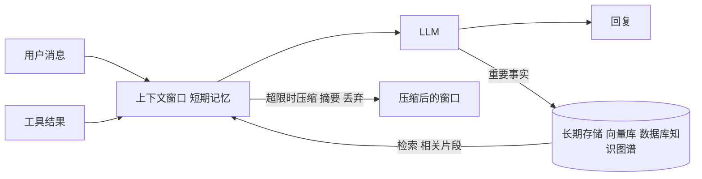
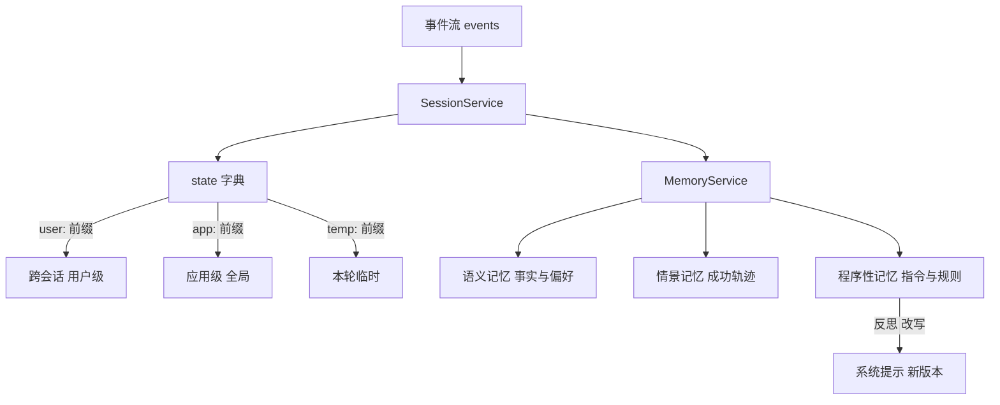

# 第 8 章：记忆管理（Memory Management）

- **难度**：★★★ | **预估学时**：2.5 小时 | **前置**：ch06、ch14（向量检索）、字典与键值存储

## 学习目标

学完本章，你能：
1. 区分短期记忆、长期记忆，以及长期记忆内部的三类（语义/情景/程序性）。
2. 说出上下文窗口的三个真实限制，并给出两种压缩策略。
3. 解释为什么"直接修改 state 字典"是反模式，正确做法走哪条路径。

## 一句话核心

记忆不是"把历史都存下来"，而是**决定什么该留在窗口里、什么该沉到外部存储、什么该被丢弃**——一个丢弃策略比一个存储方案更重要。

## 零基础讲解

### 概念 1：短期记忆与长期记忆（难度：基础）

**短期记忆**就是上下文窗口里的东西：最近几轮消息、模型的回复、工具返回结果、当前这轮的反思。它的三个限制必须记牢：

1. **容量有限**。窗口再大也是有限的，超出部分被截断或忽略。
2. **会话结束就没了**。长上下文模型只是把窗口变大，不改变"临时"这个性质。
3. **每轮都要重付成本**。窗口里的每个 token 每次调用都要重新计费，长上下文不是免费的。

**长期记忆**是外部存储：数据库、知识图谱、向量库。需要时检索出来，塞回短期记忆。

**类比**：人的工作记忆 vs 长期记忆。你在算一道题时脑子里同时装着几个数（短期），查手册找公式（检索长期）。类比失效的地方：人的遗忘是渐进的，智能体的上下文是被硬截断的——超出窗口的那部分不是"模糊了"，是"彻底看不见"。

**图示**：

看图说明：看两个动作——"压缩"发生在窗口内部（摘要旧消息、丢掉工具返回的原文），"沉淀"发生在窗口外（把用户偏好、任务结论写进长期存储）。只有压缩没有沉淀，跨会话就永远是陌生人；只有沉淀没有压缩，一次长任务就会撑爆窗口。

### 概念 2：会话、状态、记忆三层（难度：进阶）

书里用 ADK 的模型讲得很清楚，这三层很容易混：

| 层 | 是什么 | 生命周期 | 类比 |
|---|---|---|---|
| Session | 一条聊天线程，记录该线程的 events（消息与行为） | 一次会话 | 一次通话的记录 |
| State | 会话内的临时数据字典（键值对） | 随会话，可用前缀跨会话 | 通话时手边的便签 |
| Memory | 可检索的长期仓库，来自历史会话或外部数据 | 跨会话持久 | 档案室 |

`state` 的键前缀决定作用域，这个设计很实用：
- 无前缀 → 只属于当前会话；
- `user:` → 与该用户绑定，跨会话共享；
- `app:` → 应用级，所有用户共享；
- `temp:` → 仅本轮有效，不持久化。

**实例**：登录工具要记录"登录次数、任务状态、最后登录时间"，这些写进 `user:` 前缀；一次性的中间结果写 `temp:`；全局开关写 `app:`。前缀写错会导致两种事故：写成本该全局的却只在本会话生效（换个会话就失忆），或写成本该会话专属的却污染了所有用户。

### 概念 3：长期记忆的三类（难度：进阶）

这个分类借自认知科学，很值得记：

1. **语义记忆（记事实）**：用户偏好、领域知识、实体属性。实现形式通常是用户画像 JSON 或事实三元组集合。
2. **情景记忆（记经历）**：过去发生过什么、任务是怎么完成的。实现形式常是 few-shot 示例——把成功的交互序列存下来，下次当例子给模型看。
3. **程序性记忆（记规则）**：怎么做一件事，即智能体的指令与行为准则，通常住在系统提示里。它可以被"反思"（第 4 章）改写——这就是"自我优化指令"。

**为什么这个分类有用**：三类记忆的更新方式完全不同。语义记忆靠抽取与去重，情景记忆靠检索与示例化，程序性记忆靠版本管理与回滚（改错了要能退回去）。

### 概念 4：反模式——直接改 state（难度：高难）

书里明确警告：直接修改 `session.state` 字典会绕过标准事件处理机制，后果有四条：
1. 变更不被记录（事件流里没有这条）；
2. 无法持久化；
3. 可能引发并发问题；
4. 元数据不更新。

正确做法是走事件：`output_key` 把最终文本存进 state，或者手动构造 `state_delta` 附在事件上，由 `SessionService` 统一合并与持久化。

**这个反模式的本质**：状态不只是数据，它是**带日志的数据**。绕过日志写入，等于放弃了可回溯性。任何需要"事后复现一次失败"的系统，都不能这么干。

## 图示

看图说明：图的左半边是"一次会话内部的账本"，右半边是"跨会话的档案室"。中间那条 SessionService→MemoryService 的线表示会话结束时该做的沉淀动作——很多实现漏掉这一步，导致长期记忆永远是空的。

## 类比与实例

- **类比**：医院的病历系统。门诊记录（Session）只属于这一次就诊；病历本上的过敏史、慢病（user 级 state）跟着这个病人走；科室通用的诊疗规范（app 级）所有人共用；检验单原件归档到病案室（Memory），需要时调阅。
- **失效边界**：病案室的检索靠病案号，精确；向量检索靠语义，会召回"相关但不该用"的旧病历（比如十年前的用药方案）。所以长期记忆必须带时间戳和来源，检索后还要过滤。
- **实例（带数字）**：一个客服智能体的会话有 40 轮，每轮平均 300 token，工具返回占其中 60%。若全部保留，窗口约 12,000 token。压缩策略：保留最近 6 轮原文（1,800 token）+ 更早轮次的摘要（500 token）+ 当前任务的关键字段（订单号、诉求、已尝试步骤，约 200 token），总计约 2,500 token，是原来的 1/5，且关键信息没丢。这就是"压缩 + 结构化沉淀"的组合。

## 常见误解

- **别以为长上下文模型就不需要记忆管理**——实际上窗口越大，每轮成本越高，无关信息越多注意力越分散（第 16 章会量化）。长上下文是"能装更多"，不是"该装更多"。
- **别以为记忆就是聊天记录**——实际上聊天记录只是情景记忆的原料。语义记忆（用户偏好）需要抽取，程序性记忆（规则）需要版本化，都不是"存原文"能解决的。
- **别以为向量库存进去就等于记住了**——实际上没有检索质量控制，长期记忆会变成一个"什么都有、什么都查不准"的仓库。
- **别以为 state 可以直接改**——实际上必须走事件，否则不可回溯、不可持久化。

## 自测题（答案）

1. （单选）`session.state` 中键名为 `user:preferred_language` 的数据，其作用域是？
   - A. 仅当前一轮
   - B. 仅当前会话
   - C. 与该用户绑定，跨会话
   - D. 所有用户共享

   **答案**：C。**解析**：`user:` 前缀表示用户级作用域，跨会话共享；`app:` 才是全局，`temp:` 是本轮。

2. （简答）为什么"直接修改 state 字典"是反模式？至少说出两个后果。
   **答案**：变更不进入事件流，无法被记录与回溯；无法被 SessionService 持久化，进程重启后丢失；并发写可能互相覆盖；元数据（更新时间等）不更新。**解析**：状态是"带日志的数据"，绕过日志即放弃可复现性。

3. （多选）下列哪些属于长期记忆，而不是短期记忆？
   - A. 用户上次提到的偏好语言
   - B. 本轮工具返回的原始 JSON
   - C. 过去成功完成同类任务的交互序列
   - D. 系统提示中的行为准则

   **答案**：A、C、D。**解析**：A 是语义记忆，C 是情景记忆，D 是程序性记忆。B 属于本轮上下文，任务结束后即失效。

4. （填空）短期记忆的三个限制是：容量有限、______、______。
   **答案**：会话结束即丢失；每轮重复计费（成本随长度上升）。**解析**：长上下文模型只缓解第一条，不改变后两条。

## 复习锚点

- 短期 = 窗口，长期 = 外部存储 + 检索。
- 三层：Session（线程）/ State（临时字典）/ Memory（档案室）。
- 长期记忆三类：语义（事实）、情景（经历）、程序性（规则）。
- 状态写入必须走事件，不许直改字典。
