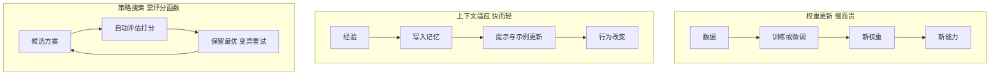

# 第 9 章：学习与适应（Learning & Adaptation）

- **难度**：★★★ | **预估学时**：2.5 小时 | **前置**：ch04 反思、ch08 记忆、监督学习与强化学习的基本概念

## 学习目标

学完本章，你能：
1. 区分六种学习方式，并判断一个具体需求该用哪一种。
2. 说清 PPO 的"裁剪"在解决什么问题，以及 DPO 省掉了哪一步。
3. 解释 SICA 这类自改代码智能体的运行机制，以及它为什么必须隔离在容器里。

## 一句话核心

"学习"在智能体里至少有六条路，绝大多数线上系统用的都不是权重更新，而是**记忆 + 提示 + 路由规则的更新**——先把这条认清，才不会把工程问题当成训练问题。

## 零基础讲解

### 概念 1：六种学习方式（难度：基础）

| 方式 | 一句话 | 典型场景 | 成本 |
|---|---|---|---|
| 强化学习 | 试错，对好结果奖励、坏结果惩罚 | 机器人控制、游戏 | 高（需大量交互） |
| 监督学习 | 从标注样本学输入到输出的映射 | 邮件分类、趋势预测 | 中（需标注） |
| 无监督学习 | 从无标签数据中发现结构 | 聚类、构建环境认知地图 | 中 |
| 少样本/零样本 | 靠提示里的几个例子即时适应 | 新任务快速上线 | 极低 |
| 在线学习 | 用持续到来的新数据不断更新 | 实时数据流场景 | 中高 |
| 基于记忆的学习 | 回忆过去经验，在相似场景调整行为 | 有长期记忆的智能体 | 低 |

**最实用的判断**：如果问题是"它不知道我们公司的规矩"，用记忆 + RAG（低成本）；如果是"它判断得不准"，考虑监督学习或换模型；如果是"它策略不对、总是选错路"，才轮到强化学习。

**书里对"适应"的定义**很清晰：适应是智能体因学习而表现出的行为或知识变化。学习是过程，适应是结果。这两个词经常被混用。

### 概念 2：PPO 与"裁剪"（难度：进阶）

PPO（近端策略优化）是强化学习里最常用的算法之一，用在连续动作空间（机器人关节、游戏角色控制）。

它的核心是**小步更新**。传统策略梯度一次更新可能把策略推得很远，结果性能崩塌、之前学到的全丢。PPO 用"裁剪"目标函数限制每次更新的幅度：


```
L_CLIP(θ) = E[ min( r_t(θ)·A_t , clip(r_t(θ), 1-ε, 1+ε)·A_t ) ]
```


其中 `r_t(θ) = π_θ(a_t|s_t) / π_old(a_t|s_t)` 是新旧策略对同一动作的概率比，`A_t` 是优势函数（这个动作比平均水平好多少），`ε` 通常取 0.2。

**逐项读这个公式**：
- `r_t` 大于 1 表示新策略更愿意做这个动作；
- 如果这个动作是好的（`A_t>0`），我们希望增大 `r_t`，但 `clip` 把它卡在 `1+ε`；
- 如果这个动作是坏的（`A_t<0`），我们希望减小 `r_t`，但 `clip` 把它卡在 `1-ε`；
- 外层 `min` 保证取更保守的那个值——**永远偏向不冒进**。

**类比**：开车微调方向盘。每次只打一点点，看清路况再继续；一把打满容易冲出车道。失效边界：如果整条路都要转弯，小步更新会很慢，PPO 在某些任务上收敛速度确实是代价。

### 概念 3：DPO 省掉了什么（难度：进阶）

传统对齐流程是两步：先用人类偏好数据训练一个**奖励模型**，再用 PPO 让 LLM 去最大化奖励模型的分数。

问题有两个：复杂，且不稳定——LLM 会"钻空子"，找到能骗高奖励模型分但质量很差的输出（reward hacking）。

DPO（直接偏好优化）跳过奖励模型，直接用偏好数据（"回答 A 比回答 B 好"）更新策略。它的目标可以理解为：提高生成偏好回答的概率，降低生成不偏好回答的概率。

**省掉的是"训练奖励模型"这一步**，换来的是更稳、更简单。代价是不能再灵活地在线调整奖励标准。

### 概念 4：SICA——自己改自己的代码（难度：高难）

SICA（自我改进编码智能体）是本章最有意思的案例：它既是修改者也是被修改者。

流程：
1. 回顾历史版本及其基准测试表现，选出得分最高的版本（综合成功率、时间、计算成本加权）；
2. 基于该版本自我修改，直接改代码库；
3. 修改后再跑基准测试，结果归档；
4. 循环。

它实际演化出来的能力很具体：从简单文件覆盖 → 智能编辑器 → 差异增强智能编辑器 → 最小差异输出优化（用 AST 解析）；导航方面从无 → AST 符号定位器 → 混合符号定位器。这些都不是人写的规则，是它自己改出来的工具。

**两个必须有的配套**：
1. **异步监督者**：另一个 LLM 并行监控，识别循环或停滞，可以终止执行。没有它，自改系统会陷在无效迭代里烧钱。
2. **容器隔离**：智能体能执行 shell 命令，必须在 Docker 容器内运行，与主机隔离。这不是可选项，是前提。

**书里也诚实承认了瓶颈**：让 LLM 每轮都提出"新颖、可行、有趣"的修改仍然是研究难题。也就是说，这类系统容易收敛到局部最优。

### 概念 5：AlphaEvolve 与 OpenEvolve（难度：进阶）

**AlphaEvolve**（Google）：Gemini Flash 生成大量初始方案，Gemini Pro 做深入分析与优化，自动评估系统按预设标准打分，打分反馈驱动迭代。实际成绩：数据中心调度优化使全球算力使用降低 0.7%；Gemini 架构核心内核提速 23%；发现 4×4 复数矩阵乘法只需 48 次标量乘法；在 75% 的数学开放问题上重新发现现有最优解，20% 实现突破（如亲吻数问题）。

这组数字值得记住，因为它说明"进化式搜索 + 自动评估"在**有明确评分函数**的领域确实能超过人类已有方案。

**OpenEvolve**：开源版本，支持整个代码文件进化（不限于单函数），多目标优化、分布式评估。

**共同前提**：必须有一个**可自动计算的评分函数**。没有评分函数，这套方法一步都走不了。

## 图示



看图说明：三条路对应三种"学习"。左边那条改的是模型本身，慢、贵、需要数据；中间那条改的是记忆与提示，快、便宜、可回滚；下边那条需要明确的评分函数，适合算法优化类任务。选错路径的典型症状是：想解决"它不懂我们业务"，却去搞微调。

## 类比与实例

- **类比**：员工成长。看手册学规范（记忆/RAG）、师傅带徒弟看案例（少样本）、做错了被指出（反思）、长期干一类活形成直觉（在线学习）、参加培训考证（微调）。不同问题对应不同手段。
- **失效边界**：人会主动总结，智能体不会——除非你把总结写成流程（第 4 章反思 + 第 8 章程序性记忆）。
- **实例**：客服智能体的三类改进。话术不准 → 更新提示与示例（小时级）；政策答错 → 更新知识库（分钟级）；分流总错 → 重训路由分类器（天级）。这三件事的成本差三个数量级，混着做就是浪费。

## 常见误解

- **别以为"学习"必须改权重**——实际上绝大多数线上改进是提示、记忆、规则的更新，成本低且可回滚。
- **别以为强化学习能解决一切**——实际上它需要大量交互与明确奖励，很多业务场景给不出可靠奖励信号。
- **别以为自改代码的智能体不需要人管**——实际上它必须有监督者与容器隔离，否则是灾难。
- **别以为评估打分可以随便定**——实际上 AlphaEvolve 那类系统的效果完全取决于评分函数是否真的代表目标；评分函数写错，进化会朝错误方向狂奔（这就是 reward hacking 的进化版）。

## 自测题（答案）

1. （单选）"让智能体学会公司的报销规则"最该用哪种方式？
   - A. 强化学习
   - B. 把规则写进知识库并用 RAG 检索
   - C. 从头预训练
   - D. 自我修改代码

   **答案**：B。**解析**：这是知识缺失而非策略问题，记忆 + 检索成本最低、可即时更新、可溯源。

2. （简答）PPO 的裁剪机制解决什么问题？用一句话说明它的保守性来源。
   **答案**：解决策略更新步长过大导致的性能崩塌（灾难性遗忘）。保守性来自对概率比 `r_t` 的截断（限制在 `1±ε`）与外层取 min，保证新策略不会在单次更新中偏离旧策略太远。**解析**：核心是"信任区间"。

3. （多选）SICA 这类自改代码智能体必须具备的配套措施包括？
   - A. 异步监督者，检测循环或停滞并可终止
   - B. 容器隔离，限制文件系统与命令执行的影响
   - C. 基准测试与历史版本归档
   - D. 完全放开权限以提升改进速度

   **答案**：A、B、C。**解析**：D 与安全前提相反。

4. （填空）进化式算法优化（AlphaEvolve / OpenEvolve）的前提是存在一个______。
   **答案**：可自动计算的评分函数（评估系统）。**解析**：没有评分就无法选择更优方案。

## 复习锚点

- 六种学习：RL、监督、无监督、少样本、在线、基于记忆。
- 先问"是知识缺失还是策略错误"，再选路径。
- PPO 靠裁剪限制步长；DPO 省掉奖励模型。
- 自改系统三件套：评分、监督者、容器隔离。
