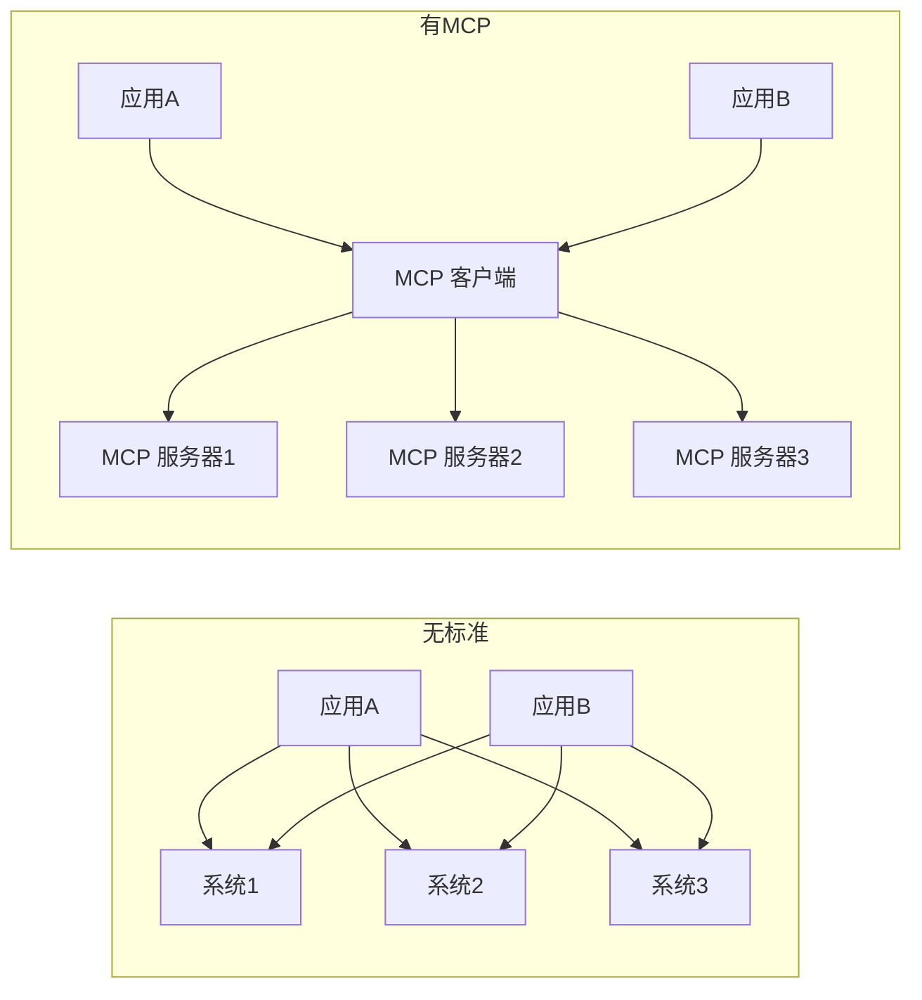
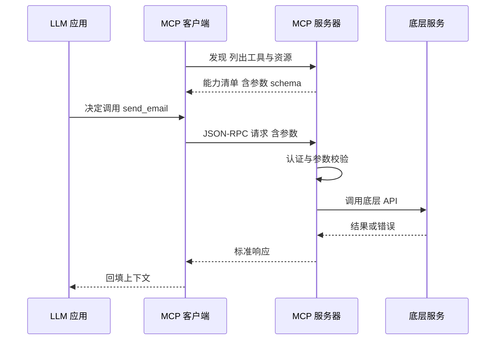

# 第 10 章：模型上下文协议（MCP）

- **难度**：★★☆ | **预估学时**：2 小时 | **前置**：ch05 工具使用、客户端-服务器架构、JSON-RPC

## 学习目标

学完本章，你能：
1. 说清 MCP 解决的 N×M 问题，并算出没有标准协议时的集成数量。
2. 区分工具、资源、Prompt 三类暴露物，各举一例。
3. 解释"把旧 API 直接包成 MCP 反而更差"这个现象，并给出改法。

## 一句话核心

MCP 的价值不在"多了一个协议"，而在把 M×N 次定制集成压缩成 M+N 次——它是一份**接口契约**，不是一个新工具。

## 零基础讲解

### 概念 1：N×M 问题（难度：基础）

设你有 4 个 LLM 应用（自家助手、客服机器人、IDE 插件、数据分析工具）和 6 个外部系统（邮件、日历、数据库、CRM、文件存储、支付）。不做标准化，每个应用接每个系统都要写一套适配代码：


```
4×6=24 套集成
```


每增加一个系统，就要为 4 个应用各写一套；每增加一个应用，就要对接 6 个系统。这就是 N×M 的膨胀。

有了 MCP，每个应用只需实现一次客户端，每个系统只需实现一次服务端：


```
4+6=10 个实现
```


**类比**：电源插座。不是每个电器配一种墙插，而是统一标准，谁都能插。类比失效的地方：插座只传电，MCP 要传"工具清单、参数结构、执行结果、错误码"，语义复杂得多，所以协议本身也有实现成本。

**图示**：



看图说明：左边是网状结构，连线的数量随应用与系统数量相乘；右边是星形结构，连线数相加。这张图就是 MCP 的全部经济账。

### 概念 2：三类暴露物（难度：进阶）

MCP 服务器可以暴露三种东西，边界要分清：

| 类型 | 是什么 | 例子 | 谁决定用它 |
|---|---|---|---|
| 资源（Resource） | 静态数据 | 一份 PDF、一张表、一条数据库记录 | 客户端按需读取 |
| 工具（Tool） | 可执行功能 | 发邮件、查订单、生成图片 | 模型决定调用 |
| Prompt | 引导交互的模板 | "审阅这份合同"的标准提示 | 服务器提供，客户端采用 |

**容易混的是资源和工具**：资源是"取回来看"，工具是"做了会改变世界"。判断标准：这个操作有没有副作用。查询类是资源或只读工具；发送、写入、删除是工具。

### 概念 3：架构与交互流程（难度：进阶）

MCP 是客户端-服务器模型，四层角色：
1. **LLM**：决定要不要用、用哪个、参数怎么填。
2. **MCP 客户端**：把模型意图翻译成标准请求，负责发现、连接、通信。
3. **MCP 服务器**：把外部能力按协议暴露（通常一个服务器管一个领域）。
4. **第三方服务**：真正干活的 API、数据库、SaaS。

五步流程：**发现**（客户端查服务器有哪些工具）→ **构造请求** → **通信** → **服务器执行**（认证、校验、调底层）→ **响应回填**。

传输机制有两种，书里说得很具体：
- 本地：`JSON-RPC over STDIO`（进程间通信，快，适合敏感数据）；
- 远程：`Streamable HTTP` 与 `SSE`（支持持久连接，适合组织共享与扩展）。

### 概念 4：MCP 不等于万能（难度：高难）

书里有一段很硬的提醒，值得完整记住：**MCP 效果高度依赖底层 API 的设计**。

两个反例：
1. 工单系统 API 只能逐条取详情。包成 MCP 之后，模型要汇总"所有高优先级工单"，只能一条条拉，慢且容易漏。**正确做法**是底层 API 本身支持过滤和排序，MCP 只负责暴露这个能力。
2. 文档存储 API 只返回 PDF 二进制。模型读不了 PDF，这个 MCP 服务器就等于没接。**正确做法**是先提供一个返回 Markdown 文本的接口。

结论：**智能体不能神奇地替代确定性流程**。过滤、排序、分页、格式转换这些确定性工作应该由 API 做，而不是让模型去"想办法"。

### 概念 5：MCP 与函数调用的区别（难度：进阶）

| 维度 | 函数调用 | MCP |
|---|---|---|
| 标准化 | 厂商专有，格式各异 | 开放标准 |
| 范围 | 模型直接请求某个已告知的函数 | 通用框架，支持发现与通信 |
| 架构 | 一对一 | 客户端-服务器，可连多个服务器 |
| 发现 | 需要显式把工具清单塞进提示 | 支持动态发现，无需重启 |
| 复用 | 与应用强耦合 | 服务器独立可复用 |

判据：**固定少量函数 → 直接函数调用足够；需要跨应用复用、动态发现、多源接入 → 上 MCP**。很多团队在只有 3 个内部工具时上 MCP，属于过度工程。

## 图示



看图说明：注意服务器在调底层之前做了两件事——认证和参数校验。这两步是安全边界所在，也是 MCP 相比"直接暴露函数"更可控的地方。

## 类比与实例

- **类比**：USB 接口。外设厂商不用为每种电脑做专用接头，电脑也不用预装每种外设的驱动格式。
- **失效边界**：USB 只定义电气与协议，不保证设备好用（劣质 U 盘照样读写失败）。MCP 也一样——协议规范了"怎么连"，不保证"连上之后的数据能不能用"。
- **实例**：FastMCP 写一个服务器只要几行：

```python
from fastmcp import FastMCP
mcp = FastMCP("greet")

@mcp.tool()
def greet(name: str) -> str:
    """生成个性化问候语。"""
    return f"你好，{name}！"
```

函数名成为工具名，类型提示成为参数 schema，docstring 成为工具描述。客户端（比如 ADK 智能体）配置服务器地址与 `tool_filter`（只开放 `greet`），就能在对话里触发它。`tool_filter` 这个设计很实用：能力暴露得越少，模型选错的概率越低。

## 常见误解

- **别以为 MCP 是模型能力**——实际上它是接口标准，模型不会因为接上 MCP 就变聪明，它只是多了几个可调用的能力。
- **别以为协议统一了就不需要改后端**——实际上后端 API 若不支持过滤、排序、分页、文本化，MCP 也救不了。
- **别以为暴露的工具越多越好**——实际上工具越多选错概率越高，应该用 `tool_filter` 按场景裁剪。
- **别以为 MCP 一定比函数调用好**——实际上只有 2~3 个固定工具时，函数调用更简单、更可控。

## 自测题（答案）

1. （计算）3 个 LLM 应用与 5 个外部系统，不作标准化需要多少套集成？用 MCP 后需要多少个实现？
   - A. 15 套；8 个
   - B. 8 套；15 个
   - C. 15 套；2 个
   - D. 5 套；8 个

   **答案**：A。**解析**：无标准为 3×5=15；有标准为 3+5=8。

2. （简答）为什么"把只返回 PDF 的文档 API 直接包成 MCP 服务器"是错误的做法？
   **答案**：因为模型无法解析 PDF 二进制，接入后仍然读不到内容，等于没接。正确做法是先提供一个返回 Markdown 或纯文本的接口，再做 MCP 暴露。这说明 MCP 只管连接方式，数据可用性要由底层 API 保证。**解析**：协议不解决"数据能不能被模型理解"。

3. （多选）MCP 服务器可暴露的三类能力是？
   - A. 资源（静态数据）
   - B. 工具（可执行功能）
   - C. Prompt（交互模板）
   - D. 模型权重

   **答案**：A、B、C。**解析**：D 不属于 MCP 暴露范围。

4. （填空）MCP 的两种传输机制：本地用______，远程用______。
   **答案**：JSON-RPC over STDIO；Streamable HTTP 与 SSE。**解析**：见概念 3。

## 复习锚点

- MCP 的经济账：N×M → N+M。
- 三类暴露物：资源（读）、工具（做）、Prompt（模板）。
- 关键提醒：底层 API 不支持确定性能力，MCP 救不了。
- 只有少量固定工具时，函数调用更划算。
