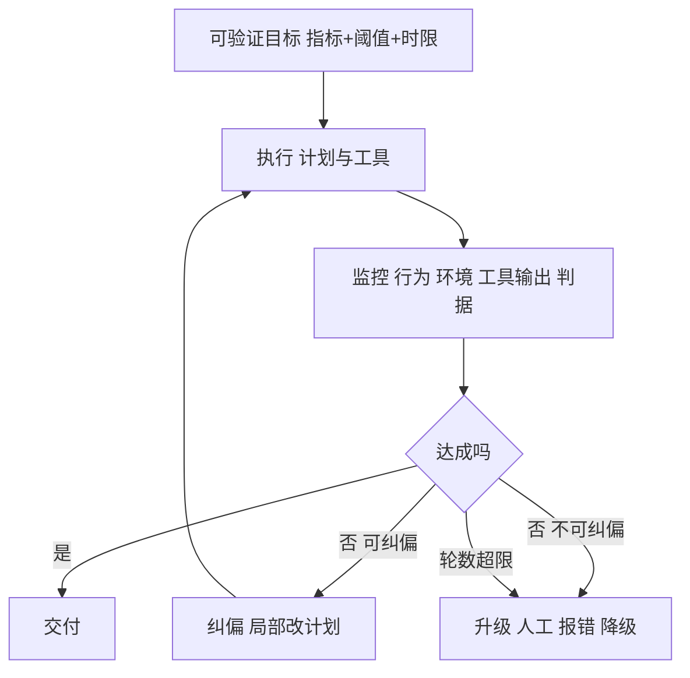
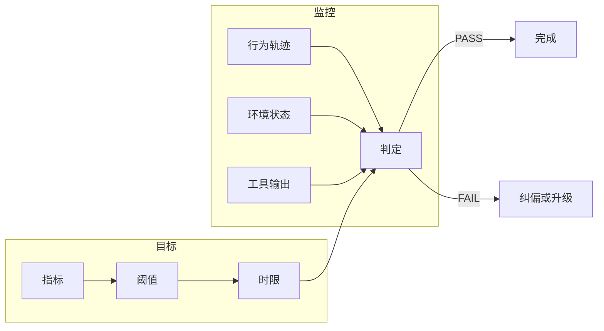

# 第 11 章：目标设定与监控（Goal Setting & Monitoring）

- **难度**：★★☆ | **预估学时**：2 小时 | **前置**：ch06 规划、ch04 反思

## 学习目标

学完本章，你能：
1. 把一个模糊目标改写成符合 SMART 的可验证目标，并给出对应的监控指标。
2. 画出"目标 → 执行 → 监控 → 判定 → 纠偏/升级"的闭环，指出出口在哪。
3. 解释为什么"同一个模型既写又评"会失效，以及怎么用职责分离解决。

## 一句话核心

目标决定"什么叫成功"，监控决定"现在离成功多远"，两者必须同时可判定——只有目标没有监控是口号，只有监控没有目标是瞎忙。

## 零基础讲解

### 概念 1：可验证目标（难度：基础）

**白话定义**：一个目标如果不能在某个时刻被判定为"达成"或"未达成"，它就不是目标，是愿望。

书里引了 SMART 原则：具体（Specific）、可衡量（Measurable）、可达成（Achievable）、相关（Relevant）、有时限（Time-bound）。这个原则的价值不在记缩写，在它逼你把四个空缺填上：**指标是什么、阈值是多少、什么时候判、谁来判断**。

**改写的三个例子**：

| 原始目标 | 问题 | 改写 |
|---|---|---|
| 提升学生对代数的理解 | 无法判定 | 两周内，目标学生在 20 题代数测验中正确率从 60% 提升到 80%，且完成时间不超过 25 分钟 |
| 把客户的问题解决好 | 无法判定 | 账单金额调整后在系统中可验证为正确，且客户在下一轮对话中确认无异议；否则 3 轮内升级人工 |
| 让代码质量更好 | 无法判定 | 通过全部单元测试，且无未捕获异常；静态检查无 error 级告警 |

**类比**：体检报告。你不会跟医生说"我想更健康"，你会说"三个月内 LDL 降到 3.4 以下"。类比失效的地方：体检指标是既定的，智能体的目标往往要自己拆出指标——这一步拆错，后面全错。

### 概念 2：监控回路（难度：进阶）

监控不是"看一眼日志"，它有四个必须观测的对象：
1. **智能体自身行为**（它调用了什么工具、走了哪一步）；
2. **环境状态**（数据库里的余额、库存、日程）；
3. **工具输出**（返回了什么，是否符合预期）；
4. **目标的达成判据**（用可验证的方式判定）。

判定结果有三种出路：
- **达成** → 结束，交付；
- **未达成但可纠偏** → 回到执行或回到计划（局部修改）；
- **未达成且不可纠偏** → 升级（转人工、报错、降级服务）。

**关键设计点**：三种出路必须**显式写在代码里**，不能交给模型"看着办"。否则系统会在"未达成"状态里无限循环——书里的示例代码也承认了这个风险，它把最大迭代次数设成 5 就是为了兜住死循环。

**图示**：

看图说明：注意出口有三个（交付、升级、超限升级），没有"继续尝试"这个无边界的出口。设计闭环时先画出这三个出口，再谈中间怎么走。

### 概念 3：职责分离（难度：进阶）

书里对示例代码给了一段很诚实的自我批评：当同一个 LLM 既写代码又评审代码时，它发现自身偏离目标的能力有限；即使目标明确，模型也可能幻觉式地判定"已达成"。

解法是拆角色：编程助手 / 代码评审员 / 文档员 / 测试编写员 / 提示优化师。每个角色有专属系统提示。

**为什么有效**：不是因为"多一个模型更聪明"，而是因为**判据被执行者之外的角色持有**。评审员看的是"这份代码是否符合检查表"，它不需要为"我写得好"负责。

**这和第 4 章的批评者是同一个道理**：视角分离 + 判据外部化。

### 概念 4：目标在框架里怎么落地（难度：进阶）

书里说，在 ADK 里目标通常通过**智能体指令**（instruction）传递，监控通过**状态管理**与**工具交互**实现。

这句可以展开成三条实践：
1. 目标写进系统提示，且写成可判定的句式（"当且仅当……时视为完成"）。
2. 进度写进 state（第 8 章），让每一轮都能读到"当前到哪一步了"。
3. 判定尽量交给工具或代码（查数据库、跑测试），不要交给模型自由心证。

## 图示

看图说明：左边三个框是目标的三个必备字段，右边三个是监控的三个观测面，它们在"判定"这个节点汇合。判定节点是全系统的中枢——如果它没有明确规则，前面所有设计都白做。

## 类比与实例

- **类比**：自动化交易。目标不能是"赚钱"，得是"在最大回撤 5% 以内，年化收益不低于 8%"。监控是盯回撤和收益两条线，一旦回撤触线就降仓，不是继续加仓赌反弹。
- **失效边界**：金融指标每秒都在变，判定窗口清晰；很多任务的成功判据是模糊的（"这份报告够不够好"），这时需要把主观判据降级成可检查项清单（是否覆盖 5 个必答问题、是否每个结论都有出处），而不是硬编一个分数。
- **实例（带数字）**：内容审核智能体。目标写成"新内容中，有害内容的召回率 ≥ 95%，误判率 ≤ 2%"。监控每天统计这两个数。若召回率跌到 90%，触发纠偏：放宽分类阈值；若误判率升到 4%，触发另一方向纠偏：收紧阈值并把疑难样本升级人工。两个指标互相拉扯，所以目标必须同时给上下界，只给一个必然失衡。

## 常见误解

- **别以为目标写进提示词就够了**——实际上提示词里的目标只影响"模型想做什么"，不影响"系统怎么判"。判定必须在提示词之外有实现。
- **别以为监控就是记日志**——实际上日志是原料，监控要的是"按判据算出的结论"。没有判定的日志只是事后考古。
- **别以为同一个模型自评就能发现问题**——实际上它倾向于确认自己的产出。职责分离不是效率优化，是可靠性要求。
- **别以为加了最大轮数就安全了**——实际上轮数上限只是兜底，真正的问题是"每轮都没有实质改进却还在跑"。要监控"每轮是否真的改变了状态"，没变化就提前终止。

## 自测题（答案）

1. （单选）下列哪个目标最符合"可验证"要求？
   - A. 让客服体验更好
   - B. 在 3 轮对话内解决客户账单问题，否则升级人工
   - C. 尽量提高系统准确率
   - D. 优化代码质量

   **答案**：B。**解析**：它给出了判定条件（3 轮内）、成功判据（问题解决）与失败出路（升级），可被系统直接判定。

2. （简答）为什么"同一个 LLM 既写代码又评审代码"效果差？正确做法是什么？
   **答案**：模型对自己产出的内容存在确认偏误，倾向于判定"已达成"，而且它无法可靠识别自身偏离目标的地方。正确做法是职责分离：评审角色使用独立系统提示与独立检查表，最好配合可执行的判据（测试、静态检查）。**解析**：有效性来自"执行者与判据持有者分离"。

3. （多选）监控需要观测的对象包括？
   - A. 智能体自身的行为轨迹
   - B. 环境状态（如库存、余额）
   - C. 工具输出
   - D. 目标达成判据的计算结果

   **答案**：A、B、C、D。**解析**：四者缺一不可，尤其 D 常被漏掉，导致"看起来跑完了"但没人算过是否达标。

4. （填空）SMART 中的 M 指______，它要求目标必须有______。
   **答案**：Measurable（可衡量）；明确的指标与阈值。**解析**：没有阈值就没有判定。

## 复习锚点

- 目标四问：指标、阈值、时限、谁判。
- 监控四观测：行为、环境、工具输出、判据。
- 三个出口：交付、纠偏、升级（含超限）。
- 判据必须由执行者之外的角色持有。
