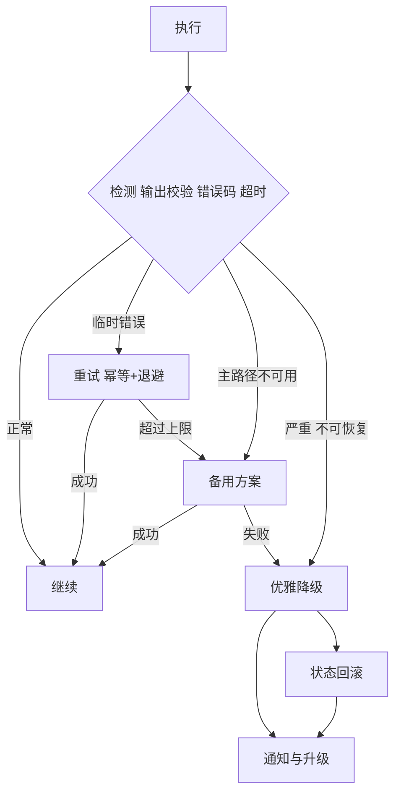

# 第 12 章：异常处理与恢复（Exception Handling & Recovery）

- **难度**：★★☆ | **预估学时**：1.5 小时 | **前置**：ch11 目标设定与监控、HTTP 状态码与重试的基本概念

## 学习目标

学完本章，你能：
1. 说出错误检测的四种手段，并给出各自的触发条件。
2. 区分重试、备用方案、优雅降级、通知、升级五种处理策略的适用条件。
3. 解释为什么"重试必须配幂等"，并识别一个不幂等的重试。

## 一句话核心

异常处理的目标不是"永不失败"，而是**让失败可控**——失败时必须知道发生了什么、能退回到哪、用户看到什么。

## 零基础讲解

### 概念 1：错误检测（难度：基础）

**白话定义**：在错误产生后果之前识别它。书里列了四种手段：

1. **输出校验**：工具返回了，但格式不对、字段缺失、值是空的。
2. **错误码**：HTTP 404（找不到）、500（服务端错误）、429（限流）。
3. **超时**：响应时间异常拉长——这本身就是一种错误信号，不能无限等。
4. **主动探测**：由另一个智能体或监控系统定期检查，提前发现问题。

**类比**：汽车的仪表盘。油量低、胎压异常、发动机故障灯——都是"还没坏但已经不对"的信号。类比失效的地方：车的传感器是专门设计的，智能体的"仪表盘"要你自己造；不造的话，它只会在彻底失败时才知道出事。

**实例**：库存查询工具返回 `{"stock": null}`。这不是抛异常，是一个"看起来成功"的失败。如果代码只判 `response.status == 200`，就会把 `null` 当成"库存为 0"告诉用户——错误被静默吞掉。正确做法是校验字段类型与取值范围。

### 概念 2：五种处理策略（难度：进阶）

| 策略 | 什么时候用 | 关键约束 |
|---|---|---|
| 日志记录 | 所有错误，无例外 | 要带上下文（参数、时间、trace id），否则事后查不出原因 |
| 重试 | 临时性错误（超时、限流、瞬时 500） | **必须幂等**；要有退避与次数上限 |
| 备用方案 | 主路径不可用但目标仍可达 | 备用方案的输出质量要提前验过，不能是"随便给一个" |
| 优雅降级 | 无法恢复，但可保留部分价值 | 必须明确告诉用户"这是降级结果" |
| 通知/升级 | 需要人介入，或问题超出系统能力 | 升级要有明确的接收方与判定条件，不能"发个告警就完事" |

**幂等为什么是硬要求**：重试意味着同一个请求可能被执行两次。如果这个请求是"扣款 100 元"，重试两次就是扣 200。幂等的做法是给每次业务操作一个唯一键（idempotency key），服务端见到重复键就返回第一次的结果而不重复执行。

**实例（反例）**：`send_email(to, subject, body)` 超时后重试，用户收到两封一样的邮件。这是典型的不幂等重试。修法：生成 `message_id`，发送前先查"这个 id 是否已发送"。

### 概念 3：恢复的四个动作（难度：进阶）

书里把恢复单独列为一层，包含：

1. **状态回滚**：撤销最近的更改或事务。要求系统有事务边界，否则"回滚到哪"无法定义。
2. **诊断**：查明原因，防止再犯。诊断的产出应当是"可写入长期记忆的规则"（第 8 章的程序性记忆）。
3. **自我修正/重新规划**：调整计划、逻辑或参数。注意这是"改计划"，不是"再试一次"。
4. **升级**：交给人工或更高层系统。

**和第 4 章反思的关系**：书里明确说这两个模式常结合使用——初次失败抛出异常后，通过反思分析原因，再以改进的方式（如优化提示）重试。这里的分工是：异常处理负责"止住血"，反思负责"想清楚为什么流血"。

### 概念 4：分层降级（难度：高难）

书里的 ADK 示例是一个很典型的三级结构：主工具（精确定位）→ 备用处理器（按城市粗定位）→ 最终输出（拿不到就致歉）。三个子智能体顺序执行，通过 state 里的标志位传递"上一步成功了吗"。

这个结构的价值在于**每一级都降低了要求，但都没有放弃服务**：
- 一级：精确地址 → 精确经纬度；
- 二级：只拿到城市 → 城市级范围；
- 三级：什么都没有 → 诚实告知 + 致歉。

设计降级链时要回答三个问题：每一级的能力边界是什么、降级后要告诉用户什么、什么情况下不再降级直接失败。

## 图示

看图说明：从上到下是"能力递减、诚实递增"的过程——越往下，系统能做的事越少，但对用户说的真话必须越多。图里"重试→备用→降级→通知"是一条单向链，不要设计成能回到重试的环，否则会形成"重试-降级-再重试"的死循环。

## 类比与实例

- **类比**：医院的急诊分级。轻伤自己处理，重伤进抢救室，救不了就转院（升级），同时全程记录病历（日志）。每一步都有明确的判定标准，不靠医生临场感觉。
- **失效边界**：医院有明确的伤情分级量表，智能体的"严重程度"往往没有量表。这时应该按**业务影响**定级（涉及钱、涉及对外发送、涉及删除数据 → 高），而不是按技术错误码定级。
- **实例（带数字）**：批量文档处理，1000 份文件，其中 7 份损坏。正确行为：跳过损坏文件并记录，继续处理 993 份，结束时报告"成功 993，跳过 7，跳过清单如下"。错误行为：第 3 份损坏时整个任务抛异常退出，992 份白跑。前者的完成率是 99.3%，后者是 0.2%。

## 常见误解

- **别以为重试总能解决问题**——实际上对参数错误、权限不足、404 这类确定性错误，重试一万次也是同样的结果，只会放大成本与副作用。
- **别以为捕获异常就等于处理了**——实际上 `catch` 之后只打一行日志然后返回空值，是把错误变成了静默错误，比崩溃更难查。
- **别以为降级是不负责任**——实际上降级加诚实的告知，比硬撑到彻底失败更负责。用户能接受"只能给你城市级信息"，不能接受"给了错误地址还理直气壮"。
- **别以为告警发出去就完成了升级**——实际上升级必须有接收方和响应时限，否则只是"通知了空气"。

## 自测题（答案）

1. （单选）下列哪种错误最**不适合**重试？
   - A. 请求超时
   - B. 服务端 503（暂时不可用）
   - C. 参数校验失败 400
   - D. 限流 429

   **答案**：C。**解析**：400 是确定性错误，参数不改，重试结果不变，还会浪费配额。

2. （简答）为什么重试必须配幂等？举一个不幂等重试造成的事故。
   **答案**：重试意味着同一业务操作可能被执行多次；若操作有副作用（扣款、发邮件、创建订单），重复执行会造成重复副作用。典型事故：发送邮件超时后重试，用户收到两封相同邮件；或扣款请求重试导致扣两次。解法是引入幂等键，服务端见到重复键返回首次结果。**解析**：安全性来自"操作可重复执行而结果不变"。

3. （多选）优雅降级的正确做法包括？
   - A. 保留部分可用功能
   - B. 明确告知用户这是降级结果
   - C. 静默返回空值，避免用户担心
   - D. 记录降级原因以便后续诊断

   **答案**：A、B、D。**解析**：C 是静默失败，会让用户基于错误信息做决策。

4. （填空）书里 ADK 的三级降级链是：精确地址查询 → ______ → ______。
   **答案**：按城市粗定位（备用处理器）；无法获取则致歉（最终输出）。**解析**：见概念 4。

## 复习锚点

- 检测四手段：输出校验、错误码、超时、主动探测。
- 处理五策略：日志、重试（幂等）、备用、降级、通知升级。
- 恢复四动作：回滚、诊断、重新规划、升级。
- 降级链的特征：能力递减，诚实递增。
