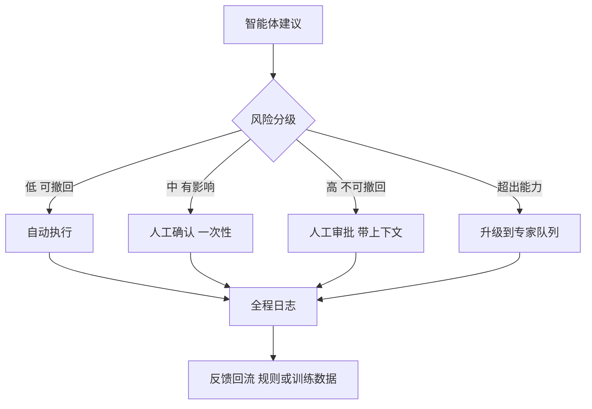

# 第 13 章：人类参与环节（Human-in-the-Loop）

- **难度**：★★☆ | **预估学时**：1.5 小时 | **前置**：ch11、ch12

## 学习目标

学完本章，你能：
1. 列出 HITL 的六个方面（监督、干预、反馈学习、决策增强、协作、升级）。
2. 指出四个必须插入人类审批的节点，并说明各自的判据。
3. 区分 Human-in-the-loop 与 Human-on-the-loop，说清后者适合什么场景。

## 一句话核心

HITL 不是"加个确认弹窗"，而是**在系统里明确划出"机器可以决定"与"必须由人决定"的边界**，并把跨越边界的那一步设计成可阻断的操作。

## 零基础讲解

### 概念 1：HITL 的六个方面（难度：基础）

书里把 HITL 拆成六件事，这个拆分比"人机协作"这种空话有用得多：

1. **人类监督**：通过日志审查或实时仪表盘观察智能体表现，确保它不越界。
2. **干预与纠正**：智能体遇到错误或模糊场景时请求介入，人补充数据、纠错、引导。
3. **人类反馈用于学习**：把人的偏好与纠正回流到模型（RLHF 是典型形态）。
4. **决策增强**：AI 出分析与建议，人做最终决定。注意这不是自动化，是"增强"。
5. **人机协作**：AI 处理常规数据，人负责创造性问题或复杂谈判。
6. **升级策略**：超出能力时按既定协议转人工。

**类比**：飞机的自动驾驶。巡航阶段自动，起降和异常情况由飞行员接管，全程有仪表和记录。类比失效的地方：飞行员本身就受过完整训练，能判断自动系统错在哪；客服或审核岗位的人未必懂模型，所以**交接时必须给上下文**——不能只丢一句"这个 AI 不确定"。

### 概念 2：四个必须插入人类的节点（难度：进阶）

书里在 FAQ 中给出了一组非常实用的清单，可以直接当设计检查表：

| 节点 | 判据 | 反例（不插人的后果） |
|---|---|---|
| 计划审批 | 多步骤计划执行前，尤其涉及外部动作 | 计划里包含"删除旧数据"，没人看就执行了 |
| 工具使用确认 | 工具有现实影响或需要付费 | 模型误调用短信接口，给 1000 个用户群发 |
| 歧义解决 | 智能体不确定如何继续或需要补充信息 | 它自己"猜"了一个订单号，改错了别人的账单 |
| 最终输出审核 | 结果要交付给终端用户或进入下游系统 | 一份带错误数字的报告直接发给客户 |

**判据的核心不是"任务难不难"，而是"错了能不能撤回"**。可撤回的（草稿、内部查询）不必插人；不可撤回的（付款、发送、删除、对外发布）必须插人。

### 概念 3：可扩展性的代价（难度：进阶）

书里对 HITL 的缺点讲得很直白：**可扩展性不足**。操作员管不了几百万个任务，所以现实系统是"自动化 + HITL 混合"。

这条约束直接推出两个设计原则：
1. **按风险分级**，而不是按任务量分流。低风险全自动，高风险抽样或全量人工。
2. **人工要看的不是全部，而是"被判定为可疑的那部分"**。这要求前面有一层可靠的自动判定（第 11 章监控、第 18 章护栏）。

另外两个代价：效果高度依赖操作员的专业水平（AI 能写代码，但只有懂行的开发才能看出细微 bug）；隐私问题（敏感信息要先匿名化才能给人工看）。

### 概念 4：Human-on-the-loop（难度：高难）

书里给了一个很有用的变体：**人在环上**，而不是**人在环中**。

区别：
- in-the-loop：每个关键决策都过人。
- on-the-loop：人制定策略与规则，AI 按规则实时执行，人只在异常或策略调整时介入。

**实例（书里的两个）**：
1. 量化交易。人定规则："70% 科技股、30% 债券；单只不超过 5%；跌破买入价 10% 自动卖出"。AI 实时按规则交易。人负责慢决策，AI 负责快执行。
2. 呼叫中心。经理定政策："提到'服务中断'立即转技术支持；客户情绪高度沮丧时主动提供转人工"。AI 实时识别并执行。

**什么时候用 on-the-loop**：决策频率高、单次决策价值低、规则可以被清楚写出来的场景。反过来，单次决策价值极高（一笔贷款审批）、规则写不出来的场景，必须 in-the-loop。

## 图示

看图说明：四个分支上方的"风险分级"是全图的入口——分级标准定错，后面所有审批都会放错位置。右下那条"反馈回流"是 HITL 从"救火"升级为"减少未来救火"的关键：人的每次纠正都应该变成规则或训练样本，而不是一次性的。

## 类比与实例

- **类比**：银行的大额转账。小额免密，中额短信验证，大额柜台面签。同一套业务，按金额分级，不同级别走不同流程。
- **失效边界**：银行的风险阈值是监管定的、长期稳定的；智能体的风险阈值要随业务变化调整，而且"金额"这种可量化维度在智能体任务里往往找不到对应物（"这条内容该不该删"没有金额）。
- **实例（带数字）**：内容审核。日均 200 万条内容，全人工不现实。方案：自动模型先判，置信度 > 0.95 的直接处置（约 85%），0.6~0.95 的进人工队列（约 12%），< 0.6 的直接不处置但记录（约 3%）。人工每天处理 24 万条，需要约 120 人（每人 2000 条/日）。这个算法把"不可扩展"变成了"可预算"。

## 常见误解

- **别以为 HITL 就是加一个"确认/取消"按钮**——实际上确认按钮如果不带上下文（模型为什么这么建议、影响是什么、有无备选），人只能盲点。上下文是 HITL 的一部分。
- **别以为人越多越安全**——实际上每个审批点都会增加延迟和疲劳，疲劳会让人开始盲目点"同意"，安全性反而下降。审批点要少而准。
- **别以为 HITL 只是合规摆设**——实际上它最重要的产出是**纠正数据**，这些数据能改进模型与规则，是长期收益。
- **别以为 on-the-loop 比 in-the-loop 更先进**——实际上它是用"规则可写"换"决策吞吐"，规则写不出来的场景用它是灾难。

## 自测题（答案）

1. （单选）下列哪个环节**最不需要**插入人类审批？
   - A. 向 1000 名用户群发营销短信
   - B. 在内部沙箱中查询一份文档
   - C. 执行一笔 5 万元的付款
   - D. 删除生产库中的一张表

   **答案**：B。**解析**：只读、可撤回、无外部影响的操作不需要人工审批。其余三项都不可撤回或影响外部。

2. （简答）Human-on-the-loop 与 Human-in-the-loop 的核心区别是什么？各自适合什么场景？
   **答案**：in-the-loop 是每个关键决策都经人；on-the-loop 是人制定策略与规则，AI 按规则实时执行，只在异常或策略调整时介入。前者适合单次决策价值高、规则难以写出的场景（贷款审批、司法判决）；后者适合决策频率高、单次价值低、规则可写清的场景（量化交易、呼叫中心分流）。**解析**：本质是"决策权放在哪一层"，不是"人参与多少"。

3. （多选）HITL 的主要代价包括？
   - A. 可扩展性不足，人工吞吐有上限
   - B. 效果依赖操作员的专业水平
   - C. 涉及隐私，需要匿名化处理
   - D. 会让模型完全失去自主性

   **答案**：A、B、C。**解析**：D 错。HITL 是按风险分级插入人工，多数环节仍自动执行。

4. （填空）判断是否需要插人，最实用的判据是"______"。
   **答案**：错了能不能撤回（不可撤回则必须插人）。**解析**：比"任务难度"更可操作。

## 复习锚点

- HITL 六方面：监督、干预、反馈学习、决策增强、协作、升级。
- 四个审批节点：计划、工具、歧义、最终输出。
- 判据一句话：**错了能不能撤回**。
- on-the-loop = 人定规则，AI 执行；适合高频低价值决策。
