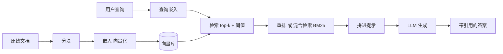

# 第 14 章：知识检索（RAG）

- **难度**：★★★ | **预估学时**：3 小时 | **前置**：ch05 工具使用、向量与内积、余弦相似度

## 学习目标

学完本章，你能：
1. 手算两个三维向量的余弦相似度，并解释为什么检索要用余弦而不是欧氏距离。
2. 说清 RAG 四个环节（分块、嵌入、检索、增强）各自会引入什么误差。
3. 区分标准 RAG、GraphRAG、智能体 RAG 的适用边界与成本。

## 一句话核心

RAG 做的事只有一件：**在模型开口之前，把"它该看的那几页"塞到它眼前**。所有技术细节（分块、嵌入、向量库、重排）都是在回答"哪几页才对"。

## 零基础讲解

### 概念 1：为什么需要 RAG（难度：基础）

LLM 的知识是训练时冻结的。它不知道你公司上周发布的报销新规，也不知道实时库存。两种补法：把知识塞进权重（微调，第 9 章会提），或者把知识塞进上下文（RAG）。RAG 便宜、可更新、可引用，所以成了默认选择。

**类比**：闭卷考试 vs 开卷考试。闭卷靠记忆，记错了也自信；开卷能翻书，但你得会查目录。RAG 就是给模型配了一个会查目录的助手。失效边界：开卷考试里，如果目录指错了页，考生会照着错页自信地答——这就是"检索到无关块"的危害，比没有检索更糟，因为它给了模型一个看似权威的错误依据。

### 概念 2：嵌入与余弦相似度（难度：进阶，本章重点）

**白话定义**：嵌入是把一段文本映射成一个高维向量（一串数）。映射的性质是：意思相近的文本，向量方向相近。

**为什么要"方向"而不是"距离"**：看余弦相似度的定义。对两个向量 `a,b`：


```
cosθ = (a · b) / (‖a‖ · ‖b‖)
     = Σ(a_i · b_i) / ( √Σa_i² · √Σb_i² )
```


分子是内积，分母是两个向量的长度之积。这个比值只取决于两个向量之间的夹角 `θ`，与它们各自多长无关。

**手算一遍（可复核）**：

设三维玩具空间里

```
q=(1,2,2), d_1=(2,4,4), d_2=(2,1,0)
```


先算 `q` 与 `d_1`：
- 内积 `=1×2+2×4+2×4=2+8+8=18`
- `‖q‖=√1+4+4=√9=3`
- `‖d_1‖=√4+16+16=√36=6`
- `cosθ = 18/(3×6) = 18/18 = 1`

`q` 与 `d_2`：
- 内积 `=1×2+2×1+2×0=4`
- `‖d_2‖=√4+1+0=√5≈2.236`
- `cosθ = 4/(3×2.236) = 4/6.708 ≈ 0.596`

结论：`d_1` 与查询的余弦是 1，完全同向；`d_2` 是 0.596，夹角约 53.4°。

**关键观察**：`d_1` 的每个分量都是 `q` 的两倍，欧氏距离 `‖d_1-q‖=√1+4+4=√9=3`，并不小。但如果只看欧氏距离，你可能误判它"离得远"；余弦却准确告诉你：它和查询说的是同一件事，只是"说得更长"。在实际嵌入里，长文档的向量模长往往更大，用欧氏距离会被长度干扰，所以检索默认用余弦（或先把向量归一化再取内积，二者等价）。

**为什么高维可行**：真实的嵌入是 768 维、1024 维甚至更高。高维空间里"语义相近 ⇒ 夹角小"这个性质是训练出来的，不是数学必然；这也是为什么换一个嵌入模型，检索效果会整体变化——向量空间的几何形状被换了。

### 概念 3：RAG 四环节与各自的误差源（难度：进阶）

**（1）分块（chunking）**。把文档切成可检索的小块。典型参数：块长 500 字、重叠 50 字（书里的示例就是 `chunk_size=500, chunk_overlap=50`）。

- 为什么要有重叠：一句话的意思可能跨在两块的边界上，重叠让边界信息不至于被切断。
- 误差源：切太碎，单块缺少上下文（"该参数默认 30"里"该参数"指谁？）；切太大，检索精度下降且浪费 token。
- 判断标准：**一个块单独拿出来，能不能不依赖前后文被理解**。

**（2）嵌入**。把块编码成向量。

- 误差源：模型对领域词的表示能力。法律、医疗、内部黑话，通用嵌入模型常常表示不好，这时要用领域微调的嵌入模型。

**（3）检索**。在向量库里找最近的 k 个块。

- 误差源一：召不回（相关信息存在但没进 top-k）。
- 误差源二：召不准（进了 top-k 但无关）。
- 常见补救：混合检索。BM25（基于词频的经典算法，擅长精确匹配专有名词、编号）与向量检索（擅长语义近似）各取所长，合并候选后再重排。书里明确点了这个组合。
- 参数：`similarity_top_k=5` 与 `vector_distance_threshold=0.7` 是书里给出的典型配置——前者控制"取几条"，后者控制"低于这个相似度就不要"。只调 k 不设阈值，会在知识库没有相关内容时硬塞 5 条噪声进去。

**（4）增强**。把检索到的块拼进提示。

- 误差源：块之间可能互相矛盾（2020 年博客与 2025 年官方政策）。标准 RAG 不解决这个问题，它只是把矛盾原样交给模型，模型可能挑错的那条。

### 概念 4：三个版本的 RAG（难度：高难）

**标准 RAG**：检索 → 拼接 → 生成。被动管道，便宜，快。适用于问题简单、知识库干净的场景。

**GraphRAG**：用知识图谱（实体为节点、关系为边）代替或补充向量库。适合"答案分散在多个文档、需要顺着关系走"的问题，比如"A 公司的供应商里，哪些同时供货给 B 公司"。代价极高：建图、维护图、保证图质量都需要专业投入，延迟也更高。书里的判断很直接——效果完全依赖底层图结构的质量和完整性。

**智能体 RAG**：在检索与生成之间插入一个会思考的智能体，它做四件事：
1. **来源验证**：识别哪份文件更新、更权威，丢掉过时的。
2. **冲突调和**：两份文件说 Q1 预算分别是 5 万欧和 6.5 万欧，按可靠度选后者。
3. **多步拆解**：把复杂对比问题拆成多个子查询，分别检索再综合。
4. **知识空缺识别**：内部库查不到就转去调 Web 搜索工具。

代价同样明确：多一层智能体 = 更多延迟、更高成本，而且智能体本身会成为新的错误源（推理跑偏、陷入无用循环、错误丢弃了相关信息）。

## 图示



看图说明：整条链路里只有最后一步是模型生成，前面四步都是"找"。所以 RAG 的效果瓶颈通常不在模型，而在"找"的环节。排查顺序也应该反过来：先看检索回来的块对不对，再看生成的答案。

## 类比与实例

- **类比**：图书馆找资料。向量检索像"按主题找书架"，BM25 像"按书名精确查找"。混合检索就是两者都查一遍再合并。
- **失效边界**：图书馆的书有明确分类号，语义空间没有绝对坐标；两个意思相反的句子在嵌入空间里可能离得很近（都关于"涨价"），因为嵌入捕捉的是主题而不是极性。
- **实例（带数字）**：企业政策问答。知识库 1,200 份文档，切成 18,000 块。用户问"远程办公每月最多几天？"。
  - 纯向量检索 top-3 返回：2020 博客（提到"每周 2 天"）、2023 政策（"每月 8 天"）、2025 政策（"每月 6 天"）。
  - 模型看到三段互相冲突的数字，很可能引用第一段。
  - 智能体 RAG 先按文档元数据排序：2025 > 2023 > 2020，只把 2025 政策送进生成，答案唯一且带出处。
  - 效果差异不来自模型变强，来自**检索后多做了一步筛选**。

## 常见误解

- **别以为 RAG 能消除幻觉**——实际上它只能把"凭空编"变成"照着你给的材料编"。材料里有错、有矛盾，答案就有错、有矛盾。
- **别以为块越小越精确**——实际上块太小会丢掉指代和上下文，检索回来的片段"每个字都对但没有用"。500 字、50 字重叠是常见起点，不是定理。
- **别以为 top-k 越大越好**——实际上 k 从 5 加到 20，召回率上升但精度下降，模型被噪声淹没，token 成本翻四倍。
- **别以为向量检索能处理所有查询**——实际上带精确编号、人名、代码符号的查询，BM25 往往更强。混合检索不是可选项，是常态。
- **别以为 RAG 一定比微调便宜**——实际上知识库需要持续预处理、同步、重建索引，长期运维成本可能高于一次性微调（第 9 章会对比）。

## 自测题（答案）

1. （计算）`a=(1,0,0)`，`b=(1,1,0)`，余弦相似度是多少？
   - A. 1
   - B. 0.707
   - C. 0.5
   - D. 0

   **答案**：B。**解析**：内积 = 1，`‖a‖=1`，`‖b‖=√2≈1.414`，`1/1.414≈0.707`，对应夹角 45°。

2. （简答）为什么长文档场景下余弦相似度比欧氏距离更合适？
   **答案**：余弦只与夹角有关，对向量模长不敏感；长文档的嵌入向量模长往往更大，用欧氏距离会把"内容相同但更长"的文档判为不相似。余弦（或归一化后取内积）消除了长度这一干扰维度。**解析**：见概念 2 中 `d_1` 的例子——方向完全一致，欧氏距离却是 3。

3. （多选）标准 RAG 在下列哪些情况下会给出错误答案？
   - A. 答案分散在三个不同块中，没有一块包含完整信息
   - B. 知识库中同时存在过时版本与最新版本，且都被检索到
   - C. 用户查询里的专有编号在向量空间里表示不好
   - D. 知识库为空

   **答案**：A、B、C、D。**解析**：A 是分块导致的上下文碎片化；B 是冲突未调和；C 是嵌入表示不足（需要 BM25 或混合检索）；D 是知识空缺，需要智能体 RAG 转而调用外部工具。

4. （填空）RAG 的四个环节是______、______、______、______。
   **答案**：分块；嵌入；检索；增强（拼接进提示）。**解析**：见概念 3。

## 复习锚点

- RAG = 开卷考试，核心问题是"查哪几页"。
- 余弦相似度只与夹角有关，公式 `cosθ = (a·b)/(‖a‖‖b‖)`。
- 四个误差源：分块丢上下文、嵌入不专业、检索召不准、增强遇冲突。
- 智能体 RAG 多一步"筛与调和"，代价是延迟、成本、新错误源。
