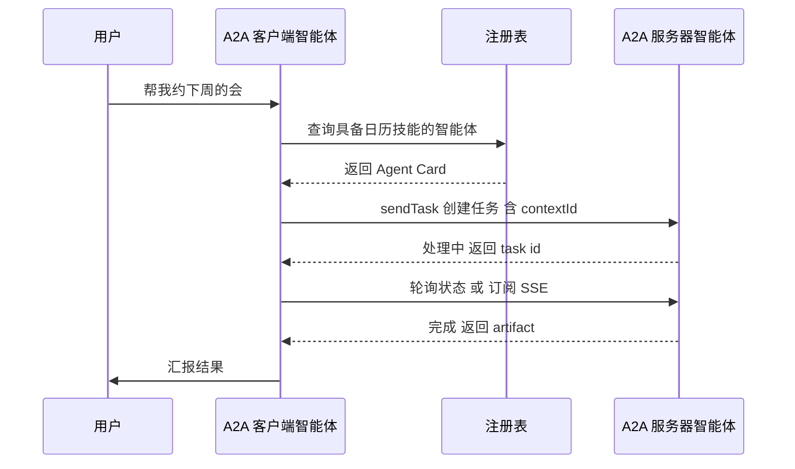

# 第 15 章：智能体间通信（A2A）

- **难度**：★★★ | **预估学时**：2 小时 | **前置**：ch07 多智能体、ch10 MCP、HTTP 与 JSON-RPC

## 学习目标

学完本章，你能：
1. 说清 A2A 与 MCP 的分工：一个管"智能体之间"，一个管"智能体与资源之间"。
2. 读懂一份 Agent Card，指出它在发现与认证中的作用。
3. 为"快、慢、超长"三类任务分别选择同步、轮询、流式、Webhook 四种交互方式。

## 一句话核心

A2A 把智能体当成**对等的服务**而不是内部函数：对方是黑盒、可能在不同框架里、可能跑在另一台机器上，所以必须有身份（Agent Card）、有任务状态、有超时与推送。

## 零基础讲解

### 概念 1：为什么需要 A2A（难度：基础）

第 7 章讲的多智能体协作，多数是在同一个框架内完成的（CrewAI 的 Crew、ADK 的 sub_agents）。一旦智能体分散在不同框架、不同团队、不同公司，问题就变成了"两个不认识彼此的智能体怎么协作"。

书里点明 A2A 是 Google 提出的开放标准，基于 HTTP，支持 LangGraph / CrewAI / ADK 等不同技术栈的智能体互通。这意味着一个用 Python 写的日历智能体，可以被一个用 Java 写的项目智能体调用。

**类比**：公司之间的商务往来。内部协作靠开会，跨公司要靠合同、名片、标准流程（报价单、发票、验收单）。A2A 就是这套"跨公司流程"。

**失效边界**：内部协作可以随时拉个群对齐口径；跨公司协作信息不对称，对方是黑盒，你只能靠它声明的能力（Agent Card）判断，判断错了只能靠重试或换供应商。

### 概念 2：三个参与者 + Agent Card（难度：进阶）

**三个角色**：用户（发起请求）→ A2A 客户端（代表用户的智能体）→ A2A 服务器（远程智能体，提供 HTTP 端点，作为黑盒处理请求）。

**Agent Card** 是这套机制的核心，一份 JSON，描述这个智能体的"数字身份"。里面至少有：
- 身份与端点（名称、URL、版本）；
- 支持的能力（是否支持流式、是否支持推送通知）；
- 技能清单（每个技能有名称、描述、示例输入）；
- 默认输入/输出模态；
- 认证要求。

看一个精简例子：

```json
{
  "name": "weather_agent",
  "description": "提供准确的天气预报和历史数据",
  "url": "https://weather.example.com/a2a",
  "capabilities": {"streaming": true},
  "skills": [
    {"name": "获取当前天气", "description": "检索任意地点的实时天气",
     "examples": ["巴黎现在的天气如何？"]},
    {"name": "获取天气预报", "description": "获取 5 天的天气预测",
     "examples": ["纽约未来 5 天的天气预报"]}
  ]
}
```

**`examples` 字段值得单独说**：它既是给调用方模型看的"什么时候该用我"，也是路由判据的来源。写得越具体，误调用越少——这和 ch05 工具描述的要求完全一致。

**发现方式**三种：公开 URL 直接拉取、管理型注册表（企业内集中目录，可查询）、直接配置（私有系统，不动态发现）。

### 概念 3：任务与消息（难度：进阶）

A2A 的通信围绕**异步任务**展开：
- 每个任务有唯一 id，经历"提交 → 处理中 → 完成"等状态；
- 消息带元数据（优先级、创建时间）与一个或多个内容部分（文本、文件、结构化 JSON）；
- 任务的最终输出叫 **artifact**（工件），也可流式传输；
- 服务器生成 `contextId` 关联多次交互，保持上下文。

**为什么是任务而不是一次请求-响应**：因为多智能体协作的任务经常是长流程（研究、代码生成、批处理）。一次请求-响应模型无法表达"还在处理中"，也无法在中途要材料。

### 概念 4：四种交互机制（难度：高难）

| 机制 | 适用 | 代价 |
|---|---|---|
| 同步请求/响应 | 快速操作（查汇率） | 长任务会超时 |
| 异步轮询 | 耗时任务（几分钟到几小时） | 客户端要轮询，浪费请求；间隔难调 |
| 流式（SSE） | 需要增量结果（边生成边看） | 单向连接，需处理断线重连 |
| 推送通知（Webhook） | 超长或资源密集任务（小时级、批处理） | 需要公网可达的回调地址与签名校验 |

**怎么选**：先问"用户能不能等"。能等 1 秒 → 同步；能等 1 分钟但需要看进度 → 流式；要等几十分钟且用户会离开 → 轮询或 Webhook。A2A 的关键设计是**由 Agent Card 声明支持哪些机制**，客户端据此选择，不必猜。

### 概念 5：安全性（难度：进阶）

书里列了四条内置机制：
1. **双向 TLS（mTLS）**：双向认证，防未授权访问。
2. **完整审计日志**：记录所有通信（谁、何时、传了什么）。
3. **Agent Card 声明认证要求**：身份与策略集中管理。
4. **凭证处理**：OAuth 2.0 令牌或 API Key，通过 HTTP 头传递，不放 URL 或消息体。

第 4 条是最容易做错的：把 token 放 query string 会进日志、进浏览器历史、进 Referer。

### 概念 6：A2A 与 MCP 的分工（难度：进阶）

这是本章最该记住的一张对照：

| 维度 | MCP | A2A |
|---|---|---|
| 连接对象 | 智能体 ↔ 外部资源/工具 | 智能体 ↔ 智能体 |
| 抽象层次 | 能力暴露（工具、资源、Prompt） | 任务委派与协作 |
| 对端性质 | 通常是被动的服务 | 主动的、有自己模型的智能体 |
| 核心元数据 | 工具 schema | Agent Card（技能与端点） |

一句话：**MCP 向下接资源，A2A 横向接同行**。两者互补，不互相替代。

## 图示



看图说明：注意"注册表"这个角色——它让发现变成自动化，而不是硬编码对端地址。也注意任务是被"创建"而不是被"调用"的，这是 A2A 与普通 RPC 的根本差别。

## 类比与实例

- **类比**：外卖平台。你不直接联系餐馆，平台上有餐馆的"名片"（菜品、营业时间、配送范围），你下单后拿到订单号，可以看进度，也可以等推送。
- **失效边界**：平台保证餐馆真实存在，A2A 的注册表未必；一个恶意注册的 Agent Card 可以声称自己会做任何事。所以认证与信誉机制必不可少。
- **实例**：跨框架协作。ADK 写的项目协调智能体，通过 A2A 调用 CrewAI 写的内容生成智能体，再调用 LangGraph 写的审核智能体。三者各自演进、各自部署，靠 Agent Card 互相认识。这就是书里说的"打破单体智能体孤岛"。

## 常见误解

- **别以为 A2A 能替代 MCP**——实际上它们管的层次不同，一个向外接资源，一个横向接同行。
- **别以为 Agent Card 只是文档**——实际上它是运行时发现与路由的依据，写得含糊会直接导致调用方选错。
- **别以为所有任务都该用流式**——实际上流式要维护长连接，任务很短时反而更贵。
- **别以为 A2A 只是"发 HTTP 请求"**——实际上它有价值的是任务状态机与上下文关联，缺了状态就不是 A2A，只是一次 RPC。

## 自测题（答案）

1. （单选）A2A 与 MCP 的核心区别是？
   - A. A2A 更安全，MCP 不安全
   - B. A2A 用于智能体之间协作，MCP 用于智能体与外部资源交互
   - C. A2A 只能用于 Google 的框架
   - D. MCP 支持流式，A2A 不支持

   **答案**：B。**解析**：两者层次不同且互补；A2A 是开放标准，不限定框架。

2. （简答）Agent Card 至少包含哪几类信息？为什么 `examples` 字段重要？
   **答案**：身份与端点（名称、URL、版本）、能力声明（流式/推送）、技能清单（名称、描述、示例）、默认输入输出模态、认证要求。`examples` 直接告诉调用方的模型"什么场景该找我"，是降低误调用的关键，作用等同于工具描述里的使用示例。**解析**：发现的质量决定协作的质量。

3. （多选）下列哪些属于 A2A 的交互机制？
   - A. 同步请求/响应
   - B. 异步轮询
   - C. SSE 流式更新
   - D. Webhook 推送通知

   **答案**：A、B、C、D。**解析**：四种机制覆盖从秒级到小时级的不同任务时长。

4. （填空）A2A 通信用 HTTP(S) 承载，消息格式为______，并通过______关联多次交互。
   **答案**：JSON-RPC 2.0；contextId。**解析**：见概念 3。

## 复习锚点

- A2A：智能体 ↔ 智能体；MCP：智能体 ↔ 资源。
- Agent Card = 数字身份 + 技能声明 + 认证要求。
- 任务有状态机，不是一次 RPC。
- 四种交互按"用户能不能等"选。
