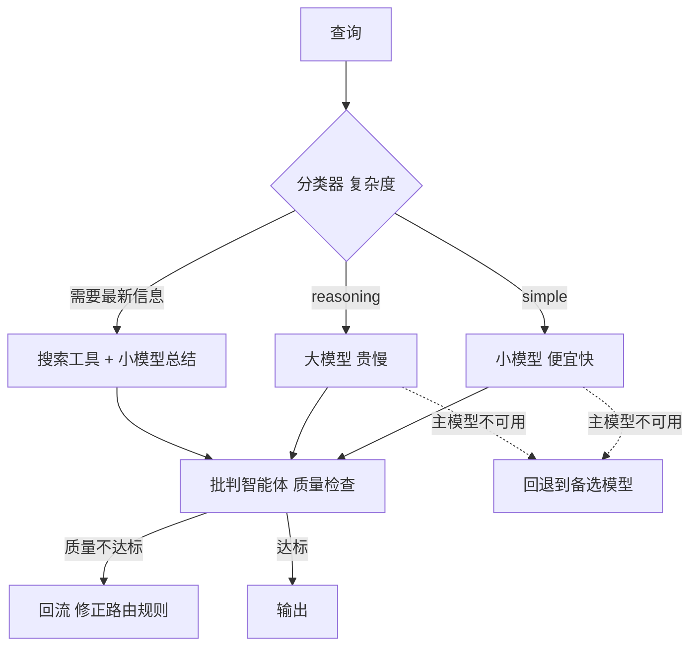

# 第 16 章：资源感知优化（Resource-Aware Optimization）

- **难度**：★★★ | **预估学时**：2 小时 | **前置**：ch11、ch12、ch14、基本的分词与价格模型

## 学习目标

学完本章，你能：
1. 用 token 数 × 单价估算一次任务调用成本，并算出"分层路由"省下多少。
2. 说出资源优化的九种技术，并挑出对你当前场景最有效的两种。
3. 解释"批判智能体"如何在不直接管预算的情况下间接优化成本。

## 一句话核心

资源感知优化的本质是**把质量当成可交易的变量**：同一个问题，多花一倍钱能换来多少准确率提升，这个比值决定该不该花。

## 零基础讲解

### 概念 1：三种资源（难度：基础）

书里点明三种：**计算**（算力、上下文 token）、**时间**（延迟）、**财务**（API 调用费）。三者经常互相冲突：要更准往往要更慢更贵；要更快往往要模型更小、准确率下降。

**先学会算账**。设一次调用输入 `T_in` 个 token、输出 `T_out` 个 token，价格分别为 `p_in`、`p_out`（元/千 token），则单次成本：


```
C = (T_in · p_in + T_out · p_out) / 1000
```


**算例**：某大模型 `p_in=0.02`、`p_out=0.06`（元/千 token），一次调用输入 1,200 token、输出 300 token：

```
C=(1200×0.02 + 300×0.06)/(1000)=(24+18)/(1000)=0.042 元
```


若同一任务每天 50,000 次，日成本 `0.042×50000=2100` 元。若其中 70% 能被路由到便宜模型（单价约为前者 1/5），这部分成本降到 `0.042×0.2=0.0084` 元，日成本变成：

```
50000×(0.3×0.042 + 0.7×0.0084)=50000×(0.0126+0.00588)=50000×0.01848≈924 元
```


省下约 56%。这个数字比任何"优化很重要"的论述都有说服力。

### 概念 2：动态模型切换（难度：进阶）

书里的核心例子是分层智能体：**高层规划用强模型，具体工具调用用便宜模型**。旅行规划器里，理解复杂请求、拆解多步行程、做逻辑决策由 Pro 级模型负责；查航班价格、查酒店余位、查餐厅评价由 Flash 级模型负责。

**为什么这样分有效**：任务的价值分布不均。规划错了，后面全错，所以规划值得用贵的；查询是"照抄结果"，便宜模型足够。

**路由怎么做**（书里给了三档）：
1. **按长度**：短问题→便宜模型，长问题→强模型。极简，几乎零成本，但"短而难"的问题会被误判（"证明 √2 是无理数"只有 8 个字）。
2. **按 LLM 判断**：让模型分类复杂度。灵活，但分类本身要花一次调用。
3. **按微调分类器**：在"问题-最佳模型"数据集上训练判别模型。最省，需要标注数据。

书里的实战做法是**三分类**：`simple`（直接可答）、`reasoning`（需多步推理）、`internet_search`（需最新信息）。第三类会触发搜索工具——这已经不只是选模型，而是选**执行路径**。

### 概念 3：批判智能体如何间接省钱（难度：进阶）

书里有一句很关键的话：批判智能体"不直接管理预算，但通过识别不合理分流间接优化资源分配"。

机制是这样的：审查每次回答的质量，如果发现"简单问题被分给了 Pro 模型却答得一般"或"复杂问题被分给 Flash 模型导致答错"，这些案例回流去修正路由规则或重训分类器。这是**用质量信号反向校正成本决策**。

**和第 4 章反思的差别**：反思关注"这一版输出好不好"；批判智能体在这里关注"这次路由选得对不对"。前者改内容，后者改调度。

### 概念 4：九种优化技术（难度：高难）

书里列了一张谱系，我按"见效速度"重排，方便你先做哪个：

| 技术 | 一句话 | 见效 | 风险 |
|---|---|---|---|
| 动态模型切换 | 按复杂度选模型 | 立竿见影 | 路由判错会降质 |
| 上下文剪枝与摘要 | 少塞无关历史 | 立竿见影 | 剪掉关键信息 |
| 优雅降级与回退 | 主模型挂了换备选 | 立竿见影 | 备选质量要预验 |
| 自适应工具选择 | 按成本/延迟选工具 | 中 | 需要工具元数据 |
| 关键任务优先级分配 | 把资源给重要任务 | 中 | 需要优先级体系（第 20 章） |
| 主动资源预测 | 预判负载提前扩容 | 慢 | 预测模型本身要维护 |
| 并行与分布式 | 把活儿摊开 | 中 | 协调成本 |
| 成本敏感探索 | 多智能体通信也计费 | 慢 | 需要全局账本 |
| 学习型资源分配 | 用反馈持续调策略 | 最慢 | 需要数据闭环 |

## 图示



看图说明：这张图有两个闭环。上面那个（批判→修正路由）是**慢反馈**，改的是策略；下面那个虚线（回退）是**快反馈**，改的是这一次可用性。很多实现只做了回退，没做批判回流，于是路由策略永远停在初始水平。

## 类比与实例

- **类比**：公司报销制度。出差坐高铁二等座够用，客户面签才批商务座。不是"省钱"，是"按价值配置"。
- **失效边界**：报销标准是死的规定，智能体的路由要能应对分布漂移——上线三个月后用户问的问题类型变了，原来的阈值就失效了。所以必须有批判回流，否则路由会慢慢变错。
- **实例**：OpenRouter 这类聚合网关提供的两种能力正好对应本章两个概念：**自动模型选择**（按内容选最优模型）与**顺序模型回退**（按优先级列表，主模型故障就换下一个，费用按实际完成请求的模型计）。这两件事一个管"选得对"，一个管"不断供"。

## 常见误解

- **别以为省成本就是用小模型**——实际上小模型答错后要重答，总成本可能更高。真正的省是"该小的用小，该大的用大"。
- **别以为按长度路由就够**——实际上短问题常常更难（数学证明、逻辑陷阱）。长度只是一个廉价代理指标，必须配合质量监控。
- **别以为上下文越长越保险**——实际上每轮重复计费，且无关 token 会稀释注意力。剪枝常常同时省钱和提质。
- **别以为回退是免费的**——实际上备选模型的行为特征不同，输出格式可能不一致，下游解析会崩。回退必须做输出格式兼容。

## 自测题（答案）

1. （计算）输入 800 token、输出 200 token，单价 `p_in=0.03`、`p_out=0.09`（元/千 token），单次成本是多少？
   - A. 0.024 元
   - B. 0.042 元
   - C. 0.060 元
   - D. 0.006 元

   **答案**：B。**解析**：`(800×0.03+200×0.09)/1000=(24+18)/1000=0.042` 元。

2. （简答）为什么"高层规划用强模型、工具查询用便宜模型"这种分层是合理的？
   **答案**：因为任务的价值分布不均：规划决定后续所有步骤的正确性，错误代价高，值得用强模型；具体的查询、取数属于格式化与信息搬运，便宜模型足够胜任。把贵的算力放在决定性的环节，是资源优化的核心判断。**解析**：这是"按价值配置"，不是"按价格配置"。

3. （多选）批判智能体在资源优化中的作用包括？
   - A. 发现简单问题被误分给贵模型
   - B. 发现复杂问题被误分给便宜模型导致质量下降
   - C. 直接修改计费配置
   - D. 为路由逻辑的调整提供依据

   **答案**：A、B、D。**解析**：C 错。批判智能体不直接管预算，它提供质量信号，由路由层或训练流程据此调整。

4. （填空）资源优化要同时权衡三种资源：计算、______、______。
   **答案**：时间（延迟）；财务（成本）。**解析**：三者常常互相冲突，所以必须显式权衡。

## 复习锚点

- 算账公式：`C=(T_inp_in+T_outp_out)/1000`。
- 分层原则：决定性环节用强模型，搬运环节用便宜模型。
- 两个闭环：批判回流（慢，改策略）+ 回退（快，保可用）。
- 剪上下文常常同时省钱和提质。
