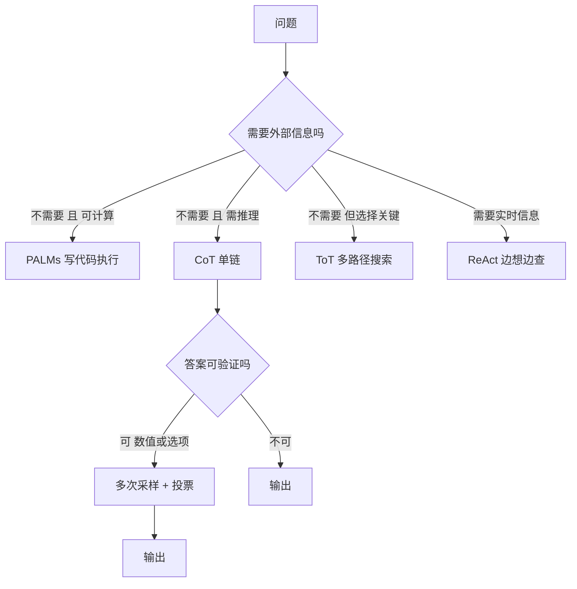

# 第 17 章：推理技术（Reasoning Techniques）

- **难度**：★★★ | **预估学时**：2.5 小时 | **前置**：ch06 规划、ch04 反思、概率与搜索的基本概念

## 学习目标

学完本章，你能：
1. 对比 CoT、ToT、ReAct、PALMs 四条推理路径的代价结构。
2. 说清"推理扩展定律"为什么能让小模型超过简单推理的大模型。
3. 判断一个任务该用单链推理、树搜索还是代码执行。

## 一句话核心

推理技术的共同动作是**把"想一想"变成可分配的资源**：给模型更多中间步骤、更多条候选路径、或一个能精确计算的执行环境——准确率的提升本质上是拿算力换的。

## 零基础讲解

### 概念 1：CoT（链式思维，难度：基础）

**白话定义**：不让模型直接给答案，而是要求它把中间步骤写出来，再给结论。

**为什么有效**：模型的输出是逐 token 生成的，前一个 token 会成为后一个的上下文。直接输出答案时，模型没有"草稿纸"；要求它先写步骤，等于给了它一块草稿纸，每一步的中间结果都能被后续步骤用到。

**实例**：问"一个班 32 人，60% 喜欢数学，其中一半喜欢物理，喜欢物理的有多少人？"
- 直接答：容易出错（模型可能答 19.2 或 16）。
- CoT：先算 `32×0.6=19.2`，再算 `19.2/2=9.6`，然后发现"人数不能是小数"，回溯确认 60% 是按 30 人算的（32 的 60% 不整），最终给出约 10 人或指出题目数据有问题。

**这类"发现问题"只在写步骤时才会发生**——这正是 CoT 的价值：它让错误在中间暴露，而不是在终点暴露。

### 概念 2：ToT（树式思维，难度：进阶）

**白话定义**：不只走一条推理链，而是分出多条，各自往下走，中途评估、剪枝、回溯，最后选最优。

**代价结构**：设每层分 `b` 条（分支因子），深度 `d`，则候选节点数为 `b^d`。`b=3`、`d=3` 时需要评估 27 条路径，每条都要调模型，成本是单链的几十倍。

**什么时候值得**：搜索空间不大但选择关键（战略规划、解题思路选择、复杂决策）。什么时候不值得：任务有唯一确定的解法（算术、格式转换）。

**类比**：下棋。高手会想"我走这步，他可能走那步，然后我再……"，而不是只看一步。失效边界：棋的规则明确、状态有限；开放式写作没有明确的"估值函数"，树搜索很难判断哪条路径更好。

### 概念 3：ReAct（推理 + 行动，难度：进阶）

**白话定义**：思考 → 行动（调工具）→ 观察 → 再思考，循环到能回答为止。

**与 CoT 的差别**：CoT 只在"脑内"推理，不接触外部世界；ReAct 每一步都可能去查、去算、去调 API，用外部事实校正推理。

**和 ch05 的关系**：ReAct 是工具使用的一种组织方式。工具是"手"，ReAct 是"边想边动手"的节奏。

**适用判据**：任务所需信息在推理过程中才会暴露 → ReAct；信息一开始就齐备 → CoT 足够，别浪费调用。

### 概念 4：PALMs（程序辅助，难度：进阶）

**白话定义**：让模型把问题翻译成代码，交给确定性的执行环境算，再把结果翻译回自然语言。

**为什么需要**：语言模型不擅长精确算术与长链条符号操作。让它写 `sum(x**2 for x in range(1,101))` 再执行，比让它"心算"可靠几个数量级。

**判据**：问题里有可计算的量（统计、日期差、单位换算、字符串处理）→ 用代码执行；问题是纯语义判断（这段文字是否得体）→ 代码帮不上。

### 概念 5：推理扩展定律（难度：高难）

书里给了一个很重要的判断：**通过在推理阶段增加计算（生成多个候选再筛选），小模型也能取得好结果，甚至超过"简单推理"的大模型**。

这不是玄学，可以算。设单次采样正确率 `p`，独立采样 `n` 次，至少一次正确的概率是：


```
P(至少一次正确)=1-(1-p)^n
```


若 `p=0.3`，采 5 次：`1-0.7^5=1-0.168=0.832`，即 83.2%。这就是"自洽性投票（self-consistency）"的数学基础。

**但这个公式有三个前提**，缺一不可：
1. **采样之间要相对独立**——同一个提示、同一个温度 0，采 5 次得到 5 个一样的结果，`P` 不涨。
2. **要有筛选机制**——多数投票需要"答案可比较"（数值、选项），开放文本无法投票。
3. **错误不能是系统性的**——如果模型对某个概念理解错了，5 次都会错，投票只会强化错误。

**这条定律的经济学含义**：与其加钱换更大的模型，不如先看看"多采几次 + 投票"能不能解决问题。前者是固定成本，后者是按次付费。

### 概念 6：CoD / GoD（难度：进阶）

- **CoD（辩论链）**：多个模型就同一问题辩论，互相批评，最终形成结论。价值是减少单一视角的偏见，代价是成本翻倍。
- **GoD（辩论图）**：把辩论建模成图，论点是节点，"支持/反驳"是边，结论取最有力且可验证的论点集。比 CoD 更接近真实辩论的多线程结构。

**判据**：需要"减少偏见"或"提高可解释性"时用；只需要一个答案且答案可验证（算术题）时，纯属浪费。

## 图示



看图说明：这张图是一个决策树，不是技术排行榜。先问"要不要外部信息"，再问"要不要多路径"，最后问"能不能投票"。每一步的选择都在改变成本结构，不是改变"先进程度"。

## 类比与实例

- **类比**：做题策略。简单题直接算（CoT）；大题先列提纲再写（分步）；选择题不确定时多算两遍看是否一致（自洽投票）；需要查表的题先去查（ReAct）；计算量大的用计算器（PALMs）。
- **失效边界**：考试有标准答案，多数真实任务没有；投票在开放文本上不可用。
- **实例（带数字）**：代码调试。CoT 让模型解释"为什么这行会报 IndexError"，准确率一般；PALMs 让它写测试并执行，直接得到失败用例与堆栈，可靠得多。同一个问题，换技术路线，可靠性差一个数量级。

## 常见误解

- **别以为 CoT 一定比直接答好**——实际上对简单任务，CoT 只是增加 token 消耗，甚至因为"过度思考"引入错误。
- **别以为 ToT 越深越好**——实际上 `b^d` 增长极快，深度 4、分支 4 就是 256 条路径，成本失控。
- **别以为自洽投票能救系统性错误**——实际上模型对同一概念的理解偏差在多次采样中是一致的，投票只会强化它。
- **别以为"思考时间越长越准"**——实际上推理扩展有边际递减，超过某个点后增加采样只增加成本。

## 自测题（答案）

1. （单选）一个任务需要先查实时汇率、再算换算结果、最后给出建议。最合适的技术路线是？
   - A. 纯 CoT
   - B. ReAct（查汇率）+ PALMs（算换算）
   - C. ToT 深度搜索
   - D. 纯自洽投票

   **答案**：B。**解析**：需要外部实时信息用 ReAct，精确计算用代码执行；两者组合是最省且最可靠的路径。

2. （计算）单次采样正确率 `p=0.4`，独立采样 3 次，至少一次正确的概率是多少？
   - A. 0.6
   - B. 0.784
   - C. 0.4
   - D. 0.936

   **答案**：B。**解析**：`1-(1-0.4)^3=1-0.216=0.784`。

3. （简答）推理扩展定律成立的三个前提是什么？
   **答案**：①多次采样之间相对独立（温度不能为 0，提示不能完全一致地锁死）；②存在可用的筛选机制（多数投票要求答案可比较）；③错误不是系统性的（否则采样会一致地错）。**解析**：缺任一条，`1-(1-p)^n` 这个公式就不成立。

4. （填空）PALMs 把复杂计算交给______，从而避免模型在______上出错。
   **答案**：确定性执行环境（代码解释器）；精确算术与符号操作。**解析**：模型擅长理解与翻译，不擅长精确计算。

## 复习锚点

- 四条路线：CoT（单链）、ToT（多路径）、ReAct（边查边算）、PALMs（代码执行）。
- 推理扩展：`1-(1-p)^n`，但需要独立采样 + 可投票 + 非系统错误。
- 选路线先问"要不要外部信息""要不要多路径""能不能验证"。
- 简单任务上 CoT 是浪费。
