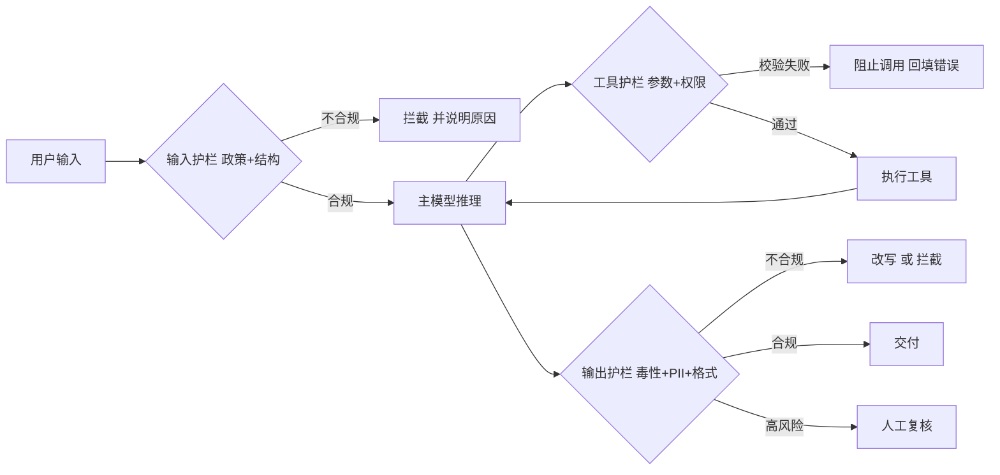

# 第 18 章：护栏与安全模式（Guardrails）

- **难度**：★★★ | **预估学时**：2.5 小时 | **前置**：ch13 人类参与、ch05 工具使用、基本的输入校验与权限概念

## 学习目标

学完本章，你能：
1. 说出护栏的六个实施阶段，并为每个阶段举一个具体手段。
2. 解释为什么"不确定时判为合规"和"不确定时判为不合规"是两个完全不同的风险选择。
3. 设计一个三层护栏（输入/工具/输出），并指出它的绕过路径。

## 一句话核心

护栏不是审查模型说的话，而是**在系统里设置若干道必须通过的关卡**——关卡的位置、判据、失败时的默认动作，三者共同决定它是安全网还是纸糊的门。

## 零基础讲解

### 概念 1：六个实施阶段（难度：基础）

书里列得很清楚，按数据流顺序：

| 阶段 | 做什么 | 具体手段 |
|---|---|---|
| 输入验证/清洗 | 过滤恶意输入 | 内容审核 API、Pydantic 校验结构、长度限制 |
| 行为约束（提示级） | 在系统提示里写清能做与不能做 | 角色定义、禁止项清单、示例轨迹 |
| 工具使用限制 | 限制模型能碰什么 | 工具白名单、参数校验、权限检查 |
| 外部内容审核 | 借助外部服务判断 | 第三方审核 API、敏感词库 |
| 输出过滤/后处理 | 检查生成结果 | 毒性检测、PII 脱敏、格式校验 |
| 人类介入 | 关键决策交人 | 审批、抽样复核（ch13） |

**一个常被忽略的细节**：书里建议用**计算资源消耗低的模型**（如轻量模型）作为快速的额外防线，对输入或输出做预筛查。这是成本设计——用便宜的模型挡掉 90% 的明显问题，把贵的模型留给正常流量。

### 概念 2：判据与默认动作（难度：进阶）

书里那个内容政策执行者的提示词里有一句极关键的话：

> 若输入明显违反任一指令，结果为 non-compliant；若是否违规存在疑问或不确定，则默认为 compliant。

这是一个**明确的风险选择**：宁可放过可疑内容，也不误伤正常内容。它适合"误伤成本高"的场景（比如教育产品误判学生提问）。

反过来，在"漏放成本高"的场景（未成年人内容、金融合规），默认动作必须是 **non-compliant**（不确定就拦，转人工）。

**判据设计的三条要求**：
1. 每条政策要有**可判定的描述**，不能是"内容要健康"这种空话；
2. 要有**允许示例**（书里的提示词给了 4 条合规示例），否则模型会把正常问题也判违规；
3. 输出必须**结构化**（`compliance_status` + `evaluation_summary` + `triggered_policies`），便于程序消费与审计。

### 概念 3：为什么护栏必须分层（难度：进阶）

单层护栏有两种失效方式：
- **被绕过**：提示注入（"忽略之前所有规则"）、编码变形（把违规内容 Base64 编码）、多轮稀释（分多轮逐步套出）。
- **被误伤**：判据过严，正常用户被拒。

分层的作用是"交叉覆盖"：输入层挡明显的，工具层挡越权的，输出层挡模型自己生成的（模型可能在正常输入下生成有害内容）。书里的示例正是这样：输入用政策执行者筛查，中间用 Pydantic 校验结构，输出再做一次格式与内容合法性的逻辑检查。

**Pydantic 那一层值得单独说**：它不判断"内容是否合规"，它判断"返回的结构是否合法"（`compliance_status` 是否存在、`triggered_policies` 是否为列表）。这是**结构性护栏**，能挡住"模型返回了一段散文导致下游解析崩溃"这类问题。

### 概念 4：工具层护栏（难度：高难）

书里的 Vertex AI 示例给了一个非常实用的模式：**工具调用前的参数校验回调**。

```python
def validate_tool_params(tool, args, tool_context):
    session_user = tool_context.state.get("user_id")
    if args.get("user_id") != session_user:
        return {"error_message": "工具调用被阻止：用户ID 校验未通过"}
    return None  # 允许执行
```

这个回调挡住的是**越权**：模型可能因为提示注入而被诱导去查别人的订单。校验 `user_id` 与会话一致，是最低成本的防线。

**这一类护栏的通用原则**：不要相信模型传来的身份、权限、金额、ID。所有"谁在操作""能操作什么"都必须由框架从可信来源（会话、数据库）取，而不是从模型输出里读。

### 概念 5：护栏的边界（难度：高难）

书里最后提醒了一句：**所有模型生成的内容在展示前都应清洗，防止恶意代码在浏览器执行**。这是 XSS 层面的问题，属于传统安全，但经常被 AI 团队忽略。

另外几个必须知道的边界：
1. 护栏不能替代对齐训练。模型本身的倾向性问题，靠提示层护栏只能压住表面。
2. 护栏有延迟成本。每加一层就多一次调用，实时场景要算清预算（ch16）。
3. 护栏会漂移。政策更新、模型更新、攻击手法更新，护栏需要定期回归测试。
4. 护栏本身可能被攻击。用 LLM 做护栏时，护栏也可能被提示注入影响——所以关键判据应尽量用规则或分类器，而不是让另一个 LLM 自由裁量。

## 图示



看图说明：三个关卡分别在"进""做""出"三个位置。注意每个关卡的失败动作不同——输入是不让进，工具是不让做，输出是不让出。设计时最容易漏的是工具层，而它恰恰是唯一能挡住"模型做错事"的一层。

## 类比与实例

- **类比**：机场安检。入口查登机牌与行李（输入），登机口查证件（工具权限），落地后查是否携带违禁品（输出）。三道关不是为了刁难，是因为任何一道都可能有漏。
- **失效边界**：安检是物理的，检查彻底；语言内容的检查是概率性的，总存在漏判。所以护栏的目标不是"零风险"，是"把风险压到可接受并留下审计痕迹"。
- **实例（带数字）**：内容平台日均 200 万条。输入护栏用轻量模型（每次约 0.001 元），挡住 3% 明确违规，成本 2000 元/日；剩下的交给主模型，输出护栏再拦 0.5%。相比让主模型自己"注意安全"，这套分层把明确违规的拦截率从约 60% 提到 95% 以上，成本只增加 1%。

## 常见误解

- **别以为写了"请勿生成有害内容"就是护栏**——实际上那只是提示层约束，模型仍可能被绕过或被诱导。
- **别以为护栏越严越安全**——实际上过严会误伤正常用户，且让运营成本飙升；关键是按场景选默认动作。
- **别以为 LLM 护栏比规则可靠**——实际上 LLM 护栏也会被注入攻击，关键判据应优先用规则、白名单、结构化校验。
- **别以为护栏只在输入端**——实际上工具层与输出层才是真正挡住"做错事"和"说错话"的地方。

## 自测题（答案）

1. （多选）护栏可实施的阶段包括？
   - A. 输入验证与清洗
   - B. 工具使用限制
   - C. 输出过滤与后处理
   - D. 人类介入

   **答案**：A、B、C、D。**解析**：四者都是书里明确列出的阶段，另有提示级行为约束与外部审核。

2. （简答）"不确定时默认为 compliant"与"不确定时默认为 non-compliant"分别适用于什么场景？
   **答案**：前者适用于误伤成本高的场景（如教育产品误拒学生正常提问），宁可放过可疑；后者适用于漏放成本高的场景（未成年人保护、金融合规、医疗建议），宁可拦截并转人工。选择依据是两类错误的代价对比，不是"哪个更安全"。**解析**：这是风险偏好问题，必须在设计文档里写明。

3. （单选）工具调用前的参数校验回调，主要防的是？
   - A. 模型输出格式错误
   - B. 越权访问（如查询他人数据）
   - C. 工具响应过慢
   - D. 提示词过长

   **答案**：B。**解析**：校验的是"参数中的身份是否与会话一致"，属于权限边界。

4. （填空）护栏的关键判据应尽量使用______或______，而不是让另一个 LLM 自由裁量。
   **答案**：规则（白名单）；结构化校验（分类器）。**解析**：LLM 护栏本身也可能被注入。

## 复习锚点

- 六阶段：输入、提示约束、工具、外部审核、输出、人工。
- 默认动作要按场景选，并在文档里写明。
- 工具层是唯一能挡住"做错事"的一层。
- 护栏需定期回归测试，会随模型与攻击手法漂移。
