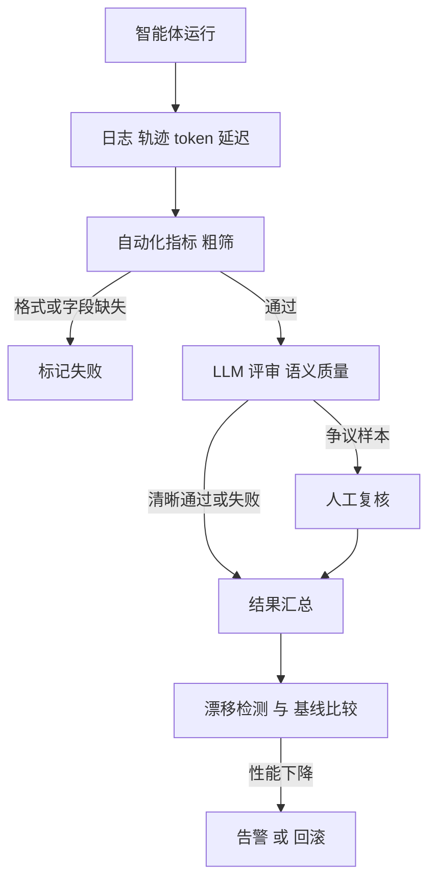

# 第 19 章：评估与监控（Evaluation & Monitoring）

- **难度**：★★★ | **预估学时**：2.5 小时 | **前置**：ch11 目标监控、ch16 成本、基本的统计与测试概念

## 学习目标

学完本章，你能：
1. 说出四种评估方法（人工、LLM 评审、自动化指标、轨迹评估）各自的价格与盲区。
2. 设计一个轨迹评估：给出理想路径，选一种匹配方式，说明它能发现什么错误。
3. 解释"智能体承包商"四支柱，以及租约合同比提示词多解决了什么问题。

## 一句话核心

评估智能体的难点不是"算准确率"，而是**它每次走的路径都不一样，所以必须评估轨迹，而不只是评估结果**。

## 零基础讲解

### 概念 1：为什么传统测试不够（难度：基础）

传统软件的测试是确定性的：给定输入，输出要么对要么错，测试用例跑通就放心。

智能体不一样：
- 同一个问题，两次运行可能走不同路径（调了不同工具、用了不同顺序）；
- 最终答案对，但过程可能违规（比如偷偷查了不该查的数据）；
- 最终答案错，但过程可能完全合理（信息源本身错了）。

所以书里说：传统软件测试仅能判断通过/失败，而智能体行为具有概率性，需定性分析最终输出**及决策过程**。

**类比**：考试评分。传统测试是选择题，只看对错；智能体评估像实验课评分，要看步骤是否规范、仪器是否校准、结论是否有依据。失效边界：实验课有标准操作流程，智能体的"标准路径"常常有多条，需要定义"可接受的路径集合"。

### 概念 2：四种评估方法（难度：进阶）

| 方法 | 优势 | 劣势 | 单位成本（量级） |
|---|---|---|---|
| 人工评估 | 能捕捉细微行为与语气问题 | 难以规模化、成本高、主观 | 每条几分到几角 |
| LLM 评审（LLM-as-a-Judge） | 一致、高效、可扩展 | 可能忽略中间步骤，受评审模型能力限制 | 每条约 0.001~0.01 元 |
| 自动化指标 | 可扩展、客观、快 | 覆盖不全，难判语义等价 | 近乎零 |
| 轨迹评估 | 能发现过程性错误 | 需要定义理想路径，维护成本高 | 中 |

**先用哪个**：先用自动化指标做粗筛（格式、长度、是否包含关键字段），再用 LLM 评审做语义判断，人工只处理争议样本。这是成本最优的组合。

**LLM 评审的两个坑**：
1. **位置偏见**：让它比较 A 和 B，它倾向选先出现的那个。缓解办法是交换顺序各评一次。
2. **自我偏好**：用同一个模型既生成又评审，它会给自己打高分。缓解办法是换一个模型做评审。

### 概念 3：轨迹评估（难度：高难）

**白话定义**：不只比最终答案，还比"它走了哪几步"。

书里给了五种匹配方式：

| 方式 | 判据 | 能发现什么 |
|---|---|---|
| 精确匹配 | 步骤序列完全一致 | 严重偏离 |
| 顺序匹配 | 关键步骤按序出现（允许中间有额外步） | 跳步、乱序 |
| 任意顺序匹配 | 关键步骤都出现，顺序不限 | 遗漏，不判顺序 |
| 查准率（precision） | 实际步骤中有多少是应该做的 | 多余动作、无效调用 |
| 查全率（recall） | 应该做的步骤中有多少被做了 | 漏掉关键环节 |

**实例（带数字）**：客服智能体的理想轨迹是"识别意图 → 查订单库 → 审核结果 → 生成回复"。

实际运行走了 6 步：识别意图、查订单库、查订单库（重复）、查用户资料、审核、生成回复。按查全率算：4/4=100%（该做的都做了）；按查准率算：4/6≈66.7%（有 2 步是多余的）。**两个指标必须一起看**，只报一个会掩盖问题。

单工具使用次数也是重要指标：同一工具被连续调用 3 次以上，通常意味着上一次调用失败但模型没意识到。

### 概念 4：多智能体评估（难度：进阶）

书里提了四个专门针对多智能体的检查项：
1. **协作是否有效**：机票智能体有没有把日期和目的地正确传给酒店智能体（信息传递是否失真）；
2. **是否遵循计划**：该先订机票再订酒店，如果酒店提前订了就是偏离；
3. **是否选对智能体**：问天气应由天气智能体答，而不是通用知识智能体；
4. **新增智能体是否提升整体性能**：加了餐厅预订智能体后是提效还是引发冲突。

第 4 条特别值得记住：**加智能体不是免费的，必须用指标证明它值得**。

### 概念 5：从智能体到"承包商"（难度：高难）

书里最后提出一个范式升级：把智能体从"执行提示的工具"变成"签合同的承包商"。四根支柱：

1. **正式合同**：明确交付物、规范、数据源、时限。例："生成 20 页 PDF 报告，分析 2025 年 Q1 欧洲市场销售，含 5 个数据可视化、与 2024 年 Q1 对比、供应链风险评估"。
2. **动态协商**：合同是对话起点。数据源不可用时，智能体应反馈"指定数据库不可用，请提供凭证或批准使用公开数据库，可能影响数据粒度"，而不是硬编数据。
3. **质量导向的迭代执行**：生成多种方案，编译并运行合同定义的单元测试，按性能、安全、可读性打分，只交全部通过的版本。
4. **分层分解与子合同**：主承包商把大任务拆成子合同（UI/UX、认证模块、产品数据库、支付网关），各自有独立交付物。

**它比提示词多解决了什么**：提示词无法表达"验收标准"，合同可以。这直接接上 ch11 的"目标必须可判定"。

### 概念 6：ADK 的三种评估入口（难度：基础）

- `adk web`：交互式评估，可生成数据集；
- pytest 集成：`AgentEvaluator.evaluate` 接 CI/CD；
- `adk eval`：命令行自动化评估。

数据组织两种：**测试文件**（单会话，单元测试用）与 **evalset 文件**（多会话，集成测试用）。前者快，后者覆盖多轮与工具调用。

## 图示

看图说明：注意左侧"日志"是整条链路的地基——没有轨迹日志，后面所有评估都做不了。右侧的"与基线比较"是漂移检测的核心：单次评估说明不了什么，趋势才有意义。

## 类比与实例

- **类比**：体检。单项指标（血压）不等于健康，要看一组指标 + 历年趋势。单次异常先复查，趋势恶化才干预。
- **失效边界**：体检有公认的正常范围；智能体的"正常范围"要自己定基线，且基线会随模型版本变化。
- **实例（带数字）**：A/B 测试。两个版本的智能体，各跑 1000 条真实请求。版本 A 解决率 72%、平均延迟 3.2 秒、每条成本 0.031 元；版本 B 解决率 74%、延迟 4.8 秒、成本 0.052 元。解决率只高 2 个百分点，但延迟 +50%、成本 +68%。结论是要看业务更在意哪个，而不是"哪个准确率高"。

## 常见误解

- **别以为准确率就是评估**——实际上延迟、token 消耗、轨迹规范度、合规性都要算进评估。
- **别以为 LLM 评审可以完全替代人工**——实际上它有自己的偏见（位置、自我偏好），且对中间步骤不敏感。
- **别以为评估是一次性的**——实际上模型换了、数据分布变了、用户行为变了，评估结论都会失效，必须持续监控与漂移检测。
- **别以为多智能体只要每个都达标就行**——实际上还要评协作（信息传递、计划遵循、分工正确）。

## 自测题（答案）

1. （多选）下列哪些属于轨迹评估可用的匹配方式？
   - A. 精确匹配
   - B. 顺序匹配
   - C. 查准率与查全率
   - D. 只比较最终答案字符串

   **答案**：A、B、C。**解析**：D 是结果评估，不是轨迹评估。

2. （简答）LLM-as-a-Judge 的两个主要偏见是什么？各给一种缓解办法。
   **答案**：①位置偏见——倾向于选先出现的选项，缓解办法是交换 A/B 顺序各评一次；②自我偏好——同一模型评审自己的输出会偏高，缓解办法是换一个模型或引入外部判据。**解析**：评审模型也是模型，也会有系统性偏差。

3. （计算）实际轨迹 6 步，其中 4 步属于理想路径，理想路径共 4 步。查准率与查全率各是多少？
   **答案**：查准率 = 4/6 ≈ 66.7%；查全率 = 4/4 = 100%。**解析**：查准率衡量"做的里面有多少是该做的"，查全率衡量"该做的里面做了多少"。

4. （填空）"承包商"四支柱是：正式合同、______、质量导向的迭代执行、______。
   **答案**：动态协商与反馈；分层分解与子合同。**解析**：合同把"验收标准"变成可验证的条款。

## 复习锚点

- 智能体是概率性的，必须评轨迹，不只评结果。
- 四方法：人工、LLM 评审、自动化指标、轨迹评估；组合使用最省。
- 轨迹五匹配：精确、顺序、任意顺序、查准、查全。
- 评估要持续：漂移检测 + 基线对比 + 告警。
